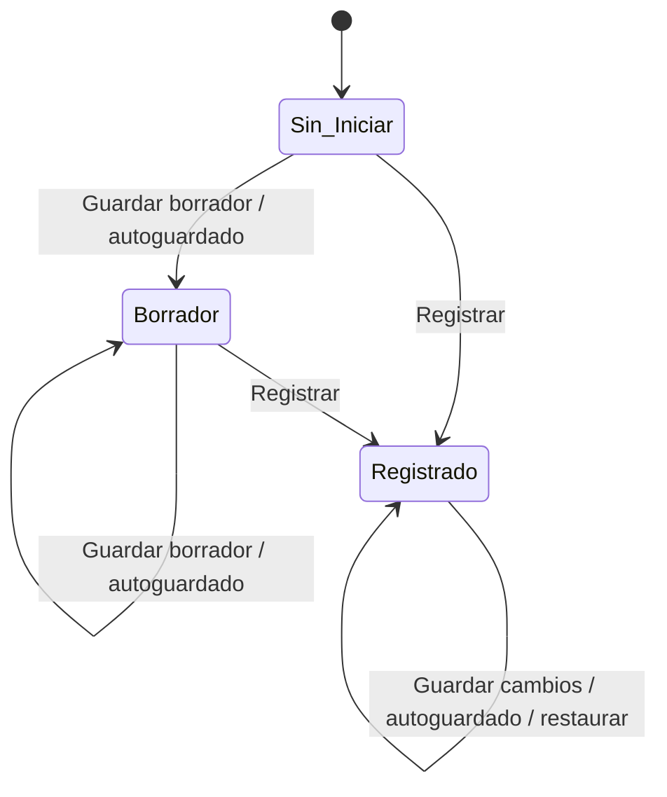

# CU-001: Registrar Plan de Ciclo

**Universidad La Salle**  
**Sistema:** SISCargaLectiva  
**Caso de Uso:** CU-001, Registrar Plan de Ciclo  
**Versión del documento:** 4.0 (2026-09-24). Alinea el documento con el prototipo funcional de `docs/prototipo/funcional`, que pasa a ser la referencia de comportamiento: el sistema deja de validar el contenido importado y pasa a interpretarlo. Desaparecen las reglas de error E01–E12 y las advertencias A01–A04; nada rechaza una carga. Conserva el estilo de redacción de la v3.0 (un paso, una acción; sin enumerar en línea lo que el sistema muestra).  
**Año:** 2026  
**Clasificación:** Confidencial

---

## 1. Datos generales del caso de uso

### 1.1 Breve descripción del caso de uso

Este caso de uso describe cómo el **Responsable del Plan de Ciclo** (Coordinador de carrera o Director de departamento) registra en el sistema la oferta académica de una carrera para un ciclo académico: qué asignaturas se dictan, cuántos grupos tiene cada una y a qué departamento académico se solicita el docente.

El Responsable puede:

- Consultar en el Tablero de Monitoreo General el avance de los planes de todas las carreras del ciclo.
- Cargar la oferta pegando un rango desde Google Sheets, subiendo un archivo o arrastrándolo sobre la rejilla de pegado.
- Revisar en la rejilla de pegado cómo quedó dividido el contenido en filas y columnas antes de procesarlo.
- Editar la oferta: horas, asignaturas y grupos, desdobles parciales de práctica o de teoría y fusiones con grupos de la misma carrera o de otras carreras.
- Guardar el plan como **Borrador** o formalizarlo como **Registrado**.
- Seguir editando un plan **Registrado**. Cada guardado genera una nueva versión.
- Consultar y restaurar versiones anteriores del plan.

El sistema no valida el contenido que recibe: lo interpreta. Ninguna regla rechaza una carga, ni total ni parcialmente. Lo que el sistema reconoce lo organiza en asignaturas y grupos; lo que no reconoce lo conserva tal como el Responsable lo escribió.

---

### 1.2 Actores del caso de uso

| Actor | Descripción |
|---|---|
| **Responsable del Plan de Ciclo** | Rol abstracto que agrupa a los actores que registran y editan planes de ciclo. En los flujos, "Responsable" designa a cualquiera de los dos actores siguientes. |
| **Coordinador de carrera** | Docente que gestiona los asuntos curriculares y de estudiantes de una o más carreras. Registra y edita el plan de ciclo **solo de las carreras que tiene asignadas** y consulta en solo lectura el de las demás carreras. |
| **Director de departamento** | Autoridad responsable de los docentes de un departamento académico (DIMA, DAHUC, DACJ, DACTE). En este caso de uso registra y edita el plan de ciclo de **cualquier carrera**. |

---

### 1.3 Precondiciones

1. El usuario cuenta con una cuenta de correo institucional activa del dominio `@ulasalle.edu.pe`.
2. El usuario tiene asignado el rol de Coordinador de carrera, con al menos una carrera asignada, o el rol de Director de departamento.
3. El ciclo académico objetivo, por ejemplo `2026-1`, está registrado en el sistema.
4. Las carreras profesionales y los departamentos académicos DIMA, DAHUC, DACJ y DACTE están registrados en el sistema.
5. El Responsable dispone de la oferta académica de la carrera en un soporte del que pueda copiarla o subirla. El sistema no exige un formato ni una estructura concretos.

---

### 1.4 Glosario de términos

| Término | Descripción |
|---|---|
| **Advertencia** | Aviso que el sistema muestra antes de una acción destructiva o al detectar una diferencia entre grupos, sin impedir nunca que el Responsable continúe. |
| **Agregar grupo** | Creación de un grupo paralelo de una asignatura con las mismas horas del grupo de partida. Reemplaza al término "desdoble total". |
| **Asignatura internacional / virtual** | Asignatura cuyas OBSERVACIONES contienen "INTERNACIONAL" o "VIRTUAL". El sistema la señala con un distintivo en la Grilla de Vista Previa. |
| **Bitácora de versiones** | Registro inmutable de los guardados de un plan. Cada entrada entra con el estado resultante, el tipo de guardado, el usuario, la fecha y hora, y el motivo. Ninguna entrada se borra. |
| **Bloqueo de edición** | Reserva exclusiva del plan de una carrera para un solo Responsable. Los demás usuarios ven el plan en solo lectura. El bloqueo expira tras el tiempo de inactividad configurado (30 minutos por defecto). |
| **Carga lectiva** | Asignación de horas semanales de dictado de clases a los docentes. Se distingue de la carga no lectiva y de la investigación. |
| **Ciclo académico** | Periodo académico en el que se planifica la carga lectiva, por ejemplo `2026-1`. |
| **DACJ** | Departamento Académico de Ciencias Jurídicas. |
| **DACTE** | Departamento Académico de Ciencias y Tecnologías Empresariales. |
| **DAHUC** | Departamento Académico de Humanidades y Comunicación. |
| **Deducción de columnas** | Procedimiento por el que el sistema averigua qué representa cada columna cuando la cabecera no la identifica, observando el contenido de sus celdas. |
| **Desdoble parcial de práctica** | División de un grupo en la que las horas teóricas se dictan en una sección común y las horas prácticas se dictan en dos o más subgrupos. |
| **Desdoble parcial de teoría** | División de un grupo en la que las horas prácticas se dictan en una sección común y las horas teóricas se dictan en dos o más subgrupos. |
| **DIMA** | Departamento Académico de Ingeniería y Matemáticas. |
| **Estado Borrador** | Estado de un plan guardado que aún no se ha formalizado. |
| **Estado Registrado** | Estado de un plan formalizado. Habilita la asignación docente y sigue siendo editable; cada guardado genera una nueva versión. |
| **Estado Sin Iniciar** | Estado inicial del plan de una carrera antes de su primer guardado. |
| **Fusión** | Unión de dos o más grupos de distintas mallas curriculares o carreras en una sola sección de dictado. |
| **Grilla de Vista Previa** | Tabla editable del plan de ciclo, organizada en bloques semestrales colapsables. |
| **Grupo** | Sección de dictado de una asignatura, identificada por un número correlativo. |
| **Grupo principal** | Grupo de una fusión cuyas horas pasan a ser las horas de la sección fusionada. |
| **HP** | Horas prácticas semanales. |
| **HT** | Horas teóricas semanales. |
| **Interpretación** | Lectura del contenido recibido para organizarlo en asignaturas y grupos. Sustituye a la validación: ninguna regla rechaza el contenido. |
| **Malla curricular** | Plan de estudios aprobado para una cohorte de estudiantes, identificado por su año, por ejemplo 2021 o 2024. |
| **Notación semestre-grupo** | Forma de escribir el semestre incluyendo el grupo: `1-2` significa semestre 1, grupo 2. Un número suelto, como `5`, significa semestre 5, grupo 1. |
| **Panel de Resumen Global** | Sección que muestra los totales del plan: asignaturas, grupos, horas teóricas, prácticas, totales y de dictado, asignaturas internacionales o virtuales, fusiones y desdobles. |
| **Plan de Ciclo** | Conjunto de asignaturas y grupos que una carrera profesional apertura en un ciclo académico. |
| **Plantilla oficial** | Conjunto de columnas que el sistema sabe interpretar: CARRERA, MALLA, SEMESTRE, CÓDIGO, ASIGNATURA, GRUPO, HT, HP, TOTAL HORAS, DPTO y OBSERVACIONES. Ninguna es obligatoria y el orden es indiferente. |
| **Rejilla de pegado** | Área con aspecto de hoja de cálculo donde el contenido pegado se muestra dividido en celdas, con cabecera de columna y número de fila, antes de procesarlo. |
| **Tablero de Monitoreo General** | Sección que muestra, para un ciclo académico, el estado del plan de cada carrera. |
| **TH** | Total de horas semanales de un grupo. El sistema lo calcula como `HT + HP`. |
| **Valor conservado** | Contenido de una celda que el sistema no interpreta como número pero guarda y muestra tal cual. Para los totales extrae el número que contenga; una celda sin número cuenta como cero. |
| **Versión** | Copia completa e inmutable del plan de una carrera, generada en cada guardado. |

---

# 2. Flujo de eventos

## 2.1 Flujo básico

| Paso | Responsable | Acción |
|---:|---|---|
| 1 | Actor | Accede a la URL del sistema. |
| 2 | Actor | Presiona **Acceder con Google**. |
| 3 | Sistema | Redirige al proveedor de identidad Google. |
| 4 | Actor | Se autentica con su cuenta de correo institucional. |
| 5 | Sistema | Comprueba el emisor, el destinatario y la vigencia del token de identidad recibido. |
| 6 | Sistema | Valida que el correo autenticado pertenezca al dominio `@ulasalle.edu.pe`. |
| 7 | Sistema | Determina el rol del usuario. |
| 8 | Sistema | Despliega el menú principal con las opciones autorizadas. |
| 9 | Actor | Selecciona **Gestión de Planes de Ciclo**. |
| 10 | Sistema | Consulta los ciclos académicos registrados. |
| 11 | Sistema | Muestra la pantalla de planes de ciclo con el selector de ciclo académico. |
| 12 | Actor | Selecciona el ciclo académico objetivo. |
| 13 | Sistema | Consulta el estado del plan de cada carrera en el ciclo seleccionado. |
| 14 | Sistema | Muestra el Tablero de Monitoreo General con los datos de cada carrera (estado, semestres, asignaturas, grupos, horas semanales, versión vigente, usuario que edita). |
| 15 | Sistema | Habilita la acción **Editar** en las carreras que el usuario tiene autorizadas. |
| 16 | Actor | Presiona **Editar** en una carrera cuyo plan se encuentra en estado **Sin Iniciar**. |
| 17 | Sistema | Verifica que ningún otro usuario tenga bloqueado el plan de la carrera. |
| 18 | Sistema | Bloquea el plan de la carrera para edición exclusiva del Responsable. |
| 19 | Sistema | Inicia el contador de la sesión de edición. |
| 20 | Sistema | Muestra las opciones: - **Pegar desde Google Sheets**. - **Subir archivo**. - **Descargar plantilla oficial**. |
| 21 | Actor | Selecciona **Pegar desde Google Sheets**. |
| 22 | Sistema | Muestra la rejilla de pegado vacía. |
| 23 | Actor | Copia el rango de celdas desde Google Sheets. |
| 24 | Actor | Pega el rango en la rejilla de pegado. |
| 25 | Sistema | Reconstruye la matriz de filas y columnas a partir del texto recibido. |
| 26 | Sistema | Dibuja el contenido en la rejilla de pegado (cabecera de cada columna, número de cada fila, valor de cada celda). |
| 27 | Sistema | Indica el resultado de la lectura (cantidad de filas, cantidad de columnas, fila reconocida como cabecera). |
| 28 | Actor | Revisa el contenido dibujado en la rejilla de pegado. |
| 29 | Actor | Presiona **Procesar contenido**. |
| 30 | Sistema | Normaliza las cabeceras sin distinguir mayúsculas, tildes ni espacios al inicio y al final. |
| 31 | Sistema | Deduce del contenido de las celdas las columnas que la cabecera no identifica. |
| 32 | Sistema | Interpreta cada fila conservando el texto original de cada celda. |
| 33 | Sistema | Resuelve el semestre de cada fila. |
| 34 | Sistema | Resuelve el grupo de cada fila. |
| 35 | Sistema | Clasifica como internacional o virtual cada asignatura cuyas OBSERVACIONES contienen "INTERNACIONAL" o "VIRTUAL". |
| 36 | Sistema | Agrupa las filas en asignaturas con sus grupos. |
| 37 | Sistema | Organiza las asignaturas en bloques por semestre. |
| 38 | Sistema | Muestra la Grilla de Vista Previa en bloques semestrales colapsables (cantidad de asignaturas, grupos, horas de cada bloque). |
| 39 | Sistema | Muestra el Panel de Resumen Global. |
| 40 | Sistema | Habilita los controles de edición, gestión de grupos, guardado y registro. |
| 41 | Actor | Revisa el plan en la Grilla de Vista Previa. |
| 42 | Actor | Presiona **Registrar plan**. |
| 43 | Sistema | Muestra un modal de confirmación (resumen consolidado, mensaje de formalización). |
| 44 | Actor | Presiona **Confirmar y registrar**. |
| 45 | Sistema | Almacena el plan con estado **Registrado** como una nueva versión. |
| 46 | Sistema | Anota el guardado en la bitácora de versiones (estado, tipo, usuario, fecha y hora, motivo). |
| 47 | Sistema | Libera el bloqueo de edición del plan. |
| 48 | Sistema | Actualiza el estado de la carrera en el Tablero de Monitoreo General. |
| 49 | Sistema | Muestra la confirmación del registro (carrera, ciclo, versión guardada, aviso de que la asignación docente queda habilitada). |
| 50 | — | Fin del caso de uso. |

### Mensaje de formalización (paso 43)

> ¿Desea registrar el Plan de Ciclo de {Carrera} para el periodo {Ciclo}? Al confirmar, el estado cambiará a REGISTRADO y se habilitará la asignación docente para los Departamentos Académicos (DIMA, DAHUC, DACJ, DACTE). El plan podrá seguir editándose y cada guardado generará una nueva versión.

---

## 2.2 Flujos alternativos

### FA-001: Carga de la oferta desde un archivo

1. En el paso 21 del flujo básico, el Responsable selecciona **Subir archivo**.
2. El sistema muestra la sección de importación de archivos.
3. El Responsable selecciona el archivo. El sistema no restringe la extensión.
4. El sistema lee el archivo como libro de cálculo.
5. El sistema reconstruye la matriz de filas y columnas a partir de la hoja leída.
6. El flujo continúa en el paso 30 del flujo básico.

### FA-002: Selección de hoja en un libro con varias hojas

1. En el paso 4 del FA-001, el sistema detecta que el libro contiene más de una hoja.
2. El sistema muestra la lista de hojas del libro.
3. El Responsable selecciona la hoja que desea importar.
4. El sistema lee el contenido de la hoja seleccionada.
5. El flujo continúa en el paso 5 del FA-001.

### FA-003: Archivo que el sistema no lee como libro de cálculo

1. En el paso 4 del FA-001, el sistema no consigue leer el archivo como libro de cálculo.
2. El sistema lee el archivo como texto plano.
3. El sistema separa las columnas por tabulaciones, comas o punto y coma.
4. El flujo continúa en el paso 30 del flujo básico.

### FA-004: Carga de la oferta arrastrando un archivo sobre la rejilla

1. En el paso 22 del flujo básico, el Responsable arrastra un archivo sobre la rejilla de pegado.
2. El sistema resalta la rejilla de pegado mientras el archivo está encima.
3. El Responsable suelta el archivo sobre la rejilla de pegado.
4. El sistema reconstruye la matriz de filas y columnas a partir del archivo.
5. El flujo continúa en el paso 26 del flujo básico.

### FA-005: Descarga de la plantilla oficial

1. En el paso 20 del flujo básico, el Responsable selecciona **Descargar plantilla oficial**.
2. El sistema genera la plantilla con el contenido de partida: - Una fila con las cabeceras de la plantilla oficial. - Una fila de ejemplo.
3. El sistema entrega la plantilla al Responsable.
4. El flujo regresa al paso 20 del flujo básico.

### FA-006: Contenido sin cabeceras reconocibles

1. En el paso 30 del flujo básico, el sistema no reconoce ninguna cabecera de la plantilla oficial.
2. El sistema examina el contenido de cada columna.
3. El sistema deduce qué representa cada columna a partir de sus valores: - El CÓDIGO, por su forma de identificador con puntos. - La MALLA, por ser un año de cuatro dígitos. - La CARRERA, por su sigla, su nombre o uno de sus alias registrados. - El DPTO, por su código oficial. - La ASIGNATURA, por ser el texto más extenso de la fila.
4. El sistema descarta las columnas que no consigue identificar.
5. El flujo continúa en el paso 32 del flujo básico.

### FA-007: Celda que el sistema no interpreta como número

1. En el paso 32 del flujo básico, el sistema encuentra en HT, HP o GRUPO un contenido que no es un número.
2. El sistema conserva el texto original de la celda.
3. El sistema muestra ese texto tal cual en la Grilla de Vista Previa.
4. El sistema extrae de la celda el número que contenga para calcular los totales.
5. El flujo continúa en el paso 33 del flujo básico.

### FA-008: Semestre que el sistema no interpreta como número

1. En el paso 33 del flujo básico, el sistema encuentra en SEMESTRE un contenido que no es un número entero ni la notación semestre-grupo.
2. El sistema conserva el texto original de la celda.
3. El sistema usa ese texto como nombre del bloque de la Grilla de Vista Previa.
4. El flujo continúa en el paso 34 del flujo básico.

### FA-009: Contenido sin filas que interpretar

1. En el paso 36 del flujo básico, el sistema no obtiene ninguna asignatura del contenido recibido.
2. El sistema informa que no encontró ninguna fila con contenido.
3. El sistema muestra la Grilla de Vista Previa vacía.
4. El sistema conserva el bloqueo de edición del plan.
5. El flujo continúa en el paso 40 del flujo básico.

### FA-010: Plan bloqueado por otro usuario

1. En el paso 17 del flujo básico, el sistema detecta que otro usuario tiene bloqueado el plan de la carrera.
2. El sistema informa el nombre del usuario que edita el plan y la hora de inicio del bloqueo.
3. El flujo continúa en el paso 2 del FA-011.

### FA-011: Consulta de un plan en solo lectura

1. En el paso 14 del flujo básico, el Responsable selecciona una carrera en el Tablero de Monitoreo General.
2. El sistema recupera la versión vigente del plan de la carrera.
3. El sistema muestra el plan en la Grilla de Vista Previa en modo de solo lectura.
4. El Responsable cierra la consulta.
5. El flujo regresa al paso 14 del flujo básico.

### FA-012: Guardado del plan como Borrador

1. En el paso 41 del flujo básico, el Responsable presiona **Guardar borrador** sobre un plan que no está Registrado.
2. El sistema solicita confirmación.
3. El Responsable confirma el guardado.
4. El sistema almacena el plan con estado **Borrador** como una nueva versión.
5. El sistema anota el guardado en la bitácora de versiones.
6. El flujo regresa al paso 41 del flujo básico.

### FA-013: Reanudación de un plan en estado Borrador

1. En el paso 16 del flujo básico, el Responsable presiona **Editar** en una carrera cuyo plan está en estado **Borrador**.
2. El sistema ejecuta los pasos 17 y 18 del flujo básico.
3. El sistema recupera la última versión del plan.
4. El sistema muestra el plan en la Grilla de Vista Previa.
5. El sistema informa que el plan se encuentra en estado Borrador.
6. El flujo continúa en el paso 40 del flujo básico.

### FA-014: Edición de un plan en estado Registrado

1. En el paso 16 del flujo básico, el Responsable presiona **Editar** en una carrera cuyo plan está en estado **Registrado**, o en el paso 49 del flujo básico presiona **Seguir editando el plan**.
2. El sistema ejecuta los pasos 17 y 18 del flujo básico.
3. El sistema recupera la versión vigente del plan.
4. El sistema muestra el plan en la Grilla de Vista Previa.
5. El sistema informa que el plan está Registrado y que cada guardado generará una nueva versión.
6. El sistema reemplaza la acción **Registrar plan** por **Guardar cambios**.
7. El flujo continúa en el paso 40 del flujo básico.

### FA-015: Guardado de cambios de un plan Registrado

1. En el paso 42 del flujo básico, el Responsable presiona **Guardar cambios** sobre un plan Registrado.
2. El sistema muestra un modal de confirmación.
3. El Responsable registra, de forma opcional, el motivo del cambio.
4. El Responsable presiona **Confirmar**.
5. El sistema almacena el plan con estado **Registrado** como una nueva versión.
6. El flujo continúa en el paso 46 del flujo básico.

### FA-016: Reemplazo del contenido mediante una nueva carga

1. En el paso 41 del flujo básico, el Responsable presiona **Reemplazar contenido** sobre un plan que ya tiene asignaturas.
2. El sistema muestra un modal de advertencia con lo que se perderá al reemplazar el contenido: - Los desdobles. - Los ajustes manuales. - Las fusiones, incluidas las fusiones con grupos de otras carreras.
3. El Responsable confirma el reemplazo.
4. El flujo continúa en el paso 20 del flujo básico.

### FA-017: Edición de las horas de un grupo

1. En el paso 41 del flujo básico, el Responsable selecciona una fila de la Grilla de Vista Previa.
2. El Responsable presiona **Editar HT / HP**.
3. El sistema muestra las horas actuales del grupo.
4. El Responsable escribe los valores nuevos.
5. El sistema guarda los valores tal como el Responsable los escribió.
6. El sistema recalcula el total del grupo.
7. El sistema actualiza el Panel de Resumen Global.
8. El flujo regresa al paso 41 del flujo básico.

### FA-018: Agregar una asignatura

1. En el paso 41 del flujo básico, el Responsable presiona **Agregar asignatura**.
2. El sistema muestra un formulario con los campos de la plantilla oficial.
3. El Responsable completa los campos.
4. El Responsable presiona **Agregar**.
5. El sistema agrega la asignatura con el contenido indicado.
6. El sistema la sitúa en su bloque semestral de la Grilla de Vista Previa.
7. El sistema actualiza el Panel de Resumen Global.
8. El flujo regresa al paso 41 del flujo básico.

### FA-019: Eliminar una asignatura

1. En el paso 41 del flujo básico, el Responsable selecciona **Eliminar asignatura** sobre una asignatura.
2. El sistema muestra un modal de confirmación con las advertencias aplicables: - Cantidad de grupos que se eliminarán. - Fusiones en las que participan esos grupos.
3. El Responsable confirma la eliminación.
4. El sistema elimina la asignatura y sus grupos.
5. El sistema retira los grupos eliminados de las fusiones en las que participaban.
6. El sistema actualiza el Panel de Resumen Global.
7. El flujo regresa al paso 41 del flujo básico.

### FA-020: Agregar un grupo a una asignatura

1. En el paso 41 del flujo básico, el Responsable selecciona **Agregar grupo** sobre una asignatura.
2. El sistema crea un grupo con el número correlativo siguiente y las mismas horas del grupo seleccionado.
3. El sistema actualiza el Panel de Resumen Global.
4. El flujo regresa al paso 41 del flujo básico.

### FA-021: Agregar un grupo a un semestre

1. En el paso 41 del flujo básico, el Responsable selecciona **Agregar grupo al semestre** en la cabecera de un bloque semestral.
2. El sistema solicita confirmación e indica la cantidad de asignaturas del semestre.
3. El Responsable confirma la acción.
4. El sistema crea, para cada asignatura del semestre, un grupo con el número correlativo siguiente.
5. El sistema actualiza el Panel de Resumen Global.
6. El flujo regresa al paso 41 del flujo básico.

### FA-022: Eliminar un grupo

1. En el paso 41 del flujo básico, el Responsable selecciona **Eliminar grupo** sobre un grupo.
2. El sistema muestra un modal de confirmación con las advertencias aplicables: - Si es el único grupo de la asignatura. - Si el grupo participa en una fusión.
3. El Responsable confirma la eliminación.
4. El sistema elimina el grupo.
5. El sistema retira la asignatura del plan cuando ese era su único grupo.
6. El sistema actualiza el Panel de Resumen Global.
7. El flujo regresa al paso 41 del flujo básico.

### FA-023: Desdoble parcial de práctica o de teoría

1. En el paso 41 del flujo básico, el Responsable selecciona **Desdoblar** sobre un grupo.
2. El sistema muestra el formulario de desdoble (tipo, cantidad de subgrupos).
3. El Responsable selecciona el tipo de desdoble.
4. El Responsable indica la cantidad de subgrupos.
5. El sistema verifica que el grupo tenga horas del tipo seleccionado.
6. El sistema verifica que la cantidad de subgrupos esté entre 2 y el máximo configurado, 5 por defecto.
7. El sistema marca el grupo con el desdoble aplicado.
8. El sistema mantiene las horas del otro tipo en una sección común.
9. El sistema recalcula el Panel de Resumen Global.
10. El flujo regresa al paso 41 del flujo básico.

### FA-024: Desdoble no aplicable por ausencia de horas del tipo seleccionado

1. En el paso 5 del FA-023, el sistema detecta que el grupo no tiene horas del tipo seleccionado.
2. El sistema informa que el desdoble no aplica.
3. El sistema no genera subgrupos.
4. El flujo regresa al paso 41 del flujo básico.

### FA-025: Cantidad de subgrupos fuera del intervalo permitido

1. En el paso 6 del FA-023, el sistema detecta una cantidad de subgrupos menor que 2 o mayor que el máximo configurado.
2. El sistema muestra el intervalo permitido.
3. El sistema no genera subgrupos.
4. El flujo regresa al paso 2 del FA-023.

### FA-026: Fusión de grupos

1. En el paso 41 del flujo básico, el Responsable selecciona **Fusionar grupos**.
2. El sistema muestra el panel de fusión con los grupos del plan.
3. El Responsable selecciona dos o más grupos.
4. El Responsable selecciona el grupo principal.
5. El Responsable confirma la fusión.
6. El sistema crea la sección fusionada con las horas del grupo principal.
7. El sistema marca los grupos fusionados en la Grilla de Vista Previa.
8. El sistema recalcula el Panel de Resumen Global contando las horas de la fusión una sola vez.
9. El flujo regresa al paso 41 del flujo básico.

### FA-027: Selección insuficiente para la fusión

1. En el paso 3 del FA-026, el Responsable selecciona un solo grupo.
2. El sistema informa que la fusión requiere al menos dos grupos.
3. El sistema vuelve a mostrar el panel de fusión.
4. El flujo regresa al paso 3 del FA-026.

### FA-028: Fusión de grupos que difieren entre sí

1. En el paso 6 del FA-026, el sistema detecta que algún grupo difiere del grupo principal en nombre, código u horas.
2. El sistema crea igualmente la sección fusionada.
3. El sistema relaciona los grupos que difieren del grupo principal.
4. El flujo continúa en el paso 7 del FA-026.

### FA-029: Deshacer una fusión

1. En el paso 41 del flujo básico, el Responsable selecciona **Deshacer fusión** sobre una sección fusionada.
2. El sistema solicita confirmación.
3. El Responsable confirma la acción.
4. El sistema disuelve la sección fusionada.
5. El sistema vuelve a contar por separado las horas de cada grupo.
6. El sistema recalcula el Panel de Resumen Global.
7. El flujo regresa al paso 41 del flujo básico.

### FA-030: Consulta del historial de versiones

1. En el paso 41 del flujo básico, el Responsable selecciona **Historial de versiones**.
2. El sistema muestra las versiones del plan (número, estado, tipo de guardado, usuario, fecha y hora, motivo).
3. El Responsable cierra el historial.
4. El flujo regresa al paso 41 del flujo básico.

### FA-031: Restauración de una versión anterior

1. En el paso 2 del FA-030, el Responsable selecciona una versión.
2. El Responsable presiona **Restaurar**.
3. El sistema solicita confirmación e informa que la restauración generará una nueva versión.
4. El Responsable confirma la restauración.
5. El sistema carga el contenido de la versión seleccionada en la Grilla de Vista Previa.
6. El sistema almacena el contenido como una nueva versión con el estado vigente del plan.
7. El sistema anota el guardado en la bitácora de versiones.
8. El flujo regresa al paso 41 del flujo básico.

### FA-032: Colapso y expansión de los bloques semestrales

1. En el paso 41 del flujo básico, el Responsable selecciona la cabecera de un bloque semestral, **Colapsar todo** o **Expandir todo**.
2. El sistema actualiza el estado de expansión de los bloques.
3. El sistema mantiene visibles los totales en la cabecera de cada bloque.
4. El flujo regresa al paso 41 del flujo básico.

### FA-033: Cancelación de una ventana de confirmación

1. En cualquier ventana de confirmación de este caso de uso, el Responsable presiona **Cancelar**.
2. El sistema cierra la ventana sin aplicar la acción.
3. El sistema conserva la Grilla de Vista Previa sin cambios.
4. El flujo regresa al paso 41 del flujo básico.

### FA-034: Salida de la edición sin guardar

1. En el paso 41 del flujo básico, el Responsable presiona **Salir de la edición**.
2. El sistema advierte que existen cambios sin guardar.
3. El Responsable confirma la salida.
4. El sistema devuelve el plan a su última versión guardada.
5. El sistema libera el bloqueo de edición del plan.
6. El flujo regresa al paso 14 del flujo básico.

### FA-035: Expiración del bloqueo por inactividad

1. Durante el paso 41 del flujo básico, transcurre el tiempo de inactividad configurado.
2. El sistema almacena los cambios sin guardar como una nueva versión: con estado **Borrador** si el plan no está Registrado, o con estado **Registrado** si ya lo está.
3. El sistema anota el autoguardado en la bitácora de versiones.
4. El sistema libera el bloqueo de edición del plan.
5. El sistema informa que la sesión de edición expiró.
6. El flujo regresa al paso 14 del flujo básico.

### FA-036: Acceso denegado por cuenta ajena al dominio institucional

1. En el paso 6 del flujo básico, el sistema detecta que el correo no pertenece al dominio `@ulasalle.edu.pe`.
2. El sistema muestra la cuenta empleada e indica que debe iniciarse sesión con el correo institucional.
3. El sistema cierra la sesión iniciada con Google.
4. Fin del caso de uso.

### FA-037: Acceso denegado por falta de rol

1. En el paso 7 del flujo básico, el sistema no encuentra un rol de Responsable del Plan de Ciclo asociado a la cuenta.
2. El sistema muestra el mensaje: *"Acceso denegado. La cuenta no cuenta con permisos de Responsable del Plan de Ciclo. Contacte con la administración del sistema."*
3. El sistema cierra la sesión iniciada con Google.
4. Fin del caso de uso.

---

## 3. Reglas de negocio y validaciones

### 3.1 Reglas generales

| ID | Regla |
|---|---|
| RN-01 | La autenticación se realiza mediante Google OAuth 2.0 con cuentas del dominio `@ulasalle.edu.pe`. |
| RN-02 | El Coordinador de carrera edita solo el plan de las carreras que tiene asignadas. El Director de departamento edita el plan de cualquier carrera. Ambos consultan en solo lectura el plan de cualquier carrera. |
| RN-03 | El estado del ciclo académico no restringe la edición: los planes de ciclos anteriores, actuales y futuros son editables. |
| RN-04 | Un plan Registrado es editable. Nunca vuelve al estado Borrador. |
| RN-05 | Cada guardado genera una nueva versión: guardar borrador, registrar, guardar cambios, autoguardado y restauración. |
| RN-06 | Solo un Responsable edita el plan de una carrera a la vez. El bloqueo expira tras 30 minutos de inactividad (valor configurable) y los cambios pendientes se guardan automáticamente. |
| RN-07 | Una nueva carga sobre un plan con asignaturas reemplaza todo su contenido. |
| RN-08 | La carga no crea fusiones ni desdobles. El texto de OBSERVACIONES se conserva tal como viene. |
| RN-09 | Las columnas que el sistema no reconoce se ignoran, por ejemplo DOCENTE o TURNO. |
| RN-11 | La malla curricular se toma de la columna MALLA. |
| RN-12 | La fusión admite grupos de la misma carrera o de otras carreras, no requiere aprobación de la otra carrera ni su bloqueo de edición y nunca se bloquea por diferencias entre los grupos. |
| RN-13 | Al guardar el plan, las fusiones con grupos de otras carreras se muestran en el plan de esas carreras con un aviso y quedan registradas en la bitácora de versiones de cada plan involucrado. |
| RN-14 | Las horas de una sección fusionada son las del grupo principal y se cuentan una sola vez en las horas de dictado. |
| RN-15 | La eliminación de asignaturas y grupos nunca se bloquea: el sistema advierte y el Responsable confirma. |
| RN-16 | El sistema no rechaza el contenido que recibe. Ninguna celda, fila ni archivo impide completar una carga. |
| RN-17 | El sistema conserva el texto original de toda celda que no interpreta. Para los totales extrae el número que la celda contenga; una celda sin número cuenta como cero. |
| RN-18 | SEMESTRE admite un número entero o la notación semestre-grupo. Un contenido distinto da nombre a su propio bloque en la Grilla de Vista Previa. |
| RN-19 | Si la celda GRUPO está vacía, el sistema toma el grupo del sufijo de SEMESTRE. Si SEMESTRE tampoco lo indica, asigna el grupo 1. |
| RN-20 | CARRERA admite la sigla de la carrera, su nombre completo o cualquiera de los alias registrados. |
| RN-21 | El sistema admite cualquier archivo. Lo lee como libro de cálculo y, cuando no lo consigue, como texto plano. |
| RN-22 | El registro de un plan nunca se bloquea por su contenido. |

> **Nota sobre RN-10.** La regla RN-10 de la versión 3.0 ("si la celda GRUPO está vacía, el sistema asigna el grupo 1") se sustituyó por RN-19, que además contempla la notación semestre-grupo. El identificador RN-10 no se reutiliza, para no romper las referencias de `preguntas.md` ni de los commits anteriores.

### 3.2 Reglas de error

Ninguna. El sistema no valida el contenido importado: lo interpreta. Las reglas E01 a E12 de la versión 3.0 quedan sin efecto y sus identificadores no se reutilizan. Lo que antes provocaba el rechazo de la carga ahora se resuelve conservando el texto del Responsable, según RN-16 y RN-17.

### 3.3 Advertencias (nunca bloquean la acción del Responsable)

| ID | Regla |
|---|---|
| A05 | Los grupos seleccionados para una fusión difieren en nombre, código, HT, HP o TH. |
| A06 | El grupo o la asignatura que se elimina es el único grupo de la asignatura o participa en una fusión. |

> **Nota sobre A01 a A04.** Las advertencias A01 a A04 de la versión 3.0 se referían a incidencias de la importación (malla distinta del sufijo del código, combinación CÓDIGO + GRUPO repetida, mismo código con distintos datos, columnas ignoradas). Al desaparecer la validación, el sistema ya no las señala. Sus identificadores no se reutilizan.

---

## 4. Requisitos especiales

| ID | Requisito |
|---|---|
| RE-01 | El sistema autentica a los usuarios mediante Google OAuth 2.0, restringido al dominio `@ulasalle.edu.pe`. |
| RE-02 | El sistema verifica en el servidor la firma del token de identidad emitido por Google antes de aceptar la sesión. |
| RE-03 | El sistema valida en el servidor la autorización por rol y por carrera. |
| RE-04 | El sistema ejecuta cada guardado (versión, bitácora de versiones, liberación del bloqueo) en una única transacción atómica. |
| RE-05 | El sistema muestra en la rejilla de pegado el resultado de la lectura antes de procesar el contenido, para que el Responsable compruebe cómo quedó dividido. |
| RE-06 | El tiempo de expiración del bloqueo de edición es configurable, con un valor por defecto de 30 minutos. |
| RE-07 | La interfaz se presenta en idioma español. |

---

## 5. Estados del Plan de Ciclo

> **Nota:** cada transición genera una nueva versión del plan. El estado **Registrado** habilita la asignación docente y conserva la edición.

---

## 6. Resumen funcional

El caso de uso CU-001 cubre la construcción y el mantenimiento de la oferta académica de una carrera en un ciclo:

1. Autenticación y autorización del Responsable.
2. Monitoreo del avance de todas las carreras del ciclo.
3. Selección del ciclo y de la carrera, con bloqueo de edición.
4. Carga del contenido pegándolo, subiéndolo o arrastrándolo, en cualquier formato.
5. Revisión del contenido en la rejilla de pegado antes de procesarlo.
6. Interpretación sin validación: lo reconocido se organiza, lo demás se conserva.
7. Vista previa organizada por semestre.
8. Edición de horas, asignaturas y grupos.
9. Desdobles parciales y fusiones entre mallas y carreras.
10. Guardado en Borrador, registro y edición posterior al registro.
11. Versionado y restauración.

El documento define **37 flujos alternativos**.

---

## 7. Historial de versiones del documento

- **v2.0 (2026-09-19):** corrigió, respecto de la v1, la referencia a pasos en FA-003 y FA-016 a FA-018; la lógica duplicada entre FA-003 y FA-012 y entre las cancelaciones; la descripción del actor Director, que incluía asignar docentes (tarea de otro CU); la inconsistencia entre "Director" y "Director de departamento"; el término ambiguo "rango admitido"; la falta de las secciones Postcondiciones y Requisitos especiales; y un paso de actor que faltaba en la autenticación.
- **v3.0 (2026-09-22):** reescribió el flujo básico y los 34 FA para que cada paso describa una sola acción (sin conjunciones que unan dos acciones distintas) y para que ninguna acción enumere en línea, con "y"/"o", lo que el sistema muestra en pantalla — ahora en listas con guiones (cuando son varias opciones) o entre paréntesis (cuando son los campos de un elemento ya nombrado). Retiró la sección 1.4 Postcondiciones: su contenido ya está cubierto por los pasos finales del flujo básico (bitácora, liberación del bloqueo, actualización del tablero, habilitación de la asignación docente). Decisiones en preguntas.md P77–P81.
- **v4.0 (2026-09-24):** alineó el documento con el prototipo funcional de `docs/prototipo/funcional`, que pasa a ser la referencia de comportamiento. El sistema dejó de validar el contenido importado: la sección 3.2 quedó sin reglas y las advertencias A01 a A04 desaparecieron, sin reutilizar sus identificadores. Se añadieron RN-16 a RN-22 para describir la interpretación, y RN-19 sustituyó a RN-10. El código oficial de Humanidades pasó de DAHU a DAHUC. SEMESTRE admite la notación semestre-grupo y CARRERA admite sigla y alias. El área de pegado pasó a ser la rejilla de pegado. Se renumeraron los flujos alternativos, que pasaron de 34 a 37: desaparecieron los que existían para rechazar contenido (formato no admitido, estructura inválida, rechazo por errores de validación, valor no válido en la edición) y se añadieron los que describen cómo el sistema resuelve lo que no reconoce (FA-003, FA-004, FA-006 a FA-009), además de separar el acceso denegado en FA-036 y FA-037. Conserva el estilo de redacción fijado en la v3.0.
