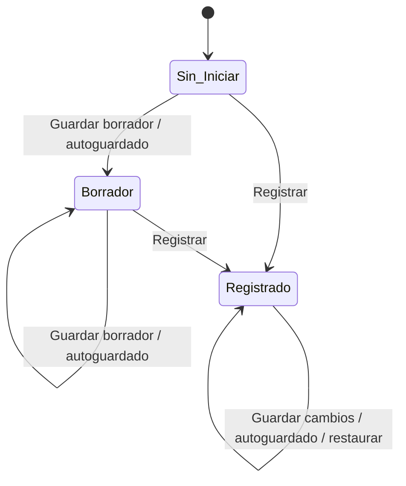

# CU-001: Registrar Plan de Ciclo

**Universidad La Salle**  
**Sistema:** SISCargaLectiva  
**Caso de Uso:** CU-001, Registrar Plan de Ciclo  
**Versión del documento:** 2.0 (2026-09-19). Incorpora las observaciones del docente y las decisiones del equipo ([requirements.md](../../requirements.md), sección 10).  
**Año:** 2026  
**Clasificación:** Confidencial

---

## 1. Datos generales del caso de uso

### 1.1 Breve descripción del caso de uso

Este caso de uso describe cómo el **Responsable del Plan de Ciclo** (Coordinador de carrera o Director de departamento) registra en el sistema la oferta académica de una carrera para un ciclo académico: qué asignaturas se dictan, cuántos grupos tiene cada una y a qué departamento académico se solicita el docente.

El Responsable puede:

- Consultar en el Tablero de Monitoreo General el avance de los planes de todas las carreras del ciclo.
- Cargar masivamente la oferta pegando un rango desde Google Sheets o subiendo un archivo `.xlsx` o `.csv`.
- Revisar la oferta en una grilla organizada por semestre, con las advertencias señaladas en la fila y la celda donde ocurren.
- Editar la oferta: celdas, asignaturas y grupos, desdobles parciales de práctica o de teoría y fusiones con grupos de la misma carrera o de otras carreras.
- Guardar el plan como **Borrador** o formalizarlo como **Registrado**.
- Seguir editando un plan **Registrado**. Cada guardado genera una nueva versión.
- Consultar, comparar y restaurar versiones anteriores del plan.

---

### 1.2 Actores del caso de uso

| Actor | Descripción |
|---|---|
| **Responsable del Plan de Ciclo** | Rol abstracto que agrupa a los actores que registran y editan planes de ciclo. En los flujos, "Responsable" designa a cualquiera de los dos actores siguientes. |
| **Coordinador de carrera** | Docente que gestiona los asuntos curriculares y de estudiantes de una o más carreras. Registra y edita el plan de ciclo **solo de las carreras que tiene asignadas** y consulta en solo lectura el de las demás carreras. |
| **Director de departamento** | Autoridad responsable de los docentes de un departamento académico (DIMA, DAHU, DACJ, DACTE). En este caso de uso registra y edita el plan de ciclo de **cualquier carrera**. |

---

### 1.3 Precondiciones

1. El usuario cuenta con una cuenta de correo institucional activa del dominio `@ulasalle.edu.pe`.
2. El usuario tiene asignado el rol de Coordinador de carrera, con al menos una carrera asignada, o el rol de Director de departamento.
3. El ciclo académico objetivo, por ejemplo `2027-1`, está registrado en el sistema.
4. Las carreras profesionales y los departamentos académicos DIMA, DAHU, DACJ y DACTE están registrados en el sistema.
5. Para la carga masiva, el Responsable dispone de la oferta académica de la carrera con la estructura de la plantilla oficial, en Google Sheets, en un archivo `.xlsx` o en un archivo `.csv`.

---

### 1.4 Postcondiciones

1. El plan de ciclo de la carrera queda almacenado en estado **Borrador** o **Registrado** como una nueva versión.
2. La operación queda registrada en la bitácora de auditoría.
3. El bloqueo de edición del plan de la carrera queda liberado.
4. El Tablero de Monitoreo General muestra el estado vigente del plan de la carrera.
5. Si el plan queda en estado **Registrado**, la asignación docente queda habilitada para los departamentos académicos.

---

### 1.5 Glosario de términos

| Término | Descripción |
|---|---|
| **Advertencia** | Situación que el sistema señala sin impedir la carga ni el guardado. Se muestra siempre de forma destacada en la fila y la celda donde ocurre. |
| **Agregar grupo** | Creación de un grupo paralelo de una asignatura con las mismas horas teóricas y prácticas. Reemplaza al término "desdoble total". |
| **Asignatura internacional / virtual** | Asignatura dictada en modalidad no presencial por un docente ubicado fuera de la sede, en el país o en el extranjero. |
| **Balance horario** | Regla de consistencia `TH = HT + HP`. |
| **Bitácora de auditoría** | Registro inmutable de las operaciones realizadas sobre los planes de ciclo, con usuario, fecha y hora, ciclo, carrera, acción y detalle. |
| **Bloqueo de edición** | Reserva exclusiva del plan de una carrera para un solo Responsable. Los demás usuarios ven el plan en solo lectura. El bloqueo expira tras el tiempo de inactividad configurado (30 minutos por defecto). |
| **Carga lectiva** | Asignación de horas semanales de dictado de clases a los docentes. Se distingue de la carga no lectiva y de la investigación. |
| **Ciclo académico** | Periodo académico en el que se planifica la carga lectiva, por ejemplo `2027-1`. |
| **DACJ** | Departamento Académico de Ciencias Jurídicas. |
| **DACTE** | Departamento Académico de Ciencias y Tecnologías Empresariales. |
| **DAHU** | Departamento Académico de Humanidades. |
| **Desdoble parcial de práctica** | División de un grupo en la que las horas teóricas se dictan en una sección común y las horas prácticas se dictan en dos o más subgrupos. |
| **Desdoble parcial de teoría** | División de un grupo en la que las horas prácticas se dictan en una sección común y las horas teóricas se dictan en dos o más subgrupos. |
| **DIMA** | Departamento Académico de Ingeniería y Matemáticas. |
| **Error de validación** | Incumplimiento de una regla de carga que provoca el rechazo de la totalidad del contenido importado. |
| **Estado Borrador** | Estado de un plan guardado que aún no se ha formalizado. |
| **Estado Registrado** | Estado de un plan formalizado. Habilita la asignación docente y sigue siendo editable; cada guardado genera una nueva versión. |
| **Estado Sin Iniciar** | Estado inicial del plan de una carrera antes de su primer guardado. |
| **Fusión** | Unión de dos o más grupos de distintas mallas curriculares o carreras en una sola sección de dictado. |
| **Grilla de Vista Previa** | Tabla editable del plan de ciclo, organizada en bloques semestrales colapsables. |
| **Grupo** | Sección de dictado de una asignatura, identificada por un número correlativo. |
| **Grupo principal** | Grupo de una fusión cuyas horas teóricas y prácticas definen las horas de la sección fusionada. |
| **HP** | Horas prácticas semanales. |
| **HT** | Horas teóricas semanales. |
| **Malla curricular** | Plan de estudios aprobado para una cohorte de estudiantes, identificado por su año, por ejemplo 2021 o 2024. |
| **Panel de Resumen Global** | Sección que muestra los totales del plan: asignaturas, grupos, horas teóricas, prácticas, totales y de dictado, asignaturas internacionales o virtuales, fusiones, desdobles y advertencias. |
| **Plan de Ciclo** | Conjunto de asignaturas y grupos que una carrera profesional apertura en un ciclo académico. |
| **Plantilla oficial** | Estructura de columnas que exige la carga masiva: CARRERA, MALLA, SEMESTRE, CÓDIGO, ASIGNATURA, GRUPO, HT, HP, TOTAL HORAS, DPTO y OBSERVACIONES. |
| **Tablero de Monitoreo General** | Sección que muestra, para un ciclo académico, el estado del plan de cada carrera. |
| **TH** | Total de horas semanales. Fórmula: `TH = HT + HP`. |
| **Versión** | Copia completa e inmutable del plan de una carrera, generada en cada guardado. |

---

# 2. Flujo de eventos

## 2.1 Flujo básico

| Paso | Responsable | Acción |
|---:|---|---|
| 1 | Actor | Accede a la URL del sistema y presiona **Iniciar sesión con Google**. |
| 2 | Sistema | Redirige al proveedor de identidad Google OAuth 2.0. |
| 3 | Actor | Se autentica con su cuenta de correo institucional. |
| 4 | Sistema | Valida que el correo autenticado pertenezca al dominio `@ulasalle.edu.pe`. |
| 5 | Sistema | Verifica que el usuario posea el rol de Coordinador de carrera o de Director de departamento. |
| 6 | Sistema | Despliega el menú principal con las opciones autorizadas. |
| 7 | Actor | Selecciona **Gestión de Planes de Ciclo**. |
| 8 | Sistema | Consulta los ciclos académicos registrados. |
| 9 | Sistema | Muestra la pantalla de planes de ciclo con el selector de ciclo académico. |
| 10 | Actor | Selecciona el ciclo académico objetivo. |
| 11 | Sistema | Consulta el estado del plan de cada carrera en el ciclo seleccionado. |
| 12 | Sistema | Muestra el Tablero de Monitoreo General con el estado, la cantidad de semestres, asignaturas, grupos y horas semanales, la versión vigente y el usuario que edita el plan de cada carrera. |
| 13 | Sistema | Consulta las carreras que el usuario tiene autorizadas para edición. |
| 14 | Sistema | Carga las carreras autorizadas en el selector de carrera. |
| 15 | Actor | Selecciona una carrera cuyo plan se encuentra en estado **Sin Iniciar**. |
| 16 | Sistema | Verifica que ningún otro usuario tenga bloqueado el plan de la carrera. |
| 17 | Sistema | Bloquea el plan de la carrera para edición exclusiva del Responsable. |
| 18 | Sistema | Habilita la sección de carga masiva. |
| 19 | Sistema | Muestra las opciones **Pegar desde Google Sheets**, **Subir archivo (.xlsx o .csv)** y **Descargar plantilla oficial**. |
| 20 | Actor | Selecciona **Pegar desde Google Sheets**. |
| 21 | Sistema | Muestra el área de pegado con las instrucciones de uso. |
| 22 | Actor | Copia el rango de celdas desde Google Sheets. |
| 23 | Actor | Pega el rango en el área de pegado. |
| 24 | Sistema | Recibe el contenido pegado. |
| 25 | Sistema | Reconstruye la matriz de filas y columnas a partir del texto tabulado. |
| 26 | Sistema | Normaliza las cabeceras y los valores sin distinguir mayúsculas, tildes ni espacios al inicio y al final. |
| 27 | Sistema | Ubica la primera fila que contiene todas las cabeceras de la plantilla oficial. |
| 28 | Sistema | Verifica que existan filas de datos debajo de la fila de cabeceras. |
| 29 | Sistema | Valida cada fila de datos con las reglas de error de la sección 3.2. |
| 30 | Sistema | Identifica en cada fila las advertencias de la sección 3.3. |
| 31 | Sistema | Clasifica como internacional o virtual cada asignatura cuyas OBSERVACIONES contienen "INTERNACIONAL" o "VIRTUAL". |
| 32 | Sistema | Organiza las asignaturas por semestre y malla curricular. |
| 33 | Sistema | Muestra la Grilla de Vista Previa en bloques semestrales colapsables con la cantidad de asignaturas, grupos y horas de cada bloque. |
| 34 | Sistema | Señala cada advertencia en la fila y la celda donde ocurre. |
| 35 | Sistema | Muestra el Panel de Resumen Global. |
| 36 | Sistema | Habilita los controles de edición, gestión de grupos, guardado y registro. |
| 37 | Actor | Revisa el plan en la Grilla de Vista Previa. |
| 38 | Actor | Presiona **Registrar Plan**. |
| 39 | Sistema | Muestra un modal de confirmación con el resumen consolidado y las advertencias vigentes. |
| 40 | Actor | Presiona **Confirmar y Registrar**. |
| 41 | Sistema | Almacena el plan con estado **Registrado** como una nueva versión. |
| 42 | Sistema | Registra la operación en la bitácora de auditoría. |
| 43 | Sistema | Libera el bloqueo de edición del plan. |
| 44 | Sistema | Actualiza el estado de la carrera en el Tablero de Monitoreo General. |
| 45 | Sistema | Muestra la confirmación de registro exitoso. |
| 46 | — | Fin del caso de uso. |

### Mensaje de formalización (paso 39)

> ¿Desea registrar el Plan de Ciclo de {Carrera} para el periodo {Ciclo}? Al confirmar, el estado cambiará a 'REGISTRADO' y se habilitará la asignación docente para los Departamentos Académicos (DIMA, DAHU, DACJ, DACTE). El plan podrá seguir editándose y cada guardado generará una nueva versión. Advertencias vigentes: {N}.

---

## 2.2 Flujos alternativos

### FA-001: Carga masiva mediante archivo .xlsx o .csv

1. En el paso 20 del flujo básico, el Responsable selecciona **Subir archivo (.xlsx o .csv)**.
2. El sistema muestra la sección de importación de archivos.
3. El Responsable selecciona el archivo.
4. El sistema recibe el archivo.
5. El sistema valida que la extensión del archivo sea `.xlsx` o `.csv`.
6. El sistema lee el contenido del archivo.
7. El sistema reconstruye la matriz de filas y columnas.
8. El flujo continúa en el paso 26 del flujo básico.

### FA-002: Selección de hoja en un libro .xlsx con varias hojas

1. En el paso 6 del FA-001, el sistema detecta que el libro contiene más de una hoja.
2. El sistema muestra la lista de hojas del libro.
3. El Responsable selecciona la hoja que desea importar.
4. El sistema lee el contenido de la hoja seleccionada.
5. El flujo continúa en el paso 7 del FA-001.

### FA-003: Archivo con formato no admitido

1. En el paso 5 del FA-001, el sistema detecta una extensión distinta de `.xlsx` y `.csv`.
2. El sistema informa que solo se admiten archivos `.xlsx` y `.csv`.
3. El sistema rechaza el archivo.
4. El flujo regresa al paso 3 del FA-001.

### FA-004: Descarga de la plantilla oficial

1. En el paso 19 del flujo básico, el Responsable selecciona **Descargar plantilla oficial**.
2. El sistema genera la plantilla con las cabeceras oficiales.
3. El sistema entrega la plantilla al Responsable.
4. El flujo regresa al paso 19 del flujo básico.

### FA-005: Estructura inválida por cabeceras ausentes o repetidas

1. En el paso 27 del flujo básico, el sistema no encuentra una fila con todas las cabeceras de la plantilla oficial o encuentra una cabecera repetida.
2. El sistema muestra un modal de estructura no válida con las cabeceras requeridas y las cabeceras ausentes o repetidas.
3. El sistema descarta el contenido.
4. El flujo regresa al paso 19 del flujo básico.

### FA-006: Matriz sin filas de datos

1. En el paso 28 del flujo básico, el sistema detecta que no existen filas de datos debajo de la fila de cabeceras.
2. El sistema informa que no hay asignaturas que procesar.
3. El sistema descarta el contenido.
4. El flujo regresa al paso 19 del flujo básico.

### FA-007: Rechazo de la carga por errores de validación

1. En el paso 29 del flujo básico, el sistema detecta al menos una fila que incumple una regla de error.
2. El sistema consolida todos los errores del contenido.
3. El sistema muestra la lista completa de errores con la fila, la columna, el valor y el motivo de cada uno.
4. El sistema rechaza la totalidad del contenido.
5. El flujo regresa al paso 19 del flujo básico.

### FA-008: Plan bloqueado por otro usuario

1. En el paso 16 del flujo básico, el sistema detecta que otro usuario tiene bloqueado el plan de la carrera.
2. El sistema informa el nombre del usuario que edita el plan y la hora de inicio del bloqueo.
3. El flujo continúa en el paso 2 del FA-009.

### FA-009: Consulta de un plan en solo lectura

1. En el paso 12 del flujo básico, el Responsable selecciona una carrera en el Tablero de Monitoreo General.
2. El sistema recupera la versión vigente del plan de la carrera.
3. El sistema muestra el plan en la Grilla de Vista Previa en modo de solo lectura.
4. El Responsable cierra la consulta.
5. El flujo regresa al paso 12 del flujo básico.

### FA-010: Guardado del plan como Borrador

1. En el paso 37 del flujo básico, el Responsable presiona **Guardar Borrador** sobre un plan que no está Registrado.
2. El sistema solicita confirmación.
3. El Responsable confirma el guardado.
4. El sistema almacena el plan con estado **Borrador** como una nueva versión.
5. El sistema registra la operación en la bitácora de auditoría.
6. El flujo regresa al paso 37 del flujo básico.

### FA-011: Reanudación de un plan en estado Borrador

1. En el paso 15 del flujo básico, el Responsable selecciona una carrera cuyo plan está en estado **Borrador**.
2. El sistema ejecuta los pasos 16 y 17 del flujo básico.
3. El sistema recupera la última versión del plan.
4. El sistema muestra el plan en la Grilla de Vista Previa.
5. El sistema informa que el plan se encuentra en estado Borrador.
6. El flujo continúa en el paso 36 del flujo básico.

### FA-012: Edición de un plan en estado Registrado

1. En el paso 15 del flujo básico, el Responsable selecciona una carrera cuyo plan está en estado **Registrado**.
2. El sistema ejecuta los pasos 16 y 17 del flujo básico.
3. El sistema recupera la versión vigente del plan.
4. El sistema muestra el plan en la Grilla de Vista Previa.
5. El sistema informa que el plan está Registrado y que cada guardado generará una nueva versión.
6. El sistema reemplaza la acción **Registrar Plan** por **Guardar Cambios**.
7. El flujo continúa en el paso 36 del flujo básico.

### FA-013: Guardado de cambios de un plan Registrado

1. En el paso 38 del flujo básico, el Responsable presiona **Guardar Cambios** sobre un plan Registrado.
2. El sistema muestra un modal con el resumen de los cambios respecto de la versión vigente y las advertencias vigentes.
3. El Responsable registra, de forma opcional, el motivo del cambio.
4. El Responsable presiona **Confirmar**.
5. El sistema almacena el plan con estado **Registrado** como una nueva versión.
6. El flujo continúa en el paso 42 del flujo básico.

### FA-014: Reemplazo del contenido mediante una nueva carga masiva

1. En el paso 37 del flujo básico, el Responsable presiona **Reemplazar contenido** sobre un plan que ya tiene asignaturas.
2. El sistema muestra un modal que advierte que se reemplazará todo el contenido del plan y que se perderán los desdobles, los ajustes manuales y las fusiones, incluidas las fusiones con grupos de otras carreras.
3. El Responsable confirma el reemplazo.
4. El flujo continúa en el paso 18 del flujo básico.

### FA-015: Edición directa de una celda

1. En el paso 37 del flujo básico, el Responsable selecciona una celda editable de la Grilla de Vista Previa.
2. El sistema habilita la edición de la celda.
3. El Responsable modifica el valor.
4. El sistema valida el valor con las reglas de error de la sección 3.2.
5. El sistema aplica el valor en la Grilla de Vista Previa.
6. El sistema recalcula TOTAL HORAS cuando el valor modificado corresponde a HT o HP.
7. El sistema actualiza las advertencias y el Panel de Resumen Global.
8. El flujo regresa al paso 37 del flujo básico.

### FA-016: Valor no válido en la edición

1. En el paso 4 del FA-015 o en el paso 5 del FA-017, el sistema detecta un valor que incumple una regla de error.
2. El sistema muestra un mensaje con la regla incumplida.
3. El sistema conserva el valor anterior.
4. El flujo regresa al paso 37 del flujo básico.

### FA-017: Agregar una asignatura

1. En el paso 37 del flujo básico, el Responsable presiona **Agregar Asignatura**.
2. El sistema muestra un formulario con los campos de la plantilla oficial.
3. El Responsable completa el formulario.
4. El Responsable presiona **Agregar**.
5. El sistema valida los datos con las reglas de error de la sección 3.2.
6. El sistema agrega la asignatura en su bloque semestral de la Grilla de Vista Previa.
7. El sistema actualiza las advertencias y el Panel de Resumen Global.
8. El flujo regresa al paso 37 del flujo básico.

### FA-018: Eliminar una asignatura

1. En el paso 37 del flujo básico, el Responsable selecciona **Eliminar Asignatura** sobre una asignatura.
2. El sistema muestra un modal de confirmación con las advertencias aplicables: cantidad de grupos, fusiones y docentes asignados.
3. El Responsable confirma la eliminación.
4. El sistema elimina la asignatura y sus grupos.
5. El sistema retira los grupos eliminados de las fusiones en las que participaban.
6. El sistema actualiza el Panel de Resumen Global.
7. El flujo regresa al paso 37 del flujo básico.

### FA-019: Agregar un grupo a una asignatura

1. En el paso 37 del flujo básico, el Responsable selecciona **Agregar Grupo** sobre una asignatura.
2. El sistema crea un grupo con el número correlativo siguiente y las mismas HT y HP de la asignatura.
3. El sistema actualiza el Panel de Resumen Global.
4. El flujo regresa al paso 37 del flujo básico.

### FA-020: Agregar un grupo a un semestre

1. En el paso 37 del flujo básico, el Responsable selecciona **Agregar Grupo al Semestre** en la cabecera de un bloque semestral.
2. El sistema solicita confirmación e indica la cantidad de asignaturas del semestre.
3. El Responsable confirma la acción.
4. El sistema crea, para cada asignatura del semestre, un grupo con el número correlativo siguiente.
5. El sistema actualiza el Panel de Resumen Global.
6. El flujo regresa al paso 37 del flujo básico.

### FA-021: Eliminar un grupo

1. En el paso 37 del flujo básico, el Responsable selecciona **Eliminar Grupo** sobre un grupo.
2. El sistema muestra un modal de confirmación con las advertencias aplicables: único grupo de la asignatura, grupo fusionado y grupo con docente asignado.
3. El Responsable confirma la eliminación.
4. El sistema elimina el grupo.
5. El sistema retira el grupo de la fusión en la que participaba.
6. El sistema actualiza el Panel de Resumen Global.
7. El flujo regresa al paso 37 del flujo básico.

### FA-022: Desdoble parcial de práctica o de teoría

1. En el paso 37 del flujo básico, el Responsable selecciona **Desdoblar** sobre un grupo.
2. El sistema muestra el formulario de desdoble con el tipo (Práctica o Teoría) y la cantidad de subgrupos.
3. El Responsable selecciona el tipo de desdoble.
4. El Responsable indica la cantidad de subgrupos.
5. El sistema verifica que el grupo tenga horas del tipo seleccionado.
6. El sistema verifica que la cantidad de subgrupos esté entre 2 y el máximo configurado.
7. El sistema genera los subgrupos con identificadores correlativos, cada uno con las horas del tipo desdoblado.
8. El sistema mantiene las horas del otro tipo en una sección común.
9. El sistema recalcula el Panel de Resumen Global.
10. El flujo regresa al paso 37 del flujo básico.

### FA-023: Desdoble no aplicable por ausencia de horas del tipo seleccionado

1. En el paso 5 del FA-022, el sistema detecta que el grupo no tiene horas del tipo seleccionado.
2. El sistema informa que el desdoble no aplica.
3. El sistema no genera subgrupos.
4. El flujo regresa al paso 37 del flujo básico.

### FA-024: Cantidad de subgrupos no válida

1. En el paso 6 del FA-022, el sistema detecta una cantidad de subgrupos fuera del rango permitido.
2. El sistema muestra el rango permitido.
3. El sistema no genera subgrupos.
4. El flujo regresa al paso 4 del FA-022.

### FA-025: Fusión de grupos

1. En el paso 37 del flujo básico, el Responsable selecciona **Fusionar Grupos**.
2. El sistema muestra el panel de fusión.
3. El sistema sugiere los grupos del ciclo, de cualquier carrera, con el mismo nombre de asignatura normalizado o las mismas horas.
4. El Responsable selecciona dos o más grupos de su plan o de otras carreras.
5. El sistema compara el nombre, el código, HT, HP y TH de los grupos seleccionados.
6. El sistema muestra las diferencias encontradas como advertencias.
7. El Responsable selecciona el grupo principal.
8. El Responsable confirma la fusión.
9. El sistema crea la sección fusionada con las HT y HP del grupo principal.
10. El sistema marca los grupos fusionados en la Grilla de Vista Previa.
11. El sistema recalcula el Panel de Resumen Global.
12. El flujo regresa al paso 37 del flujo básico.

### FA-026: Selección insuficiente para la fusión

1. En el paso 4 del FA-025, el Responsable selecciona un solo grupo.
2. El sistema informa que la fusión requiere al menos dos grupos.
3. El sistema mantiene abierto el panel de fusión.
4. El flujo regresa al paso 4 del FA-025.

### FA-027: Deshacer una fusión

1. En el paso 37 del flujo básico, el Responsable selecciona **Deshacer Fusión** sobre una sección fusionada.
2. El sistema solicita confirmación.
3. El Responsable confirma la acción.
4. El sistema disuelve la sección fusionada.
5. El sistema restituye los grupos originales con sus HT y HP.
6. El sistema recalcula el Panel de Resumen Global.
7. El flujo regresa al paso 37 del flujo básico.

### FA-028: Consulta y comparación de versiones

1. En el paso 37 del flujo básico, el Responsable selecciona **Historial de Versiones**.
2. El sistema muestra las versiones del plan con el número, el estado, el tipo de guardado, el usuario, la fecha y hora y el motivo.
3. El Responsable selecciona una versión.
4. El sistema muestra la versión seleccionada en modo de solo lectura.
5. El sistema muestra las diferencias de la versión seleccionada respecto de la versión anterior.
6. El Responsable cierra el historial.
7. El flujo regresa al paso 37 del flujo básico.

### FA-029: Restauración de una versión anterior

1. En el paso 4 del FA-028, el Responsable presiona **Restaurar esta versión**.
2. El sistema solicita confirmación e informa que la restauración generará una nueva versión.
3. El Responsable confirma la restauración.
4. El sistema carga el contenido de la versión seleccionada en la Grilla de Vista Previa.
5. El sistema almacena el contenido como una nueva versión con el estado vigente del plan.
6. El sistema registra la operación en la bitácora de auditoría.
7. El flujo regresa al paso 37 del flujo básico.

### FA-030: Colapso y expansión de los bloques semestrales

1. En el paso 37 del flujo básico, el Responsable selecciona la cabecera de un bloque semestral, **Colapsar todo** o **Expandir todo**.
2. El sistema actualiza el estado de expansión de los bloques.
3. El sistema mantiene visibles los totales en la cabecera de cada bloque.
4. El flujo regresa al paso 37 del flujo básico.

### FA-031: Cancelación de una ventana de confirmación

1. En cualquier ventana de confirmación de este caso de uso, el Responsable presiona **Cancelar**.
2. El sistema cierra la ventana sin aplicar la acción.
3. El sistema conserva la Grilla de Vista Previa sin cambios.
4. El flujo regresa al paso 37 del flujo básico.

### FA-032: Salida de la edición sin guardar

1. En el paso 37 del flujo básico, el Responsable presiona **Salir de la edición**.
2. El sistema advierte que existen cambios sin guardar.
3. El Responsable confirma la salida.
4. El sistema descarta los cambios sin guardar.
5. El sistema libera el bloqueo de edición del plan.
6. El flujo regresa al paso 12 del flujo básico.

### FA-033: Expiración del bloqueo por inactividad

1. Durante el paso 37 del flujo básico, transcurre el tiempo de inactividad configurado.
2. El sistema almacena los cambios sin guardar como una nueva versión: con estado **Borrador** si el plan no está Registrado, o con estado **Registrado** si ya lo está.
3. El sistema registra el autoguardado en la bitácora de auditoría.
4. El sistema libera el bloqueo de edición del plan.
5. El sistema informa que la sesión de edición expiró.
6. El sistema muestra el plan en modo de solo lectura.
7. Fin del caso de uso.

### FA-034: Acceso denegado

1. En el paso 4 o 5 del flujo básico, el sistema detecta que el correo no pertenece al dominio `@ulasalle.edu.pe` o que el usuario no posee un rol autorizado.
2. El sistema muestra el mensaje: *"Acceso denegado. La cuenta no cuenta con permisos de Responsable del Plan de Ciclo. Contacte con la administración del sistema."*
3. El sistema destruye la sesión temporal.
4. El sistema redirige a la pantalla de inicio de sesión.
5. Fin del caso de uso.

---

## 3. Reglas de negocio y validaciones

### 3.1 Reglas generales

| ID | Regla |
|---|---|
| RN-01 | La autenticación se realiza mediante Google OAuth 2.0 con cuentas del dominio `@ulasalle.edu.pe`. |
| RN-02 | El Coordinador de carrera edita solo el plan de las carreras que tiene asignadas. El Director de departamento edita el plan de cualquier carrera. Ambos consultan en solo lectura el plan de cualquier carrera. |
| RN-03 | El estado del ciclo académico no restringe la edición: los planes de ciclos anteriores, actuales y futuros son editables. |
| RN-04 | Un plan Registrado es editable. Nunca vuelve al estado Borrador. |
| RN-05 | Cada guardado genera una nueva versión: guardar borrador, registrar, guardar cambios, autoguardado y restauración. |
| RN-06 | Solo un Responsable edita el plan de una carrera a la vez. El bloqueo expira tras 30 minutos de inactividad (valor configurable) y los cambios pendientes se guardan automáticamente. |
| RN-07 | Una nueva carga masiva sobre un plan con asignaturas reemplaza todo su contenido. |
| RN-08 | La carga masiva no crea fusiones ni desdobles. El texto de OBSERVACIONES se conserva tal como viene. |
| RN-09 | Las columnas que no pertenecen a la plantilla oficial, como DOCENTE o TURNO, se ignoran. |
| RN-10 | Si la celda GRUPO está vacía, el sistema asigna el grupo 1. |
| RN-11 | La malla curricular se toma de la columna MALLA. |
| RN-12 | La fusión admite grupos de la misma carrera o de otras carreras, no requiere aprobación de la otra carrera ni su bloqueo de edición y nunca se bloquea por diferencias entre los grupos. |
| RN-13 | Al guardar el plan, las fusiones con grupos de otras carreras se muestran en el plan de esas carreras con un aviso y quedan registradas en la bitácora de cada plan involucrado. |
| RN-14 | Las horas de una sección fusionada son las del grupo principal y se cuentan una sola vez en las horas de dictado. |
| RN-15 | La eliminación de asignaturas y grupos nunca se bloquea: el sistema advierte y el Responsable confirma. |

### 3.2 Reglas de error (rechazan la totalidad del contenido)

| ID | Regla |
|---|---|
| E01 | El archivo tiene una extensión distinta de `.xlsx` y `.csv`. |
| E02 | Ninguna fila contiene todas las cabeceras de la plantilla oficial. Sinónimos aceptados: CODIGO (por CÓDIGO), OBSERVACIÓN (por OBSERVACIONES) y TH (por TOTAL HORAS). |
| E03 | Una cabecera está repetida. |
| E04 | No existen filas de datos debajo de la fila de cabeceras. |
| E05 | Hay una celda vacía en CARRERA, MALLA, SEMESTRE, CÓDIGO, ASIGNATURA, HT, HP, TOTAL HORAS o DPTO. |
| E06 | El valor de CARRERA no coincide con la carrera seleccionada. |
| E07 | HT, HP o TOTAL HORAS tiene un valor no numérico o negativo. |
| E08 | TOTAL HORAS es distinto de HT + HP. |
| E09 | DPTO tiene un valor distinto de DIMA, DAHU, DACJ y DACTE. |
| E10 | SEMESTRE no es un número entero mayor o igual a 1. |
| E11 | MALLA no es un año de cuatro dígitos. |
| E12 | GRUPO tiene un valor que no es un número entero mayor o igual a 1. |

### 3.3 Advertencias (se muestran siempre, de forma destacada, en la fila y la celda donde ocurren)

| ID | Regla |
|---|---|
| A01 | MALLA no coincide con el sufijo de dos dígitos del CÓDIGO. |
| A02 | La combinación CÓDIGO + GRUPO está repetida. |
| A03 | Un mismo CÓDIGO tiene distinta ASIGNATURA, HT o HP en filas diferentes. |
| A04 | El contenido incluye columnas que se ignoran. |
| A05 | Los grupos seleccionados para una fusión difieren en nombre, código, HT, HP o TH. |
| A06 | El grupo o la asignatura que se elimina es el único grupo de la asignatura, participa en una fusión o tiene docente asignado. |

---

## 4. Requisitos especiales

| ID | Requisito |
|---|---|
| RE-01 | El sistema autentica a los usuarios mediante Google OAuth 2.0, restringido al dominio `@ulasalle.edu.pe`. |
| RE-02 | El sistema valida en el servidor la autorización por rol y por carrera. |
| RE-03 | El sistema ejecuta cada guardado (versión, bitácora y liberación del bloqueo) en una única transacción atómica. |
| RE-04 | El sistema muestra las advertencias de forma destacada, junto a la fila y la celda donde ocurren, y en el Panel de Resumen Global. |
| RE-05 | El tiempo de expiración del bloqueo de edición es configurable, con un valor por defecto de 30 minutos. |
| RE-06 | La interfaz se presenta en idioma español. |

---

## 5. Estados del Plan de Ciclo

> **Nota:** cada transición genera una nueva versión del plan. El estado **Registrado** habilita la asignación docente y conserva la edición.

---

## 6. Resumen funcional

El caso de uso CU-001 cubre la construcción y el mantenimiento de la oferta académica de una carrera en un ciclo:

1. Autenticación y autorización del Responsable.
2. Monitoreo del avance de todas las carreras del ciclo.
3. Selección del ciclo y de la carrera, con bloqueo de edición.
4. Carga masiva desde Google Sheets, `.xlsx` o `.csv`.
5. Validación con rechazo total ante errores y señalización de advertencias.
6. Vista previa organizada por semestre.
7. Edición de celdas, asignaturas y grupos.
8. Desdobles parciales y fusiones entre mallas y carreras.
9. Guardado en Borrador, registro y edición posterior al registro.
10. Versionado, comparación y restauración.

El documento define **34 flujos alternativos**.
