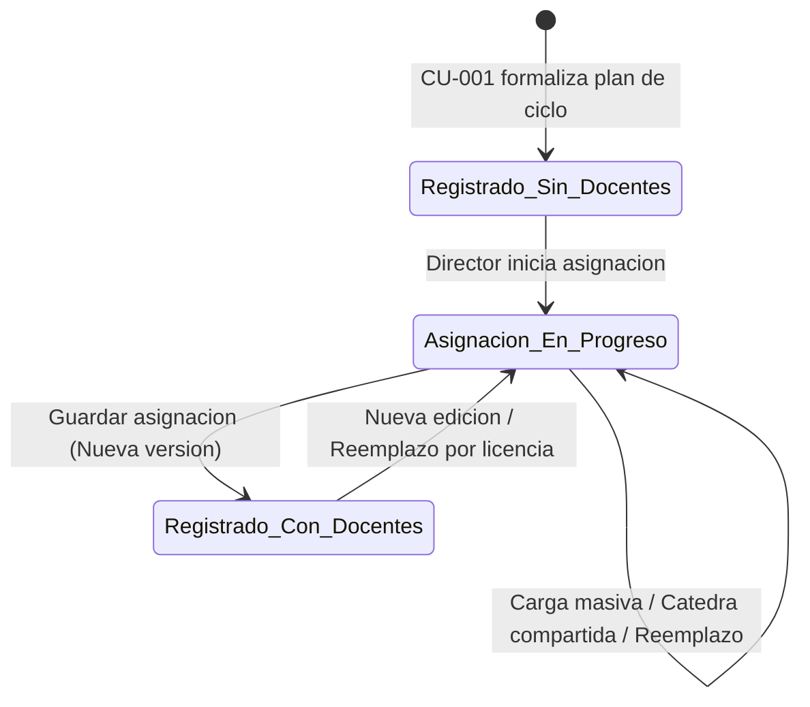

# CU-002: Asignar docentes a plan de ciclo

**Universidad La Salle**  
**Sistema:** SISCargaLectiva  
**Caso de Uso:** CU-002, Asignar docentes a plan de ciclo  
**Versión del documento:** 2.0 (2026-10-08). Reestructuración formal según la consigna docente y alineación con el diagrama UML oficial (CUs-Carga lectiva.png). Define como flujo normal (básico) la carga masiva mediante plantilla y Rejilla de Previsualización matricial, e incorpora como flujos alternativos interactivos principales FA-001 Cátedra compartida (división entre teoría y práctica) y FA-002 Reemplazo de docente durante el semestre con auditoría histórica de titular y firmante de actas. Añade la especificación detallada de pantallas presentes para correspondencia unívoca con la aplicación Web App desplegada.  
**Año:** 2026  
**Clasificación:** Confidencial  

---

## 1. Datos generales del caso de uso

### 1.1 Breve descripción del caso de uso

Este caso de uso describe cómo el **Director de departamento** asigna docentes a las asignaturas y grupos de todas las carreras profesionales que solicitaron cobertura a su departamento académico (DIMA, DAHUC, DACJ o DACTE) para un ciclo académico cuyos planes de ciclo se encuentran en estado **Registrado**.

El Director de departamento puede:

- Consultar en el Panel de Control de Carga Docente el avance de asignación en la Vista por Departamento y en la Vista por Carrera.
- Cargar asignaciones masivamente pegando un rango matricial desde Google Sheets o subiendo un archivo (.xlsx o .csv).
- Revisar en la Rejilla de Previsualización la correspondencia de columnas, filas y nombres de docentes contra el catálogo maestro antes de procesar el contenido.
- Realizar asignaciones docentes de manera interactiva curso por curso, grupo por grupo o por componente.
- Configurar cátedra compartida (FA-001) asignando docentes independientes para las horas teóricas y las horas prácticas.
- Registrar el reemplazo temporal o definitivo de un docente (FA-002) durante el ciclo lectivo con registro de motivo, fecha y resolución, preservando al titular histórico en la bitácora y designando al sustituto como firmante de actas.
- Asignar docentes o jefes de práctica a cada subgrupo de laboratorio en asignaturas con desdoble parcial.
- Asignar docentes a grupos fusionados garantizando el cómputo horario único sin duplicidad.
- Registrar vacantes bajo la modalidad de Docente Internacional Pendiente cuando la plaza requiere gestión institucional externa.
- Monitorear advertencias en tiempo real sobre la carga horaria acumulada de cada docente y sobre cruces de semestres en una misma carrera (A07 a A13).
- Guardar la asignación docente, generando una nueva versión en los planes de ciclo involucrados y registrando la bitácora de cambios.

El sistema no rechaza asignaciones por discrepancias o superación de límites: advierte de forma visible y localizada, permitiendo al Director confirmar las asignaciones bajo su responsabilidad institucional.

---

### 1.2 Actores del caso de uso

| Actor | Descripción |
|---|---|
| **Director de departamento** | Autoridad académica responsable de los docentes adscritos a un departamento académico (DIMA, DAHUC, DACJ o DACTE). En este caso de uso asigna docentes a todas las asignaturas de cualquier carrera cuyo departamento solicitado coincida con el suyo, carga asignaciones masivas, edita horas y reemplazos, y guarda las versiones de asignación. Hereda del rol abstracto Responsable de plan de ciclo según el modelo del sistema. |
| **Coordinador de carrera** | Autoridad académica responsable de una o más carreras profesionales. En este caso de uso consulta en modo de solo lectura el estado de cobertura docente de los cursos de sus carreras a través de la Vista por Carrera (`<<Extend>> Reporte por carrera`). |

---

### 1.3 Precondiciones

1. El usuario cuenta con una cuenta de correo institucional activa del dominio `@ulasalle.edu.pe`.
2. El usuario tiene asignado el rol de Director de departamento, con su departamento académico de adscripción configurado, o el rol de Coordinador de carrera.
3. El ciclo académico objetivo, por ejemplo `2026-1`, está registrado en el sistema.
4. El plan de ciclo de las carreras profesionales del ciclo se encuentra en estado **Registrado** (generado mediante CU-001).
5. El catálogo maestro de docentes se encuentra registrado en el sistema, con identificación, departamento de adscripción, condición laboral, categoría académica y condición de dedicación a tiempo completo en otra universidad.
6. El Director de departamento dispone de la información de asignación docente en una hoja de cálculo para su importación o la asigna interactivamente en la interfaz.

---

### 1.4 Glosario de términos

| Término | Descripción |
|---|---|
| **Advertencia** | Aviso que el sistema muestra ante un límite horario superado, carga insuficiente o cruce semestral, sin impedir nunca que el Director continúe. |
| **Asignación docente** | Vinculación de un profesor a una asignatura, grupo o componente específico para un ciclo académico. |
| **Bitácora de asignaciones** | Registro inmutable de cada asignación, edición o reemplazo docente con usuario, fecha, hora y motivo. |
| **Bloqueo de edición de carga** | Reserva exclusiva de la carga docente de un departamento académico para un solo Director. Los demás usuarios la visualizan en solo lectura. Expira tras 30 minutos de inactividad. |
| **Carga lectiva** | Horas semanales dedicadas estrictamente al dictado de clases presenciales o virtuales frente a estudiantes. |
| **Carga no lectiva** | Horas dedicadas a gestión directiva, comisiones, preparación y coordinación académica. Excluida del cómputo de carga lectiva semanal. |
| **Cátedra compartida** | Distribución del dictado de una misma asignatura o grupo entre dos o más docentes, separando horas teóricas y horas prácticas. |
| **Ciclo académico** | Periodo académico en el que se planifica y ejecuta la carga lectiva, por ejemplo `2026-1`. |
| **Condición docente** | Situación contractual del profesor (Ordinario o Contratado). |
| **Coordinador de carrera** | Docente responsable de los asuntos curriculares y formativos de una carrera profesional. |
| **Curso por jurado** | Modalidad extraordinaria de evaluación tutelar sin horas semanales de dictado regular. No computa horas en la carga lectiva semanal. |
| **DACJ** | Departamento Académico de Ciencias Jurídicas. |
| **DACTE** | Departamento Académico de Ciencias y Tecnologías Empresariales. |
| **DAHUC** | Departamento Académico de Humanidades y Comunicación. |
| **Dedicación docente** | Régimen horario del profesor en la universidad: Tiempo Completo (TC, 40 horas semanales) o Tiempo Parcial (TP, menos de 40 horas semanales). |
| **Desdoble parcial de práctica** | Subdivisión de un grupo donde la teoría se dicta junta y la práctica se separa en dos o más subgrupos de laboratorio. |
| **Desdoble parcial de teoría** | Subdivisión de un grupo donde la práctica se dicta junta y la teoría se separa en dos o más subgrupos. |
| **DIMA** | Departamento Académico de Ingeniería y Matemáticas. |
| **Director de departamento** | Autoridad responsable de la gestión de la plana docente adscrita a un departamento académico. |
| **Docente a tiempo completo en otra universidad** | Profesor con vínculo laboral de 40 horas semanales en otra institución universitaria. El sistema vigila que su carga lectiva local no supere las 16 horas semanales. |
| **Docente con cargo administrativo** | Profesor que desempeña cargos de decanatura, dirección o coordinación con reserva de horas no lectivas. El sistema vigila que su dictado no supere las 20 horas semanales. |
| **Docente internacional pendiente** | Registro de plaza reservada para un docente internacional gestionado mediante el área de Internacionalización, pendiente de confirmación nominativa. |
| **Fusión de grupos** | Integración de dos o más grupos de estudiantes en una sección de dictado común. Sus horas computan una sola vez para el docente asignado. |
| **Grilla de Asignación Docente** | Tabla interactiva que organiza los cursos solicitados por carrera, semestre y grupo con sus docentes vinculados y cómputo de horas. |
| **Grupo** | Sección de dictado de una asignatura identificada correlativamente. |
| **HP** | Horas prácticas semanales de una asignatura o subgrupo. |
| **HT** | Horas teóricas semanales de una asignatura. |
| **Jefe de práctica** | Profesional encargado de la conducción de las horas prácticas o sesiones de laboratorio. |
| **Panel de Control de Carga Docente** | Pantalla principal que resume el avance de cobertura docente por departamento y carrera. |
| **Plantilla oficial de carga docente** | Estructura de columnas reconocida por el sistema: DOCENTE, CARRERA, MALLA, SEMESTRE, CÓDIGO, ASIGNATURA, HT, HP, CONDICIÓN y TIPO_HORA. |
| **Reemplazo docente** | Sustitución de un docente asignado debido a licencia médica, gravidez u otra eventualidad durante el semestre. |
| **Rejilla de Previsualización** | Área con apariencia de hoja de cálculo donde el texto tabulado copiado o archivo subido se distribuye en celdas antes de su procesamiento. |
| **Subgrupo de práctica** | División específica de laboratorio dentro de un desdoble parcial. |
| **TH** | Total de horas semanales calculadas para un grupo o subgrupo. |
| **Vista por Carrera** | Modalidad de visualización que agrupa las asignaturas por programa profesional para identificar cursos pendientes de profesor. Corresponde al caso de uso extendido Reporte por carrera. |
| **Vista por Departamento** | Modalidad de visualización que agrupa la carga por cada docente adscrito al departamento para monitorear horas acumuladas y alertas. |

---

### 1.5 Presentación y especificación de las pantallas presentes

Para garantizar la correspondencia unívoca entre la especificación del caso de uso y la aplicación Web App interactiva desplegada, el sistema implementa las siguientes pantallas y modales operativos:

#### PAN-01: Menú Principal y Selector de Módulo
- **Propósito:** Punto de acceso unificado al sistema con identificación del usuario, departamento adscrito y roles activos.
- **Componentes visibles:**
  - Encabezado con correo institucional `@ulasalle.edu.pe`, insignia de rol (Director de departamento) y selector de ciclo académico activo.
  - Tarjeta de acceso a CU-001: «Registrar Plan de Ciclo».
  - Tarjeta destacada de acceso a CU-002: «Asignar docentes a plan de ciclo (CU-002)».
  - Pie de página con versión del aplicativo y estado de conexión.

#### PAN-02: Panel de Control de Carga Docente (Vista por Departamento)
- **Propósito:** Pantalla central de gestión de asignaciones por docente adscrito al departamento seleccionado.
- **Componentes visibles:**
  - Selector de departamento activo: Permite alternar entre DIMA, DAHUC, DACJ y DACTE.
  - Barra de métricas consolidadas: Horas requeridas por las carreras, Horas cubiertas, Porcentaje de cobertura global (%) y Alertas activas.
  - Barra de herramientas: Botón «Carga Masiva (Rejilla / Archivo)», Botón «Guardar asignaciones», Botón selector de conmutación («Vista por Departamento» y «Vista por Carrera»).
  - Tabla de asignación por departamento: Columnas DOCENTE, CONDICIÓN, CATEGORÍA, CURSOS ASIGNADOS, TOTAL HORAS (TH), BALANCE Y ADVERTENCIAS (A07 a A13) y ACCIONES (botón «Reemplazar docente»).

#### PAN-03: Rejilla de Previsualización e Importación Masiva
- **Propósito:** Carga masiva de asignaciones docentes a partir de hoja de cálculo con previsualización matricial interactiva antes de su aplicación.
- **Componentes visibles:**
  - Pestañas de método de entrada: «Pegar texto matricial (Sheets / Excel)» y «Subir archivo (.xlsx / .csv)».
  - Área de texto y zona de arrastre de archivos con detección automática de tabulaciones y saltos de línea.
  - Rejilla de Previsualización: Matriz interactiva en celdas que refleja exactamente la división de columnas (DOCENTE, CARRERA, MALLA, SEMESTRE, CÓDIGO, ASIGNATURA, HT, HP, CONDICIÓN, TIPO_HORA).
  - Panel de auditoría de previsualización: Cantidad de filas leídas, columnas detectadas, validación de docentes contra el catálogo y advertencias sintácticas.
  - Botones de acción: Botón «Aplicar a la grilla», Botón «Descargar plantilla oficial» y Botón «Volver».

#### PAN-04: Vista por Carrera (Monitoreo Curricular y Cátedra Compartida)
- **Propósito:** Supervisión de asignaturas agrupadas por programa profesional y semestre (`<<Extend>> Reporte por carrera`).
- **Componentes visibles:**
  - Selector de carrera profesional para filtrado focalizado.
  - Tabla de cursos solicitados: Columnas CARRERA, SEM, CÓDIGO, ASIGNATURA, GRUPO, HT, HP, TH, DOCENTE ASIGNADO, TIPO HORA, ESTADO DE COBERTURA y ACCIONES.
  - Botón contextual «Cátedra Compartida» en asignaturas con HT > 0 y HP > 0.
  - Insignia gráfica destacada: «Cátedra compartida (FA-001)» con visualización discriminada de docente de teoría y docente de práctica.

#### PAN-05: Ventana Modal de Cátedra Compartida (FA-001)
- **Propósito:** Distribución granular del dictado de un curso separando horas teóricas y horas prácticas entre docentes independientes.
- **Componentes visibles:**
  - Encabezado descriptivo: Asignatura, Código, Carrera, Semestre, Grupo, Horas Teóricas (HT) y Horas Prácticas (HP).
  - Campo selector «Docente para Teoría (HT h/sem)»: Dropdown alimentado del catálogo maestro de docentes.
  - Campo selector «Docente o Jefe de Práctica para Práctica (HP h/sem)»: Dropdown alimentado del catálogo maestro de docentes.
  - Botón «Confirmar Cátedra Compartida» y Botón «Cancelar».

#### PAN-06: Ventana Modal de Reemplazo Docente (FA-002)
- **Propósito:** Sustitución formal de un profesor asignado durante el ciclo lectivo por motivos de licencia médica, gravidez o renuncia.
- **Componentes visibles:**
  - Datos del docente saliente: Nombre del docente titular y cursos asignados.
  - Campo selector «Docente sustituto»: Dropdown del catálogo maestro para designar al nuevo profesor.
  - Campo «Motivo del reemplazo»: Dropdown/texto con opciones (Licencia médica, Gravidez, Renuncia, Comisión académica).
  - Campo «Resolución / Documento sustento»: Entrada de texto para registrar el número de resolución de decanatura.
  - Campo «Fecha de efectividad»: Selector de fecha.
  - Botón «Confirmar Reemplazo» y Botón «Cancelar».

#### PAN-07: Ventana Modal de Confirmación de Guardado y Balance
- **Propósito:** Cierre transaccional de la sesión de asignación con revisión de balance horario y advertencias vigentes.
- **Componentes visibles:**
  - Resumen ejecutivo: Total de docentes asignados, asignaturas cubiertas y horas totales asignadas.
  - Relación de advertencias vigentes confirmadas bajo responsabilidad del Director (A07 a A13).
  - Botón «Confirmar y guardar» y Botón «Volver a editar».

---

# 2. Flujo de eventos

## 2.1 Flujo básico

| Paso | Responsable | Acción |
|---:|---|---|
| 1 | Actor | Accede a la URL del sistema. |
| 2 | Actor | Presiona **Acceder con Google**. |
| 3 | Sistema | Redirige al proveedor de identidad Google. |
| 4 | Actor | Se autentica con su cuenta de correo institucional. |
| 5 | Sistema | Comprueba el emisor, el destinatario y la vigencia del token de identidad recibido. |
| 6 | Sistema | Valida que el correo autenticado pertenezca al dominio `@ulasalle.edu.pe`. |
| 7 | Sistema | Determina el rol del usuario como Director de departamento. |
| 8 | Sistema | Despliega el Menú Principal (PAN-01) con las opciones autorizadas. |
| 9 | Actor | Selecciona **Asignar docentes a plan de ciclo (CU-002)**. |
| 10 | Sistema | Consulta los ciclos académicos registrados y los planes en estado Registrado. |
| 11 | Sistema | Muestra el Panel de Control de Carga Docente (PAN-02) con el selector de departamento y el selector de ciclo académico. |
| 12 | Actor | Selecciona el departamento académico objetivo (DIMA, DAHUC, DACJ o DACTE). |
| 13 | Sistema | Consulta las asignaturas solicitadas al departamento académico en los planes registrados de todas las carreras. |
| 14 | Sistema | Muestra la Vista por Departamento con la lista de profesores adscritos, horas acumuladas, cursos asignados y métricas de cobertura. |
| 15 | Sistema | Habilita los controles de carga masiva, asignación interactiva y conmutación de vista. |
| 16 | Actor | Presiona **Carga Masiva (Rejilla / Archivo)**. |
| 17 | Sistema | Verifica que ningún otro usuario tenga bloqueada la edición de la carga del departamento. |
| 18 | Sistema | Bloquea la carga docente del departamento para edición exclusiva del Director. |
| 19 | Sistema | Inicia el contador de la sesión de edición. |
| 20 | Sistema | Despliega la pantalla de Carga Masiva (PAN-03) con las opciones: - **Pegar texto matricial (Sheets / Excel)**. - **Subir archivo (.xlsx / .csv)**. - **Descargar plantilla oficial**. |
| 21 | Actor | Selecciona la pestaña **Pegar texto matricial**. |
| 22 | Sistema | Muestra la Rejilla de Previsualización vacía con sus cabeceras normalizadas. |
| 23 | Actor | Copia el rango de celdas desde Google Sheets o archivo Excel institucional. |
| 24 | Actor | Pega el rango en la Rejilla de Previsualización. |
| 25 | Sistema | Reconstruye la matriz de filas y columnas a partir del texto recibido. |
| 26 | Sistema | Dibuja el contenido en la Rejilla de Previsualización (cabecera de cada columna, número de fila y valor de cada celda). |
| 27 | Sistema | Presenta el panel de auditoría indicando cantidad de filas, columnas detectadas y correspondencia con el catálogo docente. |
| 28 | Actor | Revisa el contenido previsualizado en la Rejilla de Previsualización. |
| 29 | Actor | Presiona **Aplicar a la grilla**. |
| 30 | Sistema | Normaliza las cabeceras sin distinguir mayúsculas, tildes ni espacios al inicio y al final. |
| 31 | Sistema | Localiza cada asignatura y grupo en el plan registrado del ciclo por carrera, semestre, código y grupo. |
| 32 | Sistema | Comprueba que el departamento requerido en la asignatura coincida con el departamento del Director. |
| 33 | Sistema | Asocia al docente indicado con la asignatura y grupo correspondiente. |
| 34 | Sistema | Identifica el componente horario asignado (horas teóricas, horas prácticas o subgrupo de práctica). |
| 35 | Sistema | Calcula las horas lectivas semanales acumuladas de cada docente en todas las carreras. |
| 36 | Sistema | Evalúa las advertencias de carga horaria acumulada y cruces semestrales para cada docente (A07 a A13). |
| 37 | Sistema | Cierra la vista de carga masiva y regresa al Panel de Control de Carga Docente (PAN-02) con las asignaciones vinculadas y las advertencias localizadas. |
| 38 | Actor | Revisa las asignaciones consolidadas y las métricas de cobertura actualizadas. |
| 39 | Actor | Presiona **Guardar asignaciones**. |
| 40 | Sistema | Muestra la ventana modal de confirmación (PAN-07) con el resumen consolidado de docentes, total de horas cubiertas y advertencias vigentes. |
| 41 | Actor | Presiona **Confirmar y guardar**. |
| 42 | Sistema | Almacena las asignaciones en los planes de ciclo correspondientes como una nueva versión. |
| 43 | Sistema | Registra la operación en la bitácora de asignaciones (usuario, departamento, ciclo, fecha y hora, total de cursos cubiertos). |
| 44 | Sistema | Libera el bloqueo de edición de la carga. |
| 45 | Sistema | Actualiza los indicadores de cobertura en el Panel de Control de Carga Docente. |
| 46 | Sistema | Muestra el mensaje de éxito de guardado (departamento, ciclo, versión guardada, cantidad de grupos cubiertos). |
| 47 | — | Fin del caso de uso. |

---

## 2.2 Flujos alternativos

### FA-001: Asignación de cátedra compartida dividiendo teoría y práctica

1. En el paso 38 del flujo básico, o tras conmutar a la Vista por Carrera (PAN-04), el Director localiza una asignatura que cuenta con horas teóricas y horas prácticas (HT > 0 y HP > 0).
2. El Director presiona el botón contextual **Cátedra Compartida** en la fila de la asignatura.
3. El sistema muestra la Ventana Modal de Cátedra Compartida (PAN-05) indicando asignatura, código, carrera, grupo, total de HT y total de HP.
4. El Director selecciona en el desplegable de teoría al docente encargado de las horas teóricas.
5. El Director selecciona en el desplegable de práctica al docente o jefe de práctica encargado de las horas prácticas.
6. El Director presiona **Confirmar Cátedra Compartida**.
7. El sistema valida que ambos campos cuenten con un profesor asignado.
8. El sistema cierra la ventana modal y actualiza la fila de la asignatura en la grilla visual, mostrando el distintivo destacado **Cátedra compartida (FA-001)**.
9. El sistema computa las HT de forma exclusiva al docente de teoría.
10. El sistema computa las HP de forma exclusiva al docente de práctica.
11. El sistema actualiza en tiempo real las horas lectivas acumuladas y las advertencias horarias de ambos docentes.
12. El flujo regresa al paso 38 del flujo básico.

### FA-002: Reemplazo de docente durante el semestre con auditoría histórica

1. En el paso 14 o 38 del flujo básico, en la Vista por Departamento (PAN-02), el Director localiza la fila de un docente titular que presenta cursos asignados.
2. El Director presiona el botón **Reemplazar docente** en la columna de acciones.
3. El sistema muestra la Ventana Modal de Reemplazo Docente (PAN-06) detallando el nombre del docente saliente y las asignaturas asignadas.
4. El Director selecciona en el menú desplegable al docente sustituto a partir del catálogo de profesores.
5. El Director ingresa el motivo del reemplazo (Licencia médica, Gravidez, Renuncia o Comisión académica).
6. El Director ingresa el número de resolución de decanatura que sustenta la sustitución.
7. El Director ingresa la fecha de efectividad del reemplazo.
8. El Director presiona **Confirmar Reemplazo**.
9. El sistema cierra la ventana modal y ejecuta la sustitución en memoria y base de datos.
10. El sistema traslada las asignaciones y el cómputo de horas lectivas al nuevo docente titular.
11. El sistema designa al docente sustituto como profesor vigente y responsable formal de la firma de actas de notas.
12. El sistema anota en la bitácora inmutable de asignaciones el registro histórico del docente sustituido (docente original, docente nuevo, motivo, resolución, fecha de efectividad y usuario responsable).
13. El sistema recalcula el balance de horas y las advertencias horarias de ambos profesores.
14. El flujo regresa al paso 38 del flujo básico.

### FA-003: Monitoreo curricular y asignación en Vista por Carrera (`<<Extend>> Reporte por carrera`)

1. En el paso 15 o 38 del flujo básico, el Director presiona **Vista por Carrera**.
2. El sistema conmuta la pantalla al panel de Vista por Carrera (PAN-04).
3. El sistema agrupa las asignaturas requeridas al departamento por programa profesional y ciclo semestral.
4. El sistema resalta con un distintivo visual de estado aquellas asignaturas que carecen de docente asignado.
5. El Director filtra las asignaturas por carrera o selecciona el botón **Asignar manual** en una asignatura específica.
6. El sistema vincula la asignación realizada y actualiza el indicador de cobertura de la carrera.
7. El Director presiona **Vista por Departamento** para regresar a la vista de balance docente.
8. El flujo regresa al paso 38 del flujo básico.

### FA-004: Asignación interactiva manual curso por curso

1. En el paso 15 o 38 del flujo básico, el Director localiza una fila de curso en la grilla interactiva.
2. El Director presiona el control de selección docente en la celda o el botón **Asignar manual**.
3. El sistema despliega el selector filtrable con los docentes adscritos al departamento académico.
4. El Director escribe el apellido o nombre del profesor.
5. El sistema filtra las coincidencias del catálogo docente en tiempo real.
6. El Director selecciona al docente deseado.
7. El sistema vincula al profesor con la asignatura y grupo.
8. El sistema recalcula de forma inmediata las horas lectivas semanales acumuladas del profesor.
9. El sistema actualiza las advertencias en la fila del curso y en el panel de balance.
10. El flujo regresa al paso 38 del flujo básico.

### FA-005: Registro de vacante bajo modalidad de Docente Internacional Pendiente

1. En el paso 38 del flujo básico o durante la asignación interactiva, el Director selecciona una asignatura convenida como internacional o virtual.
2. El Director selecciona como profesor la opción **Docente Internacional Pendiente**.
3. El sistema asocia la plaza a la gestión del área de Internacionalización institucional.
4. El sistema marca el curso con la etiqueta **Pendiente Internacional**.
5. El sistema computa la cobertura académica del curso sin imputar horas lectivas a personas físicas locales.
6. El flujo regresa al paso 38 del flujo básico.

### FA-006: Asignación a subgrupos de práctica en grupos con desdoble parcial

1. En el paso 38 del flujo básico, el Director selecciona una asignatura con desdoble parcial de práctica configurado en el plan de ciclo.
2. El sistema despliega los subgrupos de laboratorio correspondientes (G1, G2).
3. El Director selecciona un subgrupo específico.
4. El Director asigna al docente o jefe de práctica encargado de ese subgrupo.
5. El sistema computa las horas prácticas del subgrupo exclusivamente al profesor seleccionado.
6. El sistema actualiza el balance horario y advertencias del profesor.
7. El flujo regresa al paso 38 del flujo básico.

### FA-007: Asignación a secciones fusionadas con cómputo horario único

1. En el paso 33 del flujo básico o durante la asignación manual, el Director asigna un docente a un grupo que forma parte de una fusión entre carreras o mallas.
2. El sistema identifica de manera automática todos los grupos que integran la sección fusionada.
3. El sistema propaga la vinculación del docente a cada uno de los grupos de la fusión.
4. El sistema computa las horas del dictado una sola vez en la carga lectiva semanal acumulada del profesor.
5. El flujo continúa en el paso 35 del flujo básico.

### FA-008: Carga de asignaciones desde archivo (.xlsx o .csv)

1. En el paso 20 del flujo básico, el Director selecciona la pestaña **Subir archivo (.xlsx / .csv)**.
2. El sistema habilita el selector de archivos local y la zona de arrastre.
3. El Director selecciona o arrastra el archivo con la estructura de carga departamental.
4. El sistema procesa el archivo extrayendo las celdas de la hoja de cálculo.
5. El sistema traslada las filas a la Rejilla de Previsualización (PAN-03).
6. El flujo continúa en el paso 26 del flujo básico.

### FA-009: Descarga de plantilla oficial de carga docente

1. En el paso 20 del flujo básico, el Director selecciona **Descargar plantilla oficial**.
2. El sistema genera el archivo de hoja de cálculo con las cabeceras predefinidas: - DOCENTE. - CARRERA. - MALLA. - SEMESTRE. - CÓDIGO. - ASIGNATURA. - HT. - HP. - CONDICIÓN. - TIPO_HORA.
3. El sistema entrega el archivo al Director.
4. El flujo regresa al paso 20 del flujo básico.

### FA-010: Advertencia por exceso de carga lectiva semanal (A07)

1. En el paso 36 del flujo básico o durante la asignación manual, el sistema detecta que la carga lectiva acumulada de un docente supera las 40 horas semanales.
2. El sistema genera la advertencia A07 en la fila del docente y en la barra de balance.
3. El sistema permite al Director continuar y guardar bajo su responsabilidad institucional.
4. El flujo continúa en el paso 37 del flujo básico.

### FA-011: Advertencia por docente a tiempo completo en otra institución (A08)

1. En el paso 36 del flujo básico o durante la asignación manual, el sistema detecta que un docente registrado como tiempo completo en otra universidad acumula más de 16 horas lectivas semanales.
2. El sistema genera la advertencia A08 en la fila del docente y en la barra de balance.
3. El sistema permite al Director continuar y guardar bajo su responsabilidad institucional.
4. El flujo continúa en el paso 37 del flujo básico.

### FA-012: Advertencia por carga elevada en docente ordinario (A09)

1. En el paso 36 del flujo básico o durante la asignación manual, el sistema detecta que la carga lectiva acumulada de un docente ordinario a tiempo completo supera las 24 horas semanales.
2. El sistema genera la advertencia A09 de carga alta.
3. El sistema permite al Director continuar y guardar bajo su responsabilidad institucional.
4. El flujo continúa en el paso 37 del flujo básico.

### FA-013: Advertencia por carga insuficiente en docente ordinario (A10)

1. En el paso 36 del flujo básico o durante la asignación manual, el sistema detecta que la carga lectiva de un docente ordinario a tiempo completo es inferior a 8 horas semanales.
2. El sistema genera la advertencia A10 de carga baja.
3. El sistema permite al Director continuar y guardar bajo su responsabilidad institucional.
4. El flujo continúa en el paso 37 del flujo básico.

### FA-014: Advertencia por cruce semestral de asignaturas en la misma carrera (A11)

1. En el paso 36 del flujo básico o durante la asignación manual, el sistema detecta que un profesor tiene asignadas dos o más asignaturas ubicadas en el mismo semestre de una misma carrera profesional.
2. El sistema genera la advertencia A11 indicando posible colisión horaria estudiantil.
3. El sistema permite al Director continuar y guardar bajo su responsabilidad institucional.
4. El flujo continúa en el paso 37 del flujo básico.

### FA-015: Advertencia por docente con cargo directivo o administrativo (A12)

1. En el paso 36 del flujo básico o durante la asignación manual, el sistema detecta que un docente registrado con cargo de decano, director o coordinador supera las 20 horas lectivas semanales.
2. El sistema genera la advertencia A12 por superación de carga compatible con gestión.
3. El sistema permite al Director continuar y guardar bajo su responsabilidad institucional.
4. El flujo continúa en el paso 37 del flujo básico.

### FA-016: Advertencia por cursos requeridos sin docente asignado al guardar (A13)

1. En el paso 39 del flujo básico, el sistema detecta que existen asignaturas solicitadas al departamento que aún no tienen docente asignado.
2. El sistema genera la advertencia A13 detallando el número de vacantes pendientes en la ventana de confirmación (PAN-07).
3. El sistema permite al Director confirmar el guardado parcial del avance.
4. El flujo continúa en el paso 41 del flujo básico.

### FA-017: Consulta de historial de versiones de asignación docente

1. En el paso 14 del flujo básico, el Director presiona **Historial de versiones**.
2. El sistema despliega la lista inmutable de versiones guardadas con fecha, hora, usuario, cursos cubiertos y observaciones de bitácora.
3. El Director selecciona una versión anterior para inspeccionar su composición en modo de solo lectura.
4. El sistema presenta la distribución de la versión consultada.
5. El Director presiona **Cerrar historial**.
6. El flujo regresa al paso 14 del flujo básico.

### FA-018: Bloqueo de edición activo por otro usuario

1. En el paso 17 del flujo básico, el sistema detecta que otro Director de departamento tiene abierta la sesión de edición de la carga del departamento.
2. El sistema informa el nombre del usuario y la hora en que inició el bloqueo.
3. El sistema ofrece la apertura en modo de solo lectura.
4. El Director confirma la apertura en solo lectura.
5. El sistema abre el panel desactivando los controles de guardado y carga masiva.
6. Fin del caso de uso.

### FA-019: Cancelación de ventana modal o formulario emergente

1. En cualquier ventana modal de confirmación, cátedra compartida o reemplazo docente, el Director presiona **Cancelar** o el botón de cierre.
2. El sistema descarta las modificaciones no confirmadas del formulario.
3. El sistema restaura el estado visual precedente.
4. El flujo regresa a la pantalla de origen del flujo básico.

### FA-020: Acceso denegado por cuenta ajena al dominio o sin rol autorizado

1. En el paso 6 o 7 del flujo básico, el sistema determina que la cuenta autenticada no pertenece al dominio `@ulasalle.edu.pe` o carece de un rol académico registrado.
2. El sistema rechaza el inicio de sesión.
3. El sistema presenta el mensaje de acceso restringido indicando la causa institucional.
4. Fin del caso de uso.

---

## 3. Reglas de negocio y validaciones

### 3.1 Reglas generales

| ID | Regla |
|---|---|
| RN-23 | El Director de departamento asigna docentes a todas las asignaturas de cualquier carrera profesional cuyo departamento solicitado coincida con su departamento de adscripción (DIMA, DAHUC, DACJ o DACTE). |
| RN-24 | La asignación docente opera sobre planes de ciclo en estado **Registrado**. Cada guardado genera una nueva versión del plan y un registro inmutable en la bitácora de asignaciones. |
| RN-25 | En asignaturas con horas teóricas y horas prácticas (HT > 0 y HP > 0), el sistema permite cátedra compartida (FA-001) asignando un docente para teoría y un docente o jefe de práctica para práctica, computando las horas de manera discriminada. |
| RN-26 | En asignaturas con desdoble parcial de práctica, el sistema permite asignar un docente o jefe de práctica independiente para cada subgrupo de laboratorio (G1, G2), computando las HP del subgrupo a cada profesor respectivo. |
| RN-27 | En caso de licencia médica, gravidez o renuncia durante el semestre, el sistema permite registrar el reemplazo de un docente asignado (FA-002), transfiriendo el dictado al sustituto, designándolo como firmante vigente de actas y conservando la bitácora histórica del titular reemplazado. |
| RN-28 | En secciones fusionadas entre carreras o mallas, la asignación de un docente a un grupo propaga la asignación a todos los grupos de la fusión y computa las horas de dictado una sola vez para el profesor. |
| RN-29 | El sistema admite registrar asignaturas bajo la modalidad de **Docente Internacional Pendiente** para reservar la cobertura sin asociar horas a docentes físicos locales. |
| RN-30 | Los cursos bajo modalidad de jurado no computan horas lectivas semanales para el docente evaluador. |
| RN-31 | El sistema mantiene el bloqueo de edición exclusivo por departamento académico con un tiempo de expiración configurable de 30 minutos por inactividad. |
| RN-32 | Las horas no lectivas correspondientes a gestión académica, comisiones y preparación no forman parte del cómputo de carga lectiva semanal de dictado. |
| RN-33 | El Coordinador de carrera dispone de acceso en solo lectura a la Vista por Carrera para monitorear el avance de asignación docente de sus planes de estudio. |

### 3.2 Reglas de error

Ninguna. Siguiendo el principio de diseño de SISCargaLectiva, el sistema no bloquea la importación ni la asignación interactiva. Cualquier inconsistencia o superación de límites se gestiona mediante el catálogo de advertencias (A07 a A13), garantizando la continuidad operativa bajo la responsabilidad del Director de departamento.

### 3.3 Advertencias (nunca bloquean la acción del Director)

| ID | Regla |
|---|---|
| A07 | La carga lectiva semanal acumulada del docente supera el límite máximo de 40 horas semanales. |
| A08 | El docente registrado con dedicación a tiempo completo en otra universidad acumula más de 16 horas lectivas semanales. |
| A09 | El docente ordinario a tiempo completo supera las 24 horas lectivas semanales (alerta de carga elevada). |
| A10 | El docente ordinario a tiempo completo tiene asignadas menos de 8 horas lectivas semanales (alerta de carga insuficiente). |
| A11 | El docente tiene asignadas dos o más asignaturas en el mismo semestre de una misma carrera profesional (riesgo de cruce de horario estudiantil). |
| A12 | El docente con cargo directivo o administrativo asignado acumula más de 20 horas lectivas semanales de dictado. |
| A13 | Al solicitar el guardado de la asignación, existen asignaturas solicitadas al departamento que permanecen sin docente asignado (guardado con vacantes pendientes). |

---

## 4. Requisitos especiales

| ID | Requisito |
|---|---|
| RE-01 | El sistema autentica a los usuarios mediante Google OAuth 2.0 restringido al dominio institucional `@ulasalle.edu.pe`. |
| RE-02 | El sistema verifica en el servidor la firma del token de identidad emitido por Google antes de autorizar la sesión. |
| RE-03 | El sistema valida en el servidor los permisos por rol y departamento académico antes de habilitar la edición de asignaciones. |
| RE-04 | Cada guardado de asignaciones se ejecuta en una transacción atómica que actualiza la versión del plan, persiste la bitácora inmutable y libera el bloqueo de edición. |
| RE-05 | El sistema presenta la Rejilla de Previsualización matricial interactiva antes de aplicar los datos importados a la grilla principal. |
| RE-06 | El bloqueo de edición cuenta con expiración automática configurable con un valor por defecto de 30 minutos de inactividad. |
| RE-07 | La interfaz de usuario se presenta completamente en idioma español y responde reactivamente en menos de 500 milisegundos ante cambios en memoria. |

---

## 5. Estados del Plan y la Asignación Docente

> **Nota:** la asignación docente no crea un ciclo de vida paralelo de estados, sino que opera directamente sobre los planes de ciclo en estado **Registrado**, generando en cada guardado una nueva versión inmutable con la nómina de profesores asignada.

---

## 6. Resumen funcional

El caso de uso CU-002 cubre integralmente la asignación y supervisión de docentes para el plan de ciclo académico:

1. Autenticación institucional y control de acceso por departamento académico.
2. Supervisión de indicadores de avance y cobertura horaria en tiempo real.
3. Carga masiva mediante plantilla y Rejilla de Previsualización matricial interactiva.
4. Asignación granular por componente curricular mediante cátedra compartida (FA-001).
5. Gestión de reemplazos docentes durante el ciclo por licencia médica o gravidez con trazabilidad histórica (FA-002).
6. Monitoreo por carrera profesional y estado de cursos pendientes (`<<Extend>> Reporte por carrera`, FA-003).
7. Asignación a secciones fusionadas con cómputo horario único y a subgrupos desdoblados de laboratorio.
8. Gestión de cupos para docentes internacionales gestionados institucionalmente.
9. Detección reactiva de 7 tipos de advertencias horarias y cruces curriculares (A07 a A13).
10. Versionado formal de planes y bitácora inmutable de auditoría.

El documento define **20 flujos alternativos**.

---

## 7. Historial de versiones del documento

- **v1.0 (2026-10-08):** Especificación inicial del caso de uso de carga docente por departamento académico (Fase 2 de la planificación de carga lectiva).
- **v2.0 (2026-10-08):** Reestructuración formal para cumplir con la consigna del docente y el diagrama UML oficial (`CUs-Carga lectiva.png`). Título formal actualizado a **CU-002: Asignar docentes a plan de ciclo**. Establece la carga masiva matricial con Rejilla de Previsualización como Flujo Básico principal. Prioriza e implementa como flujos alternativos interactivos de evaluación directa **FA-001 Cátedra compartida** (división entre teoría y práctica) y **FA-002 Reemplazo de docente durante el semestre** con auditoría histórica y firmante vigente de actas. Añade la sección 1.5 con la descripción exhaustiva de las pantallas y componentes del aplicativo para correspondencia 1:1 con el Web App desplegado en Apps Script.
