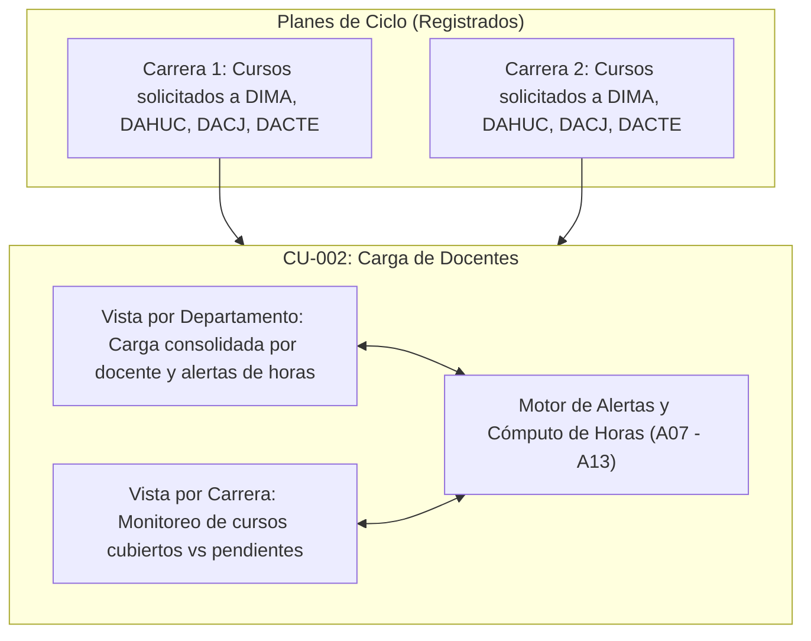

# CU-002: Carga de Docentes

**Universidad La Salle**  
**Sistema:** SISCargaLectiva  
**Caso de Uso:** CU-002, Carga de Docentes  
**Versión del documento:** 1.0 (2026-10-08). Especificación formal del caso de uso de asignación de carga docente por departamento académico (Fase 2 de la planificación de carga lectiva). Integra carga masiva desde Google Sheets y archivo .xlsx (CargaXDepartamento), grilla de asignación interactiva, control y advertencias de horas docentes (40h máximas, 16h externos TC, >24h alerta alta, <8h alerta baja, cruces de semestre en la misma carrera y cargos), cátedra compartida, asignación granular de teoría y subgrupos prácticos, docentes internacionales pendientes, registro de reemplazos e interconexión entre la Vista por Departamento y la Vista por Carrera.  
**Año:** 2026  
**Clasificación:** Confidencial  

---

## 1. Datos generales del caso de uso

### 1.1 Breve descripción del caso de uso

Este caso de uso describe cómo el **Director de departamento** asigna docentes a las asignaturas y grupos de todas las carreras profesionales que solicitaron cobertura a su departamento académico (DIMA, DAHUC, DACJ o DACTE) para un ciclo académico con planes de ciclo en estado **Registrado**.

El Director de departamento puede:

- Consultar en el Panel de Control de Carga Docente el avance de asignación en la Vista por Departamento y en la Vista por Carrera.
- Cargar asignaciones masivamente pegando un rango matricial desde Google Sheets o subiendo un archivo (.xlsx o .csv).
- Revisar en la rejilla de pegado de docentes la correspondencia de columnas y filas antes de procesar el contenido.
- Realizar asignaciones docentes de manera interactiva curso por curso, grupo por grupo o por componente.
- Configurar cátedra compartida asignando docentes independientes para las horas teóricas y las horas prácticas.
- Asignar docentes o jefes de práctica a cada subgrupo de laboratorio en grupos con desdoble parcial.
- Asignar docentes a grupos fusionados garantizando el cómputo horario único sin duplicidad.
- Registrar vacantes bajo la modalidad de Docente Internacional Pendiente cuando la plaza requiere gestión institucional externa.
- Registrar el reemplazo temporal o definitivo de un docente durante el ciclo con registro de motivo, fecha y vigencia para la firma de actas.
- Monitorear advertencias en tiempo real sobre la carga horaria acumulada de cada docente y sobre cruces curriculares.
- Guardar la asignación docente, generando una nueva versión en los planes de ciclo involucrados.

El sistema no rechaza asignaciones por discrepancias o superación de límites: advierte de forma visible y localizada, permitiendo al Director confirmar las asignaciones bajo su responsabilidad institucional.

---

### 1.2 Actores del caso de uso

| Actor | Descripción |
|---|---|
| **Director de departamento** | Autoridad académica responsable de los docentes adscritos a un departamento académico (DIMA, DAHUC, DACJ o DACTE). En este caso de uso asigna docentes a todas las asignaturas de cualquier carrera cuyo departamento solicitado coincida con el suyo, carga asignaciones masivas, edita horas y reemplazos, y guarda las versiones de asignación. |
| **Coordinador de carrera** | Autoridad académica responsable de una o más carreras profesionales. En este caso de uso consulta en modo de solo lectura el estado de cobertura docente de los cursos de sus carreras a través de la Vista por Carrera. |

---

### 1.3 Precondiciones

1. El usuario cuenta con una cuenta de correo institucional activa del dominio `@ulasalle.edu.pe`.
2. El usuario tiene asignado el rol de Director de departamento, con su departamento académico de adscripción configurado, o el rol de Coordinador de carrera.
3. El ciclo académico objetivo, por ejemplo `2026-1`, está registrado en el sistema.
4. El plan de ciclo de las carreras profesionales del ciclo se encuentra en estado **Registrado** (generado mediante CU-001).
5. El catálogo maestro de docentes se encuentra registrado en el sistema, con identificación, departamento de adscripción, condición laboral, categoría académica y condición de dedicación a tiempo completo en otra universidad.
6. El Director de departamento dispone de la información de asignación docente en una hoja de cálculo para su importación o la asigna interactivamente en la interfaz.

---

### 1.4 Glosario de términos

| Término | Descripción |
|---|---|
| **Advertencia** | Aviso que el sistema muestra ante un límite horario superado, carga insuficiente o cruce semestral, sin impedir nunca que el Director continúe. |
| **Asignación docente** | Vinculación de un profesor a una asignatura, grupo o componente específico para un ciclo académico. |
| **Bitácora de asignaciones** | Registro inmutable de cada asignación, edición o reemplazo docente con usuario, fecha, hora y motivo. |
| **Bloqueo de edición de carga** | Reserva exclusiva de la carga docente de un departamento académico para un solo Director. Los demás usuarios la visualizan en solo lectura. Expira tras 30 minutos de inactividad. |
| **Carga lectiva** | Horas semanales dedicadas estrictamente al dictado de clases presenciales o virtuales frente a estudiantes. |
| **Carga no lectiva** | Horas dedicadas a gestión directiva, comisiones, preparación y coordinación académica. Excluida del cómputo de carga lectiva semanal. |
| **Cátedra compartida** | Distribución del dictado de una misma asignatura o grupo entre dos o más docentes, separando horas teóricas y horas prácticas. |
| **Ciclo académico** | Periodo académico en el que se planifica y ejecuta la carga lectiva, por ejemplo `2026-1`. |
| **Condición docente** | Situación contractual del profesor (Ordinario o Contratado). |
| **Coordinador de carrera** | Docente responsable de los asuntos curriculares y formativos de una carrera profesional. |
| **Curso por jurado** | Modalidad extraordinaria de evaluación tutelar sin horas semanales de dictado regular. No computa horas en la carga lectiva semanal. |
| **DACJ** | Departamento Académico de Ciencias Jurídicas. |
| **DACTE** | Departamento Académico de Ciencias y Tecnologías Empresariales. |
| **DAHUC** | Departamento Académico de Humanidades y Comunicación. |
| **Dedicación docente** | Régimen horario del profesor en la universidad: Tiempo Completo (TC, 40 horas semanales) o Tiempo Parcial (TP, menos de 40 horas semanales). |
| **Desdoble parcial de práctica** | Subdivisión de un grupo donde la teoría se dicta junta y la práctica se separa en dos o más subgrupos de laboratorio. |
| **Desdoble parcial de teoría** | Subdivisión de un grupo donde la práctica se dicta junta y la teoría se separa en dos o más subgrupos. |
| **DIMA** | Departamento Académico de Ingeniería y Matemáticas. |
| **Director de departamento** | Autoridad responsable de la gestión de la plana docente adscrita a un departamento académico. |
| **Docente a tiempo completo en otra universidad** | Profesor con vínculo laboral de 40 horas semanales en otra institución universitaria. El sistema vigila que su carga lectiva local no supere las 16 horas semanales. |
| **Docente con cargo administrativo** | Profesor que desempeña cargos de decanatura, dirección o coordinación con reserva de horas no lectivas. El sistema vigila que su dictado no supere las 20 horas semanales. |
| **Docente internacional pendiente** | Registro de plaza reservada para un docente internacional gestionado mediante el área de Internacionalización, pendiente de confirmación nominativa. |
| **Fusión de grupos** | Integración de dos o más grupos de estudiantes en una sección de dictado común. Sus horas computan una sola vez para el docente asignado. |
| **Grilla de Asignación Docente** | Tabla interactiva que organiza los cursos solicitados por carrera, semestre y grupo con sus docentes vinculados y cómputo de horas. |
| **Grupo** | Sección de dictado de una asignatura identificada correlativamente. |
| **HP** | Horas prácticas semanales de una asignatura o subgrupo. |
| **HT** | Horas teóricas semanales de una asignatura. |
| **Jefe de práctica** | Profesional encargado de la conducción de las horas prácticas o sesiones de laboratorio. |
| **Panel de Control de Carga Docente** | Pantalla principal que resume el avance de cobertura docente por departamento y carrera. |
| **Plantilla oficial de carga docente** | Estructura de columnas reconocida por el sistema: DOCENTE, CARRERA, MALLA, SEMESTRE, CÓDIGO, ASIGNATURA, HT, HP, CONDICIÓN y TIPO_HORA. |
| **Reemplazo docente** | Sustitución de un docente asignado debido a licencia médica, gravidez u otra eventualidad durante el semestre. |
| **Rejilla de pegado de docentes** | Área con apariencia de hoja de cálculo donde el texto tabulado copiado se distribuye en celdas antes de su procesamiento. |
| **Subgrupo de práctica** | División específica de laboratorio dentro de un desdoble parcial. |
| **TH** | Total de horas semanales calculadas para un grupo o subgrupo. |
| **Vista por Carrera** | Modalidad de visualización que agrupa las asignaturas por programa profesional para identificar cursos pendientes de profesor. |
| **Vista por Departamento** | Modalidad de visualización que agrupa la carga por cada docente adscrito al departamento para monitorear horas acumuladas y alertas. |

---

# 2. Flujo de eventos

## 2.1 Flujo básico

| Paso | Responsable | Acción |
|---:|---|---|
| 1 | Actor | Accede a la URL del sistema. |
| 2 | Actor | Presiona **Acceder con Google**. |
| 3 | Sistema | Redirige al proveedor de identidad Google. |
| 4 | Actor | Se autentica con su cuenta de correo institucional. |
| 5 | Sistema | Comprueba el emisor, el destinatario y la vigencia del token de identidad recibido. |
| 6 | Sistema | Valida que el correo autenticado pertenezca al dominio `@ulasalle.edu.pe`. |
| 7 | Sistema | Determina el rol del usuario como Director de departamento. |
| 8 | Sistema | Despliega el menú principal con las opciones autorizadas. |
| 9 | Actor | Selecciona **Carga de Docentes**. |
| 10 | Sistema | Consulta los ciclos académicos registrados. |
| 11 | Sistema | Muestra la pantalla de carga de docentes con el selector de ciclo académico. |
| 12 | Actor | Selecciona el ciclo académico objetivo. |
| 13 | Sistema | Consulta las asignaturas solicitadas al departamento académico del Director en los planes registrados de todas las carreras. |
| 14 | Sistema | Muestra el Panel de Control de Carga Docente en la Vista por Departamento (docentes adscritos, horas lectivas acumuladas, cantidad de cursos asignados, alertas vigentes). |
| 15 | Sistema | Habilita los controles de carga masiva, asignación interactiva y conmutación de vista. |
| 16 | Actor | Presiona **Cargar asignación de docentes**. |
| 17 | Sistema | Verifica que ningún otro usuario tenga bloqueada la edición de la carga del departamento. |
| 18 | Sistema | Bloquea la carga docente del departamento para edición exclusiva del Director. |
| 19 | Sistema | Inicia el contador de la sesión de edición. |
| 20 | Sistema | Muestra las opciones: - **Pegar desde Google Sheets**. - **Subir archivo**. - **Descargar plantilla oficial de docentes**. |
| 21 | Actor | Selecciona **Pegar desde Google Sheets**. |
| 22 | Sistema | Muestra la rejilla de pegado de docentes vacía. |
| 23 | Actor | Copia el rango de celdas desde Google Sheets. |
| 24 | Actor | Pega el rango en la rejilla de pegado de docentes. |
| 25 | Sistema | Reconstruye la matriz de filas y columnas a partir del texto recibido. |
| 26 | Sistema | Dibuja el contenido en la rejilla de pegado de docentes (cabecera de cada columna, número de cada fila, valor de cada celda). |
| 27 | Sistema | Indica el resultado de la lectura (cantidad de filas, cantidad de columnas, fila reconocida como cabecera). |
| 28 | Actor | Revisa el contenido dibujado en la rejilla de pegado de docentes. |
| 29 | Actor | Presiona **Procesar asignación**. |
| 30 | Sistema | Normaliza las cabeceras sin distinguir mayúsculas, tildes ni espacios al inicio y al final. |
| 31 | Sistema | Localiza cada asignatura y grupo en el plan registrado del ciclo por carrera, semestre, código y grupo. |
| 32 | Sistema | Verifica que el departamento requerido en la asignatura coincida con el departamento del Director. |
| 33 | Sistema | Asocia al docente indicado con la asignatura y grupo correspondiente. |
| 34 | Sistema | Identifica el componente horario asignado (horas teóricas, horas prácticas o subgrupo de práctica). |
| 35 | Sistema | Calcula las horas lectivas semanales acumuladas de cada docente en todas las carreras. |
| 36 | Sistema | Evalúa las advertencias de carga horaria acumulada y cruces semestrales para cada docente. |
| 37 | Sistema | Muestra la Grilla de Asignación Docente con las asignaciones vinculadas y las advertencias localizadas. |
| 38 | Actor | Revisa las asignaciones en la Grilla de Asignación Docente. |
| 39 | Actor | Presiona **Guardar asignación**. |
| 40 | Sistema | Muestra un modal de confirmación (resumen consolidado de docentes, total de horas cubiertas, advertencias vigentes). |
| 41 | Actor | Presiona **Confirmar y guardar**. |
| 42 | Sistema | Almacena las asignaciones en los planes de ciclo correspondientes como una nueva versión. |
| 43 | Sistema | Anota el guardado en la bitácora de asignaciones (usuario, departamento, ciclo, fecha y hora, total de cursos cubiertos). |
| 44 | Sistema | Libera el bloqueo de edición de la carga. |
| 45 | Sistema | Actualiza los indicadores de cobertura en el Panel de Control de Carga Docente. |
| 46 | Sistema | Muestra la confirmación del guardado (departamento, ciclo, versión guardada, cantidad de grupos cubiertos). |
| 47 | — | Fin del caso de uso. |

---

## 2.2 Flujos alternativos

### FA-001: Carga de asignaciones desde un archivo

1. En el paso 20 del flujo básico, el Director selecciona **Subir archivo**.
2. El sistema muestra la sección de importación de archivos.
3. El Director selecciona el archivo (.xlsx o .csv).
4. El sistema lee el archivo como libro de cálculo.
5. El sistema reconstruye la matriz de filas y columnas a partir de la hoja leída.
6. El flujo continúa en el paso 30 del flujo básico.

### FA-002: Selección de hoja en un libro con varias hojas

1. En el paso 4 del FA-001, el sistema detecta que el libro contiene más de una hoja.
2. El sistema muestra la lista de hojas del libro.
3. El Director selecciona la hoja correspondiente a su departamento.
4. El sistema lee el contenido de la hoja seleccionada.
5. El flujo continúa en el paso 5 del FA-001.

### FA-003: Archivo de asignaciones que el sistema no lee como libro de cálculo

1. En el paso 4 del FA-001, el sistema no consigue leer el archivo como libro de cálculo.
2. El sistema lee el archivo como texto plano.
3. El sistema separa las columnas por tabulaciones, comas o punto y coma.
4. El flujo continúa en el paso 30 del flujo básico.

### FA-004: Carga de asignaciones arrastrando un archivo sobre la rejilla

1. En el paso 22 del flujo básico, el Director arrastra un archivo sobre la rejilla de pegado de docentes.
2. El sistema resalta la rejilla de pegado mientras el archivo está encima.
3. El Director suelta el archivo sobre la rejilla de pegado.
4. El sistema reconstruye la matriz de filas y columnas a partir del archivo.
5. El flujo continúa en el paso 26 del flujo básico.

### FA-005: Descarga de la plantilla oficial de docentes

1. En el paso 20 del flujo básico, el Director selecciona **Descargar plantilla oficial de docentes**.
2. El sistema genera la plantilla con las cabeceras oficiales: - DOCENTE. - CARRERA. - MALLA. - SEMESTRE. - CÓDIGO. - ASIGNATURA. - HT. - HP. - CONDICIÓN. - TIPO_HORA.
3. El sistema entrega la plantilla al Director.
4. El flujo regresa al paso 20 del flujo básico.

### FA-006: Contenido sin cabeceras reconocibles

1. En el paso 30 del flujo básico, el sistema no reconoce las cabeceras de la plantilla.
2. El sistema examina el contenido de cada columna.
3. El sistema deduce la columna DOCENTE por nombres del catálogo de profesores.
4. El sistema deduce CÓDIGO y CARRERA por el formato de código institucional y sigla.
5. El sistema descarta las columnas no identificables.
6. El flujo continúa en el paso 31 del flujo básico.

### FA-007: Asignación interactiva manual curso por curso

1. En el paso 15 del flujo básico, el Director selecciona una fila de asignatura en la Grilla de Asignación Docente.
2. El Director presiona **Asignar docente**.
3. El sistema muestra un modal con el buscador de docentes adscritos al departamento.
4. El Director escribe el apellido o nombre del docente.
5. El sistema filtra las coincidencias del catálogo docente en tiempo real.
6. El Director selecciona al docente deseado.
7. El sistema vincula al docente con la asignatura y grupo.
8. El sistema recalcula las horas semanales acumuladas del docente.
9. El sistema actualiza las advertencias en la fila seleccionada.
10. El flujo regresa al paso 38 del flujo básico.

### FA-008: Asignación de cátedra compartida dividiendo teoría y práctica

1. En el paso 38 del flujo básico, el Director selecciona **Configurar cátedra compartida** sobre una asignatura con HT > 0 y HP > 0.
2. El sistema muestra el formulario de asignación discriminada por componente.
3. El Director selecciona al docente encargado de las horas teóricas.
4. El Director selecciona al docente o jefe de práctica encargado de las horas prácticas.
5. El Director confirma la distribución.
6. El sistema computa las HT exclusivamente al docente de teoría.
7. El sistema computa las HP exclusivamente al docente de práctica.
8. El sistema actualiza el conteo de horas y advertencias de ambos profesores.
9. El flujo regresa al paso 38 del flujo básico.

### FA-009: Asignación a subgrupos de práctica en grupos con desdoble parcial

1. En el paso 38 del flujo básico, el Director selecciona una asignatura con desdoble parcial de práctica.
2. El sistema despliega la lista de subgrupos prácticos configurados en el plan.
3. El Director selecciona un subgrupo específico.
4. El Director asigna al docente o jefe de práctica de ese subgrupo.
5. El sistema computa las horas prácticas del subgrupo exclusivamente al profesor asignado.
6. El sistema actualiza las advertencias de carga del profesor.
7. El flujo regresa al paso 38 del flujo básico.

### FA-010: Asignación a secciones fusionadas

1. En el paso 33 del flujo básico o durante la asignación manual, el Director asigna un docente a un grupo que forma parte de una fusión.
2. El sistema identifica los grupos participantes en la fusión.
3. El sistema vincula al docente en todos los grupos de la sección fusionada.
4. El sistema computa las horas de la sección una sola vez en la carga acumulada del docente.
5. El flujo continúa en el paso 35 del flujo básico.

### FA-011: Registro de vacante bajo modalidad de Docente Internacional Pendiente

1. En el paso 38 del flujo básico, el Director selecciona una asignatura clasificada como internacional o virtual.
2. El Director presiona **Marcar como Internacional Pendiente**.
3. El sistema asigna el indicador institucional de vacante pendiente de nombramiento exterior.
4. El sistema mantiene la plaza en estado cubierto para la carrera sin sumar horas a ninguna persona física.
5. El flujo regresa al paso 38 del flujo básico.

### FA-012: Reemplazo de docente durante el semestre

1. En el paso 38 del flujo básico, el Director selecciona **Reemplazar docente** sobre una asignatura con profesor asignado.
2. El sistema solicita los datos del reemplazo (nuevo docente, motivo del cambio, fecha de efectividad).
3. El Director completa los campos requeridos.
4. El Director confirma la acción.
5. El sistema registra al docente anterior como titular histórico en la bitácora de asignaciones.
6. El sistema coloca al nuevo docente como profesor vigente y firmante de actas.
7. El sistema traslada el cómputo de horas lectivas semanales al nuevo profesor.
8. El flujo regresa al paso 38 del flujo básico.

### FA-013: Conmutación a la Vista por Carrera

1. En el paso 15 o 38 del flujo básico, el Director presiona **Ver por Carrera**.
2. El sistema agrupa la oferta académica por carrera profesional y semestre.
3. El sistema resalta con distintivo visual las asignaturas y grupos que carecen de docente asignado.
4. El Director revisa el estado de cobertura general.
5. El Director presiona **Ver por Departamento**.
6. El sistema restablece la visualización organizada por profesores del departamento.
7. El flujo regresa al paso 38 del flujo básico.

### FA-014: Filtrado y búsqueda de asignaturas pendientes en la Vista por Carrera

1. En la Vista por Carrera (paso 3 del FA-013), el Director activa el filtro **Solo asignaturas sin docente**.
2. El sistema oculta los cursos que ya cuentan con profesor asignado.
3. El Director selecciona una asignatura pendiente para asignarle docente directamente.
4. El flujo continúa en el paso 3 del FA-007.

### FA-015: Modificación interactiva de docente asignado

1. En el paso 38 del flujo básico, el Director selecciona una asignatura con docente asignado y presiona **Cambiar docente**.
2. El sistema abre el selector de profesores adscritos.
3. El Director selecciona al nuevo profesor.
4. El sistema descuenta las horas al profesor anterior.
5. El sistema suma las horas al nuevo profesor.
6. El sistema recalcula las advertencias horarias de ambos docentes.
7. El flujo regresa al paso 38 del flujo básico.

### FA-016: Retiro de asignación docente en una asignatura

1. En el paso 38 del flujo básico, el Director selecciona una asignatura y presiona **Desasignar docente**.
2. El sistema solicita confirmación del retiro.
3. El Director confirma la acción.
4. El sistema elimina la vinculación docente de la asignatura.
5. El sistema descuenta las horas lectivas del cómputo del profesor.
6. El sistema marca la asignatura como pendiente de cobertura.
7. El flujo regresa al paso 38 del flujo básico.

### FA-017: Detección de docente no registrado en el catálogo maestro

1. En el paso 31 del flujo básico, el sistema detecta que el nombre del docente no coincide con ningún registro del catálogo maestro.
2. El sistema conserva el texto del docente como asignación nominativa provisional.
3. El sistema muestra una advertencia localizada indicando que el profesor no se encuentra en el catálogo oficial.
4. El flujo continúa en el paso 34 del flujo básico.

### FA-018: Asignación a una asignatura perteneciente a otro departamento

1. En el paso 32 del flujo básico, el sistema detecta que el curso importado tiene configurado un departamento académico distinto al del Director.
2. El sistema no bloquea la carga.
3. El sistema muestra una advertencia localizada indicando la discrepancia departamental (A13).
4. El sistema mantiene la asignación bajo confirmación del Director.
5. El flujo continúa en el paso 33 del flujo básico.

### FA-019: Advertencia por docente que supera 40 horas lectivas semanales

1. En el paso 36 del flujo básico o durante la asignación manual, el sistema detecta que la carga acumulada del docente excede las 40 horas semanales.
2. El sistema genera la advertencia A07 en la celda y en el panel consolidado.
3. El sistema resalta las horas del profesor con distintivo de sobrecarga extrema.
4. El flujo continúa en el paso 37 del flujo básico.

### FA-020: Advertencia por docente a tiempo completo en otra universidad que supera 16 horas lectivas

1. En el paso 36 del flujo básico o durante la asignación manual, el sistema detecta que el docente marcado como tiempo completo en otra universidad acumula más de 16 horas semanales.
2. El sistema genera la advertencia A08 en la celda y en el panel consolidado.
3. El sistema resalta al profesor con distintivo de incompatibilidad horaria externa.
4. El flujo continúa en el paso 37 del flujo básico.

### FA-021: Advertencia por docente que supera 24 horas lectivas semanales

1. En el paso 36 del flujo básico o durante la asignación manual, el sistema detecta que la carga acumulada del docente supera las 24 horas semanales sin sobrepasar las 40 horas.
2. El sistema genera la advertencia A09 resaltando al profesor en color amarillo.
3. El flujo continúa en el paso 37 del flujo básico.

### FA-022: Advertencia por docente con menos de 8 horas lectivas semanales

1. En el paso 36 del flujo básico, el sistema detecta que un docente regular acumula menos de 8 horas semanales.
2. El sistema genera la advertencia A10 señalando carga lectiva baja.
3. El flujo continúa en el paso 37 del flujo básico.

### FA-023: Advertencia por docente asignado a dos asignaturas distintas en el mismo semestre dentro de la misma carrera

1. En el paso 36 del flujo básico o durante la asignación manual, el sistema detecta que un profesor tiene asignadas dos asignaturas distintas dentro del mismo semestre y malla curricular de una misma carrera.
2. El sistema verifica si ambas asignaturas corresponden a grupos paralelos del mismo curso.
3. El sistema comprueba que son asignaturas curriculares diferentes.
4. El sistema genera la advertencia A11 indicando cruce curricular indebido.
5. El flujo continúa en el paso 37 del flujo básico.

### FA-024: Advertencia por docente con cargo administrativo que supera 20 horas lectivas

1. En el paso 36 del flujo básico o durante la asignación manual, el sistema detecta que un profesor registrado con cargo administrativo acumula más de 20 horas lectivas semanales.
2. El sistema genera la advertencia A12 por sobrecarga de dedicación directiva.
3. El flujo continúa en el paso 37 del flujo básico.

### FA-025: Reemplazo total de asignaciones mediante una nueva carga masiva

1. En el paso 38 del flujo básico, el Director presiona **Reemplazar asignaciones**.
2. El sistema muestra un modal advirtiendo que se sobrescribirán las asignaciones actuales del departamento en el ciclo.
3. El Director confirma el reemplazo.
4. El flujo continúa en el paso 20 del flujo básico.

### FA-026: Consulta de asignaciones en modo de solo lectura

1. En el paso 8 del flujo básico, un Coordinador de carrera accede a **Carga de Docentes**.
2. El sistema detecta el rol de Coordinador de carrera.
3. El sistema abre automáticamente el Panel de Control en la Vista por Carrera en modo de solo lectura.
4. El sistema inhabilita los botones de edición y carga masiva.
5. El Coordinador consulta qué profesores fueron asignados a los cursos de su carrera.
6. El Coordinador cierra la consulta.
7. Fin del caso de uso.

### FA-027: Carga docente bloqueada por otro usuario

1. En el paso 17 del flujo básico, el sistema detecta que otro usuario mantiene bloqueada la carga docente del departamento.
2. El sistema informa el nombre del usuario y la hora de inicio del bloqueo.
3. El sistema abre la grilla en modo de solo lectura.
4. Fin del caso de uso.

### FA-028: Cancelación de una ventana de confirmación

1. En cualquier modal de confirmación o formulario emergente, el Director presiona **Cancelar**.
2. El sistema cierra la ventana sin guardar modificaciones.
3. El sistema conserva la grilla en su estado previo.
4. El flujo regresa al paso 38 del flujo básico.

### FA-029: Salida de la edición sin guardar

1. En el paso 38 del flujo básico, el Director presiona **Salir sin guardar**.
2. El sistema advierte sobre la existencia de modificaciones pendientes.
3. El Director confirma la salida.
4. El sistema revierte los cambios a la última versión guardada.
5. El sistema libera el bloqueo de edición.
6. El flujo regresa al paso 14 del flujo básico.

### FA-030: Expiración del bloqueo por inactividad

1. Durante el paso 38 del flujo básico, transcurre el tiempo límite de inactividad configurado (30 minutos por defecto).
2. El sistema efectúa el guardado automático de los cambios como una nueva versión.
3. El sistema registra el autoguardado en la bitácora de asignaciones.
4. El sistema libera el bloqueo de edición.
5. El sistema muestra una notificación comunicando el cierre de la sesión de edición por inactividad.
6. El flujo regresa al paso 14 del flujo básico.

### FA-031: Acceso denegado por cuenta ajena al dominio institucional

1. En el paso 6 del flujo básico, el sistema detecta que la cuenta no pertenece al dominio `@ulasalle.edu.pe`.
2. El sistema muestra el mensaje de restricción institucional.
3. El sistema destruye la sesión iniciada.
4. Fin del caso de uso.

### FA-032: Acceso denegado por falta de rol autorizado

1. En el paso 7 del flujo básico, el sistema no identifica los roles de Director de departamento ni Coordinador de carrera asociados al usuario.
2. El sistema muestra el mensaje: *"Acceso denegado. La cuenta no cuenta con permisos para gestionar ni consultar la carga docente. Contacte con la administración del sistema."*
3. El sistema destruye la sesión iniciada.
4. Fin del caso de uso.

---

## 3. Reglas de negocio y validaciones

### 3.1 Reglas generales

| ID | Regla |
|---|---|
| RN-23 | El Director de departamento asigna docentes a todas las asignaturas y grupos de cualquier carrera profesional cuyo campo DPTO coincide con su departamento académico en el ciclo seleccionado. |
| RN-24 | La autenticación se realiza mediante Google OAuth 2.0 con cuentas obligatoriamente pertenecientes al dominio institucional `@ulasalle.edu.pe`. |
| RN-25 | El Coordinador de carrera accede a la información de asignación docente exclusivamente en modo de solo lectura para las carreras que tiene asignadas. |
| RN-26 | La asignación de docentes opera sobre planes de ciclo en estado Registrado y no crea estados de ciclo independientes. Cada guardado de asignaciones genera una nueva versión en los planes afectados. |
| RN-27 | Solo un Director edita la carga de su departamento a la vez. El bloqueo de edición expira tras 30 minutos de inactividad, ejecutando un autoguardado preventivo. |
| RN-28 | En asignaturas fusionadas, las horas lectivas se computan una sola vez al docente asignado, calculándose sobre el grupo principal de la fusión. |
| RN-29 | En asignaturas con desdoble parcial de práctica o cátedra compartida, el sistema permite la asignación independiente de docentes para teoría y para cada subgrupo práctico, distribuyendo las horas según corresponda. |
| RN-30 | La marcación de Docente Internacional Pendiente reserva la vacante académica sin asignar horas a ninguna persona física ni activar alertas de sobrecarga horaria. |
| RN-31 | El reemplazo docente registra al docente saliente como titular histórico en la bitácora y coloca al nuevo profesor como titular vigente para efectos del cómputo lectivo y suscripción de actas finales. |
| RN-32 | Las horas computadas en este caso de uso son estrictamente lectivas semanales. La labor no lectiva, la investigación institucional y los cursos por jurado no suman horas en la carga lectiva semanal. |
| RN-33 | El sistema aplica el principio de advertir y no bloquear: ninguna regla horaria o discrepancia de departamento rechaza destructivamente la operación; el sistema alerta de forma visible y permite guardar bajo confirmación del Director. |

---

### 3.2 Reglas de error

Ninguna. Siguiendo el principio de arquitectura de información del sistema y la decisión P83, el sistema no bloquea la asignación docente por validaciones rígidas ni impide completar guardados. Todas las restricciones se gestionan a través de advertencias visibles y confirmación informada.

---

### 3.3 Advertencias (nunca bloquean la acción del Director)

| ID | Regla |
|---|---|
| A07 | La carga lectiva semanal acumulada de un docente supera las 40 horas en la universidad. |
| A08 | El docente tiene dedicación a tiempo completo en otra universidad y su carga lectiva local acumulada supera las 16 horas semanales. |
| A09 | La carga lectiva semanal acumulada de un docente supera las 24 horas en la universidad. |
| A10 | La carga lectiva semanal acumulada de un docente regular a tiempo parcial es inferior a 8 horas semanales. |
| A11 | El docente se encuentra asignado a dos o más asignaturas curriculares distintas dentro del mismo semestre de una misma carrera profesional. |
| A12 | El docente desempeña un cargo administrativo con horas no lectivas y su carga lectiva semanal supera las 20 horas. |
| A13 | La asignatura asignada posee en el plan de ciclo un departamento académico solicitado diferente al departamento del Director que realiza la asignación. |

---

## 4. Requisitos especiales

| ID | Requisito |
|---|---|
| RE-08 | El sistema autentica a los usuarios mediante Google OAuth 2.0 validando la pertenencia al dominio `@ulasalle.edu.pe` en el servidor. |
| RE-09 | El sistema calcula de forma reactiva y en tiempo real el balance de horas lectivas acumuladas por docente en todas las carreras del ciclo ante cada asignación. |
| RE-10 | El sistema valida las autorizaciones de acceso y edición en el servidor, garantizando que un Director solo modifique cursos correspondientes a su departamento académico. |
| RE-11 | Cada operación de guardado o autoguardado de asignaciones se ejecuta como una transacción atómica, actualizando la versión del plan y la bitácora de auditoría. |
| RE-12 | El tiempo de expiración del bloqueo de edición de carga es configurable, estableciéndose por defecto en 30 minutos. |
| RE-13 | La interfaz presenta conmutación inmediata entre la Vista por Departamento y la Vista por Carrera sin recargar la página. |
| RE-14 | La interfaz se presenta en idioma español y los registros horarios se expresan con fechas en la zona horaria `America/Lima`. |

---

## 5. Modelo operativo de asignación y vistas

El caso de uso estructura la gestión docente en dos perspectivas operativas complementarias:

- **Vista por Departamento:** Permite al Director de departamento visualizar a su plana docente, fiscalizar el cumplimiento de topes semanales (40h, 24h, 16h y 8h) y asignar profesores a los cursos que las carreras le han solicitado.
- **Vista por Carrera:** Permite tanto al Director como al Coordinador de carrera fiscalizar en tiempo real qué asignaturas y grupos cuentan ya con docente y cuáles permanecen en estado pendiente.

---

## 6. Resumen funcional

El caso de uso CU-002 cubre la asignación, fiscalización y mantenimiento de la carga lectiva de los docentes por departamento académico:

1. Autenticación y verificación de roles para Directores de departamento y Coordinadores de carrera.
2. Consulta de avance y cobertura mediante la Vista por Departamento y la Vista por Carrera.
3. Reserva de edición mediante bloqueo exclusivo por departamento académico.
4. Carga masiva de asignaciones pegando datos desde Google Sheets o subiendo archivos de hoja de cálculo.
5. Asignación granular interactiva curso por curso, grupo por grupo y por subgrupo de práctica.
6. Soporte para cátedra compartida discriminando horas de teoría y horas de práctica.
7. Cómputo horario unificado sin duplicidad en cursos fusionados.
8. Registro de plazas bajo modalidad de Docente Internacional Pendiente.
9. Gestión de reemplazos docentes por licencia médica o gravidez con trazabilidad histórica.
10. Motor de alertas horarias reactivas (40h, 16h, 24h, 8h, cruces de semestre y cargos).
11. Versionado atómico y registro inmutable en bitácora de auditoría.

El documento define **32 flujos alternativos**.

---

## 7. Historial de versiones del documento

- **v1.0 (2026-10-08):** Redacción inicial del caso de uso CU-002: Carga de Docentes, derivado de los requerimientos y precisiones del docente (`docs/requerimientos/pavulrequerimientos.md`) y las decisiones de diseño P82 a P90. Establece el flujo primario de carga masiva por departamento con edición interactiva, el principio de advertencias sin bloqueo destructivo (A07–A13), la asignación por componentes para cátedra compartida y desdobles, la gestión de vacantes internacionales pendientes y la bitácora de reemplazos. Sigue el formato estricto de la plantilla oficial de casos de uso del proyecto.
