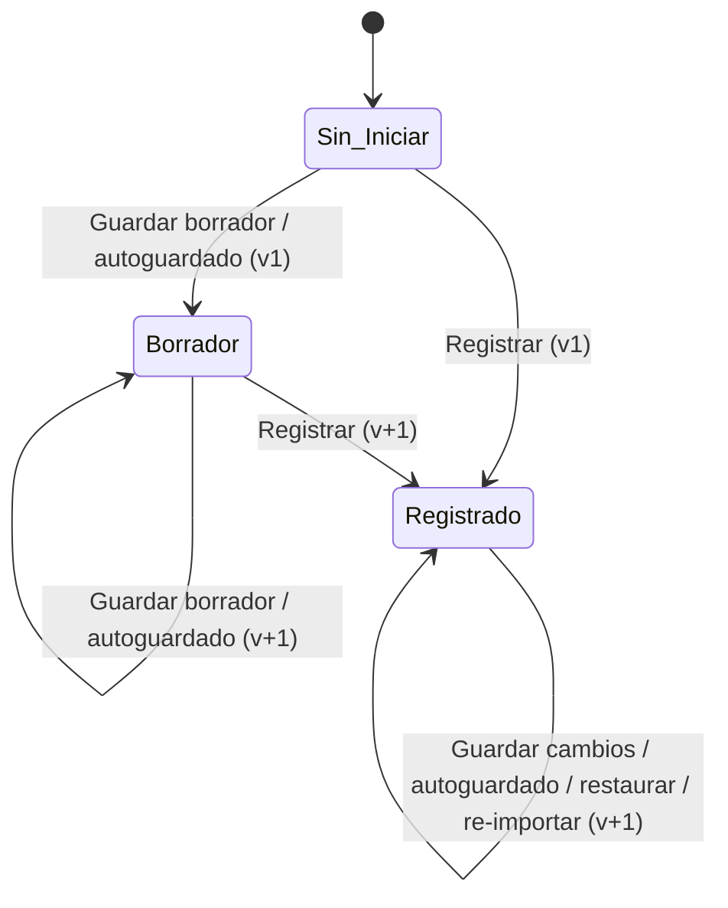

# Requerimientos: SISCargaLectiva

**Universidad La Salle (Arequipa)**. Sistema de gestión de la carga lectiva docente.

| Campo | Valor |
|---|---|
| Versión del documento | 1.1 |
| Fecha | 2026-09-29 |
| Fase actual | **Fase 1: CU-001 Registrar Plan de Ciclo** |
| Fuentes | `docs/feedback/transcripcion.md` (clase del docente), `docs/feedback/flujobasico.md` (1.ª revisión), `docs/feedback/flujosalternativos.md` (2.ª revisión), `docs/CU/CUs-Carga lectiva.png` (diagrama de CU), `docs/QA/Checklist.md`, `docs/archivos/*.xlsx` (datos reales) |
| Decisiones del equipo | Resumidas en la sección 10. El detalle P01–P45 está en `preguntas.md` (archivo local, excluido del repositorio por `.gitignore`). Las decisiones del 2026-09-29, que llevan la etiqueta **[2026-09-29]**, solo constan en la sección 10. |
| Cambios de la v1.1 | Stack en Google Apps Script con los `.xlsx` de Drive como fuente de datos (sección 9 y 10); sección 8 alineada con CU-001 v4.0, que interpreta el contenido en vez de validarlo; nuevas preguntas abiertas Q15 y Q16. |

> **Regla de lectura.** Cada requisito indica su fuente: **[D]** docente (transcripción o revisiones), **[P##]** decisión del equipo registrada en `preguntas.md`, **[X]** hallazgo en los archivos `.xlsx`. Lo que no tiene fuente confirmada figura en la sección 15, *Preguntas abiertas*, y no se implementa hasta resolverse.

---

## 1. Propósito

La universidad asigna hoy la carga lectiva en varios Google Sheets separados: uno por carrera y otro por departamento. Hay que mantenerlos sincronizados a mano, lo que provoca errores de horas, docentes mal asignados y confusión entre versiones ("versión última, última, última"). **[D]**

El sistema debe centralizar la información en **un solo registro**. Los listados por carrera, por departamento y por docente pasan a ser **reportes** generados a partir de ese registro. **[D]**

---

## 2. Contexto del dominio

| Concepto | Descripción |
|---|---|
| **Carrera** | Programa profesional (Ingeniería de Software, Derecho…). Se organiza en torno a los **estudiantes**. La dirige un **Coordinador de carrera**. **[D]** |
| **Departamento académico** | Agrupa a los **docentes**. Lo dirige un **Director de departamento**, que proporciona docentes a todas las carreras que los necesitan. Son cuatro: DIMA, DAHU, DACJ y DACTE. **[D]** |
| **Carga lectiva** | Asignación de docentes para dictar cursos en un ciclo. Se distingue de la carga **no lectiva** (labores administrativas o de coordinación) y de la **investigación**, que están fuera de alcance. **[D]** |
| **Ciclo** | Periodo académico en el que se planifica la carga (p. ej. `2026-2`, `2027-1`). La carga se planifica **ciclo por ciclo**. **[D]** |
| **Semestre** | Nivel dentro del plan de estudios (1.º, 2.º…). El número de semestres **varía por carrera**: Derecho llega a 12 y Psicología, por ser nueva, tiene menos. No se fija un número. **[D]** |
| **Plan de estudios / malla** | Currícula aprobada (2016, 2021, 2022, 2024…). En un mismo ciclo conviven cursos de varias mallas mientras la antigua va saliendo. El sufijo del código indica la malla (`…21`, `…24`). **[D]** |
| **Plan de ciclo** | Cursos y grupos que **cada carrera** apertura en un ciclo. Cada carrera lo registra por separado, en momentos distintos y con usuarios distintos. El conjunto de todas las carreras forma el plan de ciclo de la universidad. **[D]** |
| **Grupo** | Sección de dictado de una asignatura. Puede haber varios grupos, por ejemplo en semestres iniciales a inicio de año o cuando hay muchos desaprobados. **[D]** |
| **Fusión** | Se juntan en un solo grupo estudiantes de distintas mallas o carreras que llevan el "mismo" curso. Es un proceso interno, no normado por la Ley Universitaria. Mandan las horas y los créditos, no el nombre exacto. **[D]** |
| **Desdoble** | División de un grupo. **Total:** todas las horas (en el sistema es *Agregar grupo*, P15). **Parcial:** solo las horas prácticas (típico en laboratorios de Arquitectura e Industrial) o solo las teóricas. **[D][P16]** |
| **Docente internacional / virtual** | Dicta en forma virtual desde fuera de Arequipa. No necesariamente es extranjero. Se marca de forma especial. **[D]** |
| **Tiempo completo / parcial** | TC = 40 h/semana, que deben cubrirse. Menos de 40 h es TP. Aplica a la fase de asignación docente. **[D]** |
| **Curso por jurado** | Curso que salió de la malla y se ofrece por jurado **durante** el ciclo. Es un **caso de uso separado**, fuera de la carga lectiva inicial. **[D]** |

---

## 3. Actores y roles

| Rol | Descripción | Fase 1 |
|---|---|---|
| **Coordinador de carrera** | Define qué cursos y cuántos grupos se abren en su carrera. Especializa a *Responsable del plan de ciclo*. **[D]** | Registra y edita el plan **solo de sus carreras asignadas**. Consulta el de las demás en solo lectura. **[P17][P43]** |
| **Director de departamento** | Asigna docentes al plan registrado. También especializa a *Responsable del plan de ciclo*. **[D][diagrama]** | Registra y edita el plan de **cualquier carrera**. **[P17]** |
| **Administrador** | Administra los ciclos. **[diagrama]** | Sin pantallas propias en fase 1: los datos maestros se cargan por migraciones (seed). **[P29]** |

*Responsable del plan de ciclo* es un **rol abstracto** (generalización del diagrama): no se asigna directamente a los usuarios.

---

## 4. Alcance por fases

| Fase | Caso de uso | Actor | Estado |
|---|---|---|---|
| **1** | **CU-001 Registrar plan de ciclo** (extensiones: agregar grupo, quitar grupo, dividir grupos, fusionar grupos) | Responsable del plan de ciclo | **En curso** |
| 2 | Administrar ciclos | Administrador | Futuro |
| 3 | Asignar docentes a plan de ciclo | Director de departamento | Futuro |
| 4 | Generar reporte de carga lectiva (extensiones: por carrera, por departamento, por docente) | Director de departamento | Futuro |
| 5 | Asignar docentes a cursos por jurado | Por definir | Futuro (el docente anunció que lo agregará) |

**Fuera de alcance:** estudiantes y matrícula; la decisión de abrir o cerrar grupos (la toman las autoridades, el sistema solo la registra); aforo mínimo y alumnos proyectados **[P03]**; horarios; carga no lectiva e investigación; notificaciones por correo en fase 1 **[P30]**; cálculo de créditos en fase 1 **[P26]**.

---

## 5. Requisitos funcionales: fase 1 (CU-001)

### 5.1 Acceso

| ID | Requisito | Fuente |
|---|---|---|
| RF-001 | El usuario se autentica con **Google OAuth 2.0** usando una cuenta del dominio `@ulasalle.edu.pe`. | CU-001 |
| RF-002 | El sistema autoriza según el rol (Coordinador de carrera o Director de departamento) y, para el Coordinador, según sus carreras asignadas. Si el usuario no tiene rol, se deniega el acceso y se destruye la sesión. | CU-001, [P17] |

### 5.2 Tablero de monitoreo general

| ID | Requisito | Fuente |
|---|---|---|
| RF-010 | El usuario elige un **ciclo** (actual, futuro o anterior) en un selector. Los ciclos anteriores se ven con la misma pantalla y el mismo detalle, no mediante la bitácora. | [D] 1.ª revisión |
| RF-011 | Para el ciclo elegido se muestra el **tablero de todas las carreras** con estado del plan (*Sin Iniciar*, *Borrador*, *Registrado*), número de semestres cargados, número de asignaturas, número de grupos, total de horas semanales, versión vigente, última modificación (usuario y fecha) y quién lo está editando. | [D] 1.ª revisión, [P18] |
| RF-012 | El tablero destaca qué carreras **faltan** subir su plan (*Sin Iniciar*). | [D] transcripción |
| RF-013 | El número de semestres es informativo ("la carrera tiene N semestres"). Nunca es un error. | [D] 1.ª revisión |
| RF-014 | Desde el tablero, cualquier responsable abre el detalle de cualquier carrera en **solo lectura**. Solo puede editar las carreras que tiene autorizadas. | [P43] |

### 5.3 Carga masiva

| ID | Requisito | Fuente |
|---|---|---|
| RF-020 | Hay tres formas de carga: **pegar desde Google Sheets** (texto tabulado del portapapeles), **subir `.xlsx`** y **subir `.csv`**. | [P28] |
| RF-021 | El usuario puede **descargar la plantilla oficial** (sección 7). | CU-001 |
| RF-022 | Si el `.xlsx` tiene varias hojas, el sistema las lista y **el usuario elige** cuál importar. | [P27] |
| RF-023 | El sistema **detecta automáticamente** la fila de cabeceras (la primera que contiene todas las obligatorias) e ignora lo que esté encima, como los títulos. | [P34] |
| RF-024 | Cabeceras y valores se **normalizan**: sin distinción de mayúsculas ni tildes, y sin espacios al inicio y al final. Se aceptan sinónimos fijos (sección 7.2). | [P33] |
| RF-025 | Las columnas que no forman parte de la plantilla (DOCENTE, TURNO u otras) **se ignoran** y se informa cuáles se ignoraron. | [P08][P11] |
| RF-026 | Si hay **al menos un error** (sección 8.1), se **rechaza todo el archivo** y se muestra la **lista completa** de errores (fila, columna, valor y motivo). | [P04][P06] |
| RF-027 | Las **advertencias** (sección 8.2) no rechazan el archivo. | [P09][P36][P37] |
| RF-028 | La carga **no crea fusiones ni desdobles parciales**: esos se configuran en el sistema. El texto de OBSERVACIONES se conserva tal cual. | [P10] |
| RF-029 | **Re-importación:** si el plan ya tiene datos, el sistema advierte que se **reemplazará todo** el contenido y que se perderán las fusiones (incluidas las que involucran a otras carreras), los desdobles y los ajustes manuales. El reemplazo requiere confirmación. | [P12] |

### 5.4 Vista previa y edición

| ID | Requisito | Fuente |
|---|---|---|
| RF-030 | La grilla se organiza en **bloques por semestre**, colapsables, con número de asignaturas, grupos y horas por bloque, y con distinción visual por malla. El objetivo es parecerse a la organización actual en Sheets: por carrera, qué semestres hay y cuántos cursos tiene cada uno. | [D] 2.ª revisión |
| RF-031 | Las asignaturas **internacionales o virtuales** llevan un marcador distintivo (sección 8.3). | CU-001, [D] |
| RF-032 | Las **advertencias** se muestran **siempre**, de forma **altamente visible** y **localizada**: en la fila y la celda donde ocurren, más un contador y una lista navegable en el panel de resumen. | [P37] |
| RF-033 | El **panel de resumen** muestra el número de asignaturas y de grupos, el total de HT, HP y TH semanales, las horas de dictado (las horas de un grupo fusionado cuentan una sola vez; los subgrupos de desdoble se suman), el número de asignaturas internacionales o virtuales, de fusiones, de desdobles y de advertencias. | CU-001, [P38] |
| RF-034 | **Edición directa de celdas** con la misma validación que la importación. Un valor inválido se rechaza en el momento. **TH se recalcula** al editar HT o HP. | CU-001, [D] |
| RF-035 | **Agregar asignatura** manualmente, con los campos de la plantilla y sus validaciones. | [D][P32] |
| RF-036 | **Eliminar asignatura** con confirmación, advirtiendo si tiene fusiones, varios grupos o docente asignado (este último dato llega en la fase 3). | [D][P32] |

### 5.5 Gestión de grupos

| ID | Requisito | Fuente |
|---|---|---|
| RF-040 | **Agregar grupo a una asignatura.** Crea un grupo paralelo con número correlativo y las mismas HT y HP. Sustituye al antiguo "desdoble total". | [D][P15][P16] |
| RF-041 | **Agregar grupo a un semestre.** Crea en un solo paso un grupo nuevo para **todas** las asignaturas del semestre (p. ej. 1-1 y 1-2 a inicio de año). | [D][P16] |
| RF-042 | **Eliminar grupo** es una acción **genérica** (sin motivo obligatorio) y lleva confirmación. Advierte si es el **único grupo** de la asignatura, si está **fusionado** o si tiene **docente asignado**. Nunca bloquea. | [D] 2.ª revisión, [P03] |
| RF-043 | **Desdoble parcial de práctica.** La teoría se mantiene común y las HP se dividen en N subgrupos. Requiere HP > 0. | [D][P16] |
| RF-044 | **Desdoble parcial de teoría.** La práctica se mantiene común y las HT se dividen en N subgrupos. Requiere HT > 0. | [D][P16] |
| RF-045 | **Fusionar grupos** de la misma carrera (entre mallas) o de **otras carreras**. Se seleccionan 2 o más grupos. El sistema **sugiere** candidatos (mismo nombre normalizado o mismas horas), pero el usuario puede elegir cualquier grupo. | [D][P13] |
| RF-046 | Si los grupos seleccionados difieren en **nombre, código, HT, HP o TH**, el sistema **advierte y nunca bloquea**. El usuario confirma bajo su responsabilidad. | [D][P14] |
| RF-047 | Al fusionar, el usuario elige el **grupo principal**. Sus HT y HP son las de la sección fusionada y, en los totales consolidados, las horas cuentan **una sola vez**. | [P38][X] |
| RF-048 | Cualquier responsable que pueda editar una de las carreras involucradas puede crear una fusión **sin aprobación** de la otra carrera. Al guardar, la fusión aparece en **ambos planes**, se muestra un **aviso** en el plan de la otra carrera y queda en el historial de ambos. **No requiere** el bloqueo de la otra carrera. | [P13][P39] |
| RF-049 | **Deshacer fusión.** Restituye los grupos originales con sus horas. Lo puede hacer cualquier responsable de una de las carreras involucradas (simetría con RF-048). | CU-001, [P13] |

### 5.6 Estados, guardado y versionado

| ID | Requisito | Fuente |
|---|---|---|
| RF-050 | El plan de cada carrera en cada ciclo tiene los estados **Sin Iniciar → Borrador → Registrado**. También se puede pasar de Sin Iniciar directamente a Registrado. | CU-001 |
| RF-051 | **Guardar borrador** está disponible mientras el plan no está registrado. | CU-001 |
| RF-052 | **Registrar plan** pide confirmación con el resumen consolidado y las advertencias vigentes. Al registrar se habilita la asignación docente (fase 3). | CU-001 |
| RF-053 | Un plan **Registrado sigue siendo editable** con advertencias. Se guarda con **Guardar cambios** (con motivo opcional) y el estado sigue siendo Registrado. | [D] 2.ª revisión, [P01] |
| RF-054 | El estado del ciclo **no** restringe la edición: se pueden editar planes de ciclos futuros, actuales o **anteriores**. | [P02][P41] |
| RF-055 | **Todo guardado genera una versión**: guardar borrador, registrar, guardar cambios, autoguardado y restauración. Cada versión registra número, estado resultante, tipo de guardado, usuario, fecha y hora, motivo y el contenido completo del plan. | [P05][P25][P44] |
| RF-056 | El usuario consulta el **historial de versiones**, ve cualquier versión en solo lectura y la **compara** con la anterior (asignaturas, grupos y fusiones agregados, eliminados o modificados). | [P05] |
| RF-057 | **Restaurar versión.** Copia una versión anterior como **nueva versión**, sin borrar el historial. | [P45] |

### 5.7 Concurrencia

| ID | Requisito | Fuente |
|---|---|---|
| RF-060 | **Bloqueo por carrera.** Solo un usuario edita el plan de una carrera a la vez. Los demás lo ven en solo lectura y con aviso de quién lo está editando. | [P18] |
| RF-061 | El bloqueo se libera al guardar y cerrar, al cancelar o al cerrar sesión, o por **inactividad de 30 minutos** (valor configurable). | [P40] |
| RF-062 | Si el bloqueo expira con cambios sin guardar, se hace un **autoguardado**: como Borrador si el plan no está registrado, o como nueva versión si está Registrado. | [P42] |

### 5.8 Auditoría

| ID | Requisito | Fuente |
|---|---|---|
| RF-070 | Se registra en una bitácora inmutable cada importación, guardado, registro, restauración, fusión y bloqueo, con usuario, fecha y hora, ciclo, carrera, acción y detalle. | [D] 1.ª revisión, [P01] |

---

## 6. Estados del plan de carrera

Un plan **no** vuelve de Registrado a Borrador.

---

## 7. Plantilla oficial de importación

### 7.1 Columnas

| Columna | Obligatoria (celda) | Tipo | Notas |
|---|---|---|---|
| CARRERA | Sí | Sigla | Debe coincidir con la carrera seleccionada (ADM, DER, ING…). |
| MALLA | Sí | Año de 4 dígitos | Manda sobre el sufijo del código. **[P07][P09]** |
| SEMESTRE | Sí | Entero ≥ 1 | Sin máximo fijo. **Ya no** se escribe "1-1" ni "1-2" aquí. |
| CÓDIGO | Sí | Texto | Formato observado: `{n.º carrera}.{semestre}.{orden}.{malla 2 dígitos}`, p. ej. `3.3.1.24`. |
| ASIGNATURA | Sí | Texto | |
| GRUPO | No | Entero ≥ 1 | Si está vacío se asume **1**. **[P07][P35]** |
| HT | Sí | Numérico ≥ 0 | Horas teóricas semanales. |
| HP | Sí | Numérico ≥ 0 | Horas prácticas semanales. |
| TOTAL HORAS | Sí | Numérico ≥ 0 | Debe cumplir `TOTAL HORAS = HT + HP`. |
| DPTO | Sí | DIMA, DAHU, DACJ o DACTE | **Solo códigos oficiales.** "DAHUC" es error. **[P07][P19][P20][P21]** |
| OBSERVACIONES | No | Texto | Detecta internacional o virtual (sección 8.3). |

Todas las **cabeceras** de la tabla son obligatorias en el archivo. Las celdas de GRUPO y OBSERVACIONES pueden ir vacías.

### 7.2 Sinónimos de cabecera aceptados [P33]

Las cabeceras se comparan ya normalizadas (sin mayúsculas, tildes ni espacios extremos).

| Cabecera oficial | Sinónimos aceptados |
|---|---|
| CÓDIGO | CODIGO |
| OBSERVACIONES | OBSERVACIÓN, OBSERVACION |
| TOTAL HORAS | TH |

Una cabecera **repetida** es error. Es el caso del Excel actual, que tiene "HT" dos veces en lugar de "HT" y "TH".

> ⚠️ **Consecuencia:** los Excel reales de `docs/archivos/` **no pasan** la validación tal como están, por tres motivos: "HT" repetido, "DAHUC" en DPTO y "1-1"/"1-2" en SEMESTRE, que además Excel convierte en fechas (`45658`). Hay que migrarlos a la plantilla oficial.

---

## 8. Interpretación del contenido (sin validación)

> Desde la **v4.0 de CU-001** (2026-09-24) el sistema no valida el contenido importado: lo **interpreta** y nunca rechaza una carga (RN-16 a RN-22 del CU). Las reglas de error E01–E12 y las advertencias A01–A04 de la v1.0 de este documento quedaron sin efecto y sus identificadores no se reutilizan. Con ellas pierden efecto el rechazo del archivo completo (RF-026), la validación de celdas al editar (RF-034) y el carácter obligatorio de las columnas de la sección 7.1. La referencia de comportamiento es el prototipo funcional de `docs/prototipo/funcional/`, que la versión en Apps Script (`AppScript/`) reproduce. **[CU v4.0]**

### 8.1 Reglas de interpretación

| Regla | Comportamiento |
|---|---|
| Nada se rechaza | Ninguna celda, fila ni archivo impide completar una carga. Cualquier archivo se lee como libro de cálculo y, si no se puede, como texto. **[CU RN-16, RN-21]** |
| Cabeceras | Se localiza la fila de cabeceras aunque haya títulos encima. Se normalizan (mayúsculas, tildes y espacios) y se aceptan los sinónimos de la sección 7.2. Una columna sin cabecera reconocible se deduce por su contenido: el código por su forma `3.1.1.24`, la malla por el año, la carrera por su sigla o alias y el departamento por su código. |
| Texto conservado | Una celda que no se entiende como número se guarda y se muestra tal cual. Para los totales se toma el número que contenga; si no tiene ninguno, cuenta como cero. **[CU RN-17]** |
| SEMESTRE | `5` es el semestre 5, grupo 1; `1-2` es el semestre 1, grupo 2. Otro texto da nombre a su propio bloque. **[CU RN-18]** |
| GRUPO | Si está vacío se toma del sufijo de SEMESTRE; si SEMESTRE tampoco lo indica, vale 1. **[CU RN-19]** |
| CARRERA | Admite la sigla, el nombre completo o un alias (`Ing. Software`, `Adm. Neg. Int.`…). **[CU RN-20]** Al importar en el plan de una carrera, las filas que indican **otra** carrera se ignoran y el sistema avisa cuántas fueron; una fila sin CARRERA sí se importa. **[2026-09-29]** |
| Columnas sin uso | TOTAL HORAS no se lee: el total se calcula como HT + HP. DOCENTE, TURNO y cualquier otra columna se ignoran. **[CU RN-09]** |

### 8.2 Advertencias vigentes

Las advertencias no bloquean: el sistema avisa y el Responsable confirma.

| ID | Regla |
|---|---|
| A05 | Los grupos de una fusión difieren del grupo principal en nombre, código u horas. Las horas se comparan como números, de modo que `3` y `3.0` no cuentan como diferencia. **[P14]** |
| A06 | Se elimina el único grupo de una asignatura o un grupo que participa en una fusión. **[D][P03]** |

### 8.3 Clasificación

- **Internacional/virtual:** OBSERVACIONES contiene "INTERNACIONAL" o "VIRTUAL". Valores reales: `INTERNACIONAL/VIRTUAL`, `INTERNACIONAL COLOMBIA- VIRTUAL`, `INTERNACIONAL MÉXICO - VIRTUAL`.
- **Malla:** se toma de la columna MALLA. **[CU RN-11]**

### 8.4 Lectura de los `.xlsx` de Drive (versión Apps Script) **[2026-09-29]**

El servidor lee los `.xlsx` de la carpeta de Drive sin convertirlos a Hoja de cálculo de Google y aplica las mismas reglas de la sección 8.1.

| Regla | Comportamiento |
|---|---|
| Archivos | CargaXCarrera aporta la oferta: cada hoja es una carrera, reconocida por el nombre de la hoja o por la columna CARRERA. CargaXDepartamento solo aporta las marcas de CONDICIÓN. CargaDeDocentes no se lee. |
| Fechas | Una celda con formato de fecha se lee como la mostraría Excel: SEMESTRE `1-1` guardado como `45658` con formato `d-m` vuelve a ser `1-1`. |
| Marcas de CONDICIÓN | Si una asignatura no trae OBSERVACIONES y su código tiene en CargaXDepartamento una CONDICIÓN que menciona INTERNACIONAL, VIRTUAL o FUSIÓN, esa condición pasa a ser su observación. |
| Fusiones | Las fusiones anotadas en el Excel (`FUSIÓN ADM-2/COM-6`) quedan como texto en OBSERVACIONES: no se convierten en fusiones del sistema. |
| Fila repetida | Si una hoja repite código y grupo, se conserva la primera fila y el tablero avisa con la hoja, la asignatura y el código, hasta que el Excel cambie. |

---

## 9. Requisitos no funcionales

| ID | Requisito | Fuente |
|---|---|---|
| RNF-01 | Acceso con cuenta de Google restringido al dominio `@ulasalle.edu.pe`. La aplicación web se publica solo para el dominio y el servidor vuelve a comprobar el dominio de la cuenta. | CU-001, [2026-09-29] |
| RNF-02 | La autorización por rol y por carrera se valida en el **servidor** (Apps Script), no solo en la interfaz. | Seguridad |
| RNF-03 | Las reglas de interpretación (sección 8) son un único código que usan el servidor y el navegador (`AppScript/Dominio.js`). | Consistencia |
| RNF-04 | Cada guardado (versión, bitácora y liberación del bloqueo) es una **transacción atómica**. | [D] 1.ª revisión |
| RNF-05 | Las advertencias son altamente visibles y están localizadas en fila y celda. | [P37] |
| RNF-06 | La carga masiva minimiza el uso de formularios uno por uno. La preocupación del docente era la cantidad de clics. | [D] |
| RNF-07 | Interfaz en español. Fechas en zona `America/Lima`. | Contexto |
| RNF-08 | El tiempo de expiración del bloqueo es configurable (30 min por defecto). | [P40] |
| RNF-09 | Stack: **Google Apps Script** (servidor y página con HtmlService). Los `.xlsx` de una carpeta de **Google Drive** son la fuente de la oferta y nunca se modifican. Una **hoja de cálculo de Google** guarda los planes, las versiones, los bloqueos y los usuarios. Reemplaza al stack Spring Boot + PostgreSQL + Flyway de P22–P24. | [2026-09-29] |
| RNF-10 | Los usuarios y roles viven en la pestaña Usuarios de la hoja del sistema. Las carreras y los departamentos son constantes del código. Los ciclos y los parámetros son propiedades del script. La función `instalar()` crea la estructura y siembra los usuarios iniciales. | [P29], [2026-09-29] |

---

## 10. Resumen de decisiones del equipo

Los códigos P## remiten a `preguntas.md` (archivo local). Las decisiones marcadas **[2026-09-29]** se tomaron al pasar el prototipo a Google Apps Script y no tienen código P##.

| Tema | Decisión |
|---|---|
| Registrado | Editable con advertencias; todo guardado versiona; restaurar crea una nueva versión (P01, P05, P25, P44, P45). |
| Ciclo | Siempre editable, incluidos los ciclos anteriores (P02, P41). |
| Alumnos y aforo | Fuera de alcance (P03). |
| Importación | Se interpreta y nunca se rechaza; lo que no se entiende se conserva como texto. Reemplaza el rechazo del archivo completo de P04 y P06 (CU-001 v4.0). |
| Plantilla | Agrega MALLA, GRUPO y DPTO; DOCENTE, TURNO y otras columnas se ignoran (P07, P08, P11). |
| Parser | Normaliza, acepta sinónimos, detecta la fila de cabeceras, pide elegir la hoja; GRUPO vacío es 1 (P27, P33–P35). |
| DPTO | Obligatorio y solo con códigos oficiales; Humanidades es **DAHU** (P19–P21). |
| Duplicados y malla | Advertencias altamente visibles (P09, P36, P37). |
| Grupos | Agregar a una asignatura o a un semestre; eliminar genérico; desdoble parcial de práctica o de teoría (P15, P16). |
| Fusión | Cualquier carrera, sin aprobación, nunca se bloquea, se elige grupo principal, no requiere el bloqueo ajeno (P13, P14, P38, P39). |
| Re-importar | Reemplaza todo con confirmación (P12). |
| Concurrencia | Bloqueo por carrera, 30 min configurable, autoguardado al expirar (P18, P40, P42). |
| Roles | Coordinador edita sus carreras; Director edita todas; todos consultan todas (P17, P43). |
| Formatos | Pegar, `.xlsx` y `.csv` (P28). |
| Fuera de fase 1 | Créditos y correo (P26, P30). |
| Stack | Google Apps Script + Google Drive + hoja de cálculo de Google. Reemplaza Java 21, Maven, Spring Boot, PostgreSQL y Flyway (P22–P24) [2026-09-29]. |
| Fuente de datos | Los `.xlsx` de la carpeta de Drive se leen como base de datos y nunca se modifican. Lo editado, las versiones, los bloqueos y los usuarios se guardan en la hoja «SISCargaLectiva-BD» [2026-09-29]. |
| Archivos leídos | CargaXCarrera aporta la oferta de cada carrera; CargaXDepartamento, solo las marcas de CONDICIÓN; CargaDeDocentes no se usa [2026-09-29]. |
| Estado inicial | Cada carrera del xlsx entra en su ciclo (2026-1) como **Registrado v1**, con el tipo «importación desde xlsx» [2026-09-29]. |
| Cambios en el xlsx | Si el xlsx cambia, cada plan cuyo contenido cambió recibe una versión «actualización desde xlsx»; el estado se conserva y nada se pierde del historial. La carpeta se revisa como mucho cada 5 minutos (`SIS_MINUTOS_REVISION_XLSX`) o al pulsar «Releer Excel» en el tablero [2026-09-29]. |
| Fusiones del Excel | Quedan como texto en OBSERVACIONES; no se convierten en fusiones del sistema [2026-09-29]. |
| Fusión al editar | Solo entre grupos del plan en edición, como en el prototipo. La fusión con otras carreras (RF-048, RN-12 y RN-13 del CU) queda abierta: Q15 [2026-09-29]. |
| Ciclos | Lista fija y configurable: 2026-1, 2026-2, 2027-1 y 2027-2 [2026-09-29]. |
| Acceso | La aplicación web se ejecuta con la cuenta propietaria y se publica para el dominio; el correo sale de la sesión de Google y no se muestran nombre ni foto [2026-09-29]. |
| Usuarios | Pestaña Usuarios, sembrada con las cuentas del equipo como Director. Una cuenta del dominio que no figure entra como Director; la propiedad `SIS_ROL_POR_DEFECTO` lo cambia. El rol de cada cuenta se guarda 5 minutos en caché, así que un cambio en la pestaña tarda hasta eso en aplicarse [2026-09-29]. |
| Rapidez | La página llega con el tablero y el contenido vigente de los planes del ciclo, así que consultar un plan no llama al servidor. «Editar» abre al instante y toma el bloqueo de fondo; hasta que se confirma no se puede guardar. El contenido de cada versión se guarda en caché y SheetJS se descarga al entrar en la carga masiva [2026-09-29]. |
| Configuración | Propiedades del script, creadas por `instalar()` [2026-09-29]. |
| Correcciones del prototipo | Deshacer una fusión devuelve a cada grupo sus horas; un desdoble se puede quitar; importar toma solo las filas de la carrera del plan y avisa cuántas ignoró [2026-09-29]. |
| Redacción de CU | Tabla de flujo Paso|Responsable|Acción (no Actor|Sistema); sin sección de Postcondiciones; en el flujo de eventos, un paso nunca une dos acciones ni enumera en línea lo que el sistema muestra (va en guiones o entre paréntesis); el resto del documento usa "y"/"o" con normalidad (P77–P81). |
| CU-002 Flujo | Carga masiva basada en hoja de cálculo (pegar rango de celdas o subir .xlsx por departamento) como flujo primario, con edición manual de ajustes (P82). |
| CU-002 Reglas | Principio de "advertir, no prohibir" extendido a la carga docente: advertencias A## para topes (>40h, >16h externo, >24h cargo/alta, <8h baja, cruce en mismo semestre de carrera), sin bloqueo destructivo (P83). |
| CU-002 Componentes | Asignación granular por componente: teoría y subgrupos prácticos/laboratorios independientes (P84). |
| CU-002 Reemplazos e Int. | Opción de 'Pendiente Internacional' y acción de 'Reemplazar docente' con historial de auditoría de titular y sustituto (P85). |
| CU-002 Alcance Director | Director asigna solo a cursos de su departamento en todas las carreras; excepciones requieren cambio formal de DPTO (P86). |
| CU-002 Título | Título formal: CU-002 Carga de Docentes (P87). |
| CU-002 Plantilla | Plantilla oficial basada en CargaXDepartamento: DOCENTE, CARRERA, MALLA, SEMESTRE, CÓDIGO, ASIGNATURA, HT, HP, CONDICIÓN, TIPO_HORA (P88). |
| CU-002 Vistas | Dos vistas integradas: Vista por Departamento y Vista por Carrera para monitorear cursos pendientes (P89). |
| CU-002 Estados | Sin estados nuevos de ciclo; versionado directo sobre el plan Registrado incorporando las asignaciones docentes (P90). |
| CU-002 Prototipo Apps Script | Integrado directamente en la Web App de AppScript/, habilitando el botón del menú principal y compartiendo sesión y estilos (P91). |
| CU-002 Catálogo de Docentes | Leído directamente de CargaDeDocentes.xlsx en Google Drive (P92). |
| CU-002 Persistencia Asignaciones | Pestaña Asignaciones en SISCargaLectiva-BD para persistencia granular por fila de asignación docente (P93). |
| CU-002 Conmutador de Vistas | Conmutador interactivo entre Vista por Departamento y Vista por Carrera con filtro de pendientes (P94). |
| CU-002 Rejilla de Carga | Reutilización de Rejilla de Pegado matricial y subida de CargaXDepartamento .xlsx con previsualización (P95). |
| CU-002 Búsqueda de docentes | Búsqueda por nombre en el catálogo y entre los docentes asignados fuera de él: todas las palabras, sin distinguir tildes ni mayúsculas, hasta 30 resultados, con las horas de las cargas guardadas del ciclo. No muestra el DNI (CU-002 FA-115 a FA-118) **[2026-11-02]**. |

---

## 11. Requisitos de fases futuras (referencia)

### 11.1 Administrar ciclos (Administrador)
- Crear ciclos (p. ej. `2027-1`) y actualizar sus datos. **[D]**

### 11.2 CU-002: Carga de Docentes (Director de departamento) [P82–P90]
- Asignar docentes a los grupos cuyo DPTO sea el del director en todas las carreras. **[D][P86]**
- Carga masiva desde Google Sheets o archivo `.xlsx` (CargaXDepartamento) y edición directa en pantalla. **[D][P82][P88]**
- Asignación por componente: docente de teoría y docente o jefe de práctica por cada subgrupo de laboratorio. **[D][P84]**
- Control y alertas de carga horaria (40h máximo, 16h externos TC, >24h alerta alta, <8h alerta baja, cruce semestral). **[D][P83]**
- Gestión de docentes internacionales pendientes y registro de reemplazos temporales durante el semestre. **[D][P85]**
- Monitoreo integrado mediante vista por departamento y vista por carrera. **[D][P89]**
- Búsqueda de docentes por nombre en la pantalla de asignación, con sus horas en las cargas guardadas del ciclo, sus carreras y sus advertencias, sin el DNI (CU-002 FA-115 a FA-118). **[2026-11-02]**

### 11.3 Generar reporte de carga lectiva
- **Por carrera:** cursos de la carrera y quién los dicta. **[D]**
- **Por departamento:** por docente, sus cursos, las horas y el total; horas por semana por carrera; total de profesores, internacionales, locales, por concurso, conferencistas y jefes de práctica. **[D][X]**
- **Por docente.** **[D]**
- En los totales, las horas de un grupo fusionado cuentan **una vez**. En el Excel actual, el grupo no principal aparece con 0 h. **[X]**
- Deben incluir los cursos por jurado cuando exista ese CU. **[D]**

### 11.4 Cursos por jurado
- Es un CU separado que ocurre **durante** el ciclo. Asigna docentes a cursos por jurado y estos aparecen en los reportes. **[D]**

---

## 12. Datos maestros observados [X]

### Carreras (prefijo del código → sigla)

| N.º | Sigla | Carrera |
|---:|---|---|
| 1 | ADM | Administración de Negocios Internacionales |
| 2 | DER | Derecho |
| 3 | ING | Ingeniería de Software |
| 7 | ICO | Ingeniería Comercial |
| 8 | COM | Ciencias de la Comunicación |
| 9 | PSI | Psicología |
| 16 | ARQ | Arquitectura |
| 17 | IND | Ingeniería Industrial |

### Departamentos

| Sigla | Nombre |
|---|---|
| DIMA | Departamento Académico de Ingeniería y Matemáticas |
| DAHU | Departamento Académico de Humanidades (en el Excel: "Humanidades y Com.", sigla DAHUC) |
| DACJ | Departamento Académico de Ciencias Jurídicas |
| DACTE | Departamento Académico de Ciencias y Tecnologías Empresariales |

Mallas vistas: 2016, 2021, 2022 y 2024. Turnos vistos: Mañana, Tarde y Noche (no forman parte de la plantilla).

---

## 13. Hallazgos en los archivos de ejemplo [X]

| Archivo | Hallazgo | Impacto |
|---|---|---|
| CargaXCarrera | Una hoja por carrera. Título en la fila 1 y cabeceras en la fila 3. | RF-022, RF-023 |
| CargaXCarrera | La columna H se llama "HT" pero es el total (TH). | E03, sección 7.2 |
| CargaXCarrera | SEMESTRE `1-1`/`1-2` convertido por Excel en fechas (`45658`, `45689`, `46023`, `46054`). | Columna GRUPO (P07) |
| CargaXCarrera | Desdoble de práctica escrito como `3 - 1` (HT3 HP2) y `3 - 2` (HT0 HP2). | Desdoble en el sistema (P10) |
| CargaXCarrera | ICO: MALLA 2022 con códigos `…24`. | A01 |
| CargaXCarrera | PSI: código `9.2.5.24` repetido en dos asignaturas distintas («Psicología del desarrollo I» y «Procesos básicos I»), ambas en el grupo 1. | Al leer el xlsx se conserva la primera fila y el tablero avisa (sección 8.4); Q16 |
| CargaXCarrera | Fusiones anotadas como texto libre en OBSERVACIONES (`FUSIÓN ADM-4/ICO-4/COM-4`, `Fusión con ADM 3`…). | RF-028 |
| CargaXCarrera | Fusiones con reparto HT/HP distinto (Epistemología ICO 2/2 y COM 4/0; Derechos Humanos). | P14, RF-047 |
| CargaXCarrera | Mismo curso fusionado con DPTO distinto según la carrera (Liderazgo y Trabajo en Equipo: DAHUC y DACTE). | Posible inconsistencia a revisar en la fase 3 |
| CargaXCarrera | Valores con espacios al final (`DER `, `ING `) y fórmulas `=SUM(F:G)` en TH. | RF-024; el parser lee el valor calculado |
| CargaXCarrera | Otras OBSERVACIONES: `ELECTIVO`, `cambio`, `Liz Bernedo como Jefe de práctica`. | Se conservan como texto |
| CargaXDepartamento | Una hoja por departamento. Celdas combinadas por docente; subtotales y totales por carrera; conteos de profesores. | Fase 4 |
| CargaDeDocentes | Datos personales y contractuales del docente, horas por carrera y total de lectivas. | Fase 3 |

---

## 14. Trazabilidad de observaciones del docente → CU-001

| # | Observación del docente | CU-001 original | Resolución (CU-001 actualizado) |
|---|---|---|---|
| O1 | Tablero con el avance de **todas** las carreras (lo valoró como diferencial). | Parcial: solo se mencionaba en el paso 7. | Pasos del tablero en el flujo básico, RF-011 a RF-014. |
| O2 | Ver ciclos anteriores con el mismo detalle, no mediante la bitácora. | Atendida (FA-003), pero referenciaba el paso 6. | Selector de ciclo en el flujo básico; referencia corregida. |
| O3 | Probar el pegado desde el portapapeles. | No aplica al CU. | Pendiente: prueba técnica (sección 15). |
| O4 | Carga en momentos distintos y por usuarios distintos. | Parcial: sin concurrencia. | Bloqueo por carrera, autoguardado (RF-060 a RF-062). |
| O5 | Poder corregir errores sin empezar de cero. | Parcial: sin agregar asignatura ni re-importar. | RF-034 a RF-036, RF-029. |
| O6 | Grupos adicionales. | Atendida (FA-004). | Agregar grupo a asignatura o a semestre. |
| O7 | No fijar 10 semestres. | Atendida. | RF-013. |
| O8 | El ciclo `2027-1` es solo un ejemplo. | Atendida. | Se mantiene "por ejemplo". |
| O9 | Los cursos por jurado van en otro CU. | Atendida. | Fuera de alcance (sección 4). |
| O10 | **Registrado debe ser editable**: avisar, no prohibir. | **No atendida** ("irreversible"). | RF-053, versionado. |
| O11 | **Campo departamento** por curso, con excepciones. | **No atendida** (8 cabeceras sin DPTO). | Columna DPTO obligatoria, editable. |
| O12 | El coordinador ve su carrera; el director ve varias. | Parcial. | RF-002, RF-014, P17. |
| O13 | Carrera sin nada registrado. | Atendida (FA-017). | Además, el tablero muestra *Sin Iniciar*. |
| O14 | Prototipo de pantallas (HTML o AppSheet). | No aplica al CU. | Pendiente: entregable. |
| O15 | Vista por carrera y semestre con cantidad de cursos, como en Sheets. | Parcial. | RF-030. |
| O16 | **Fusión:** no exigir nombre idéntico; advertir en vez de bloquear. | **No atendida** (FA-006, FA-025, FA-026 rígidos). | RF-045 a RF-049. |
| O17 | Desdoble flexible para práctica **o teoría**. | Parcial (solo práctica). | RF-043 y RF-044. |
| O18 | **Eliminar grupo genérico**, no solo por aforo mínimo. | **No atendida** (FA-005, FA-020). | RF-042; aforo fuera de alcance. |
| O19 | AppSheet tiene limitaciones con `.xlsx`. | No aplica al CU. | Se tiene en cuenta al decidir el frontend. |

**Observaciones del Checklist corregidas en CU-001 v2.0:** la referencia a pasos en FA-003 y FA-016 a FA-018; la lógica duplicada entre FA-003 y FA-012 y entre las cancelaciones; la descripción del actor Director, que incluía asignar docentes (tarea de otro CU); la inconsistencia entre "Director" y "Director de departamento"; el término ambiguo "rango admitido"; la falta de las secciones *Postcondiciones* y *Requisitos especiales*; y un paso de actor que faltaba en la autenticación.

**Observaciones del Checklist corregidas en CU-001 v3.0 (P77–P81):** a partir de un CU de ejemplo del docente ("Vender Entradas"), se reescribieron el flujo básico y los 34 FA para que cada paso describa una sola acción (sin conjunciones que unan dos acciones distintas) y para que el sistema nunca enumere en línea, con "y"/"o", lo que muestra en pantalla — ahora en listas con guiones o entre paréntesis. Se retiró de nuevo la sección *Postcondiciones*, esta vez a propósito: su contenido ya queda cubierto por los últimos pasos del flujo básico (P78).

---

## 15. Preguntas abiertas (para el docente o para el equipo)

| # | Pregunta | Para |
|---|---|---|
| Q1 | ¿Cuál es la fórmula oficial de **créditos** a partir de HT y HP? | Docente |
| Q2 | Los Excel usan **DAHUC** ("Humanidades y Com."). ¿La sigla y el nombre oficiales son DAHU? El equipo eligió DAHU (P19). | Docente |
| Q3 | ¿Las horas pueden tener **decimales**? | Docente |
| Q4 | ¿Cuál es el **máximo de subgrupos** en un desdoble parcial? Por ahora es un parámetro configurable. | Docente |
| Q5 | ¿El **Administrador** también puede registrar o editar planes? | Docente |
| Q6 | ¿El plan de ciclo de la **universidad** tiene un estado propio (p. ej. "consolidado") o solo es la suma de las carreras? | Docente |
| Q7 | ¿Un ciclo podrá **cerrarse** en el futuro CU *Administrar ciclos*? Hoy todo es siempre editable (P02). | Docente |
| Q8 | Si se elimina el **grupo principal** de una fusión de tres o más grupos, ¿se disuelve la fusión o se elige otro principal? | Equipo |
| Q9 | ¿Se usará en **celular**? El docente valoró que el Sheet se puede editar desde el móvil. | Docente |
| Q10 | ¿Hay **metas de rendimiento** (tiempo máximo de importación o de respuesta)? | Equipo |
| Q11 | `.csv`: ¿qué delimitador (`,` o `;`) y qué codificación (UTF-8, Windows-1252)? | Equipo |
| Q12 | ¿Se valida que el segmento de semestre del código coincida con SEMESTRE? | Equipo |
| Q13 | **Prueba técnica:** verificar que pegar desde Google Sheets entrega texto tabulado (TSV) en el navegador objetivo. | Equipo |
| Q14 | ~~¿Qué **frontend** se usará? ¿La lectura del archivo se hace en el frontend o en el backend?~~ **Resuelta [2026-09-29]:** Google Apps Script. Los `.xlsx` de Drive los lee el servidor sin convertirlos a Hoja de cálculo de Google; el archivo que sube el usuario se lee en el navegador con SheetJS. | Equipo |
| Q15 | **Fusión entre carreras.** RF-048 y las reglas RN-12 y RN-13 de CU-001 v4.0 piden fusionar con grupos de otras carreras, y el docente lo planteó así. La versión en Apps Script solo fusiona grupos del plan en edición, como el prototipo. ¿Se mantiene así o se implementa la fusión entre carreras? | Docente |
| Q16 | En el Excel de Psicología, «Procesos básicos I» repite el código `9.2.5.24` de «Psicología del desarrollo I». ¿Cuál es su código correcto? Mientras no se corrija, esa fila no se lee y el tablero lo avisa. | Equipo |
