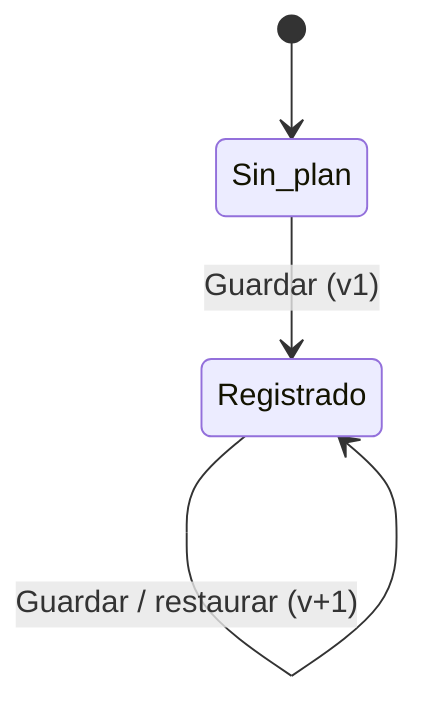

# Requerimientos: SISCargaLectiva

**Universidad La Salle (Arequipa)**. Sistema de gestión de la carga lectiva docente.

| Campo | Valor |
|---|---|
| Versión del documento | 2.1 |
| Fecha | 2026-11-05 |
| Fase actual | **Versión simplificada: CU-001 Registrar plan de ciclo y CU-002 Carga docente** |
| Fuentes | `docs/feedback/transcripcion.md` (clase del docente), `docs/feedback/flujobasico.md` (1.ª revisión), `docs/feedback/flujosalternativos.md` (2.ª revisión), `docs/CU/CUs-Carga lectiva.png` (diagrama de CU), `docs/QA/Checklist.md`, `docs/archivos/*.xlsx` (datos reales), `instrucciones.md` (simplificación) |
| Decisiones del equipo | Resumidas en la sección 10. El detalle P01–P45 está en `preguntas.md` (archivo local, excluido del repositorio por `.gitignore`). Las decisiones del 2026-09-29, que llevan la etiqueta **[2026-09-29]**, solo constan en la sección 10. Las de la simplificación llevan **[2026-11-03]** y están en la sección 10.1. |
| Cambios de la v1.1 | Stack en Google Apps Script con los `.xlsx` de Drive como fuente de datos (sección 9 y 10); sección 8 alineada con CU-001 v4.0, que interpreta el contenido en vez de validarlo; nuevas preguntas abiertas Q15 y Q16. |
| Cambios de la v2.0 | Simplificación de la aplicación al mínimo de los CU (`instrucciones.md`): lo eliminado queda marcado **Fuera de alcance [2026-11-03]**, sin borrar su texto; los requisitos que cambiaron se reescriben; nueva sección 10.1 con las decisiones; CU-002 pasa a estar implementado, por carrera. |
| Cambios de la v2.1 | Formato de las tablas de flujo de los CU en Word: la respuesta del sistema en la misma fila que la acción del actor y el retorno de cada flujo como último paso numerado de su tabla (sección 10, «Tablas de flujo de los CU») **[2026-11-05]**. |

> **Regla de lectura.** Cada requisito indica su fuente: **[D]** docente (transcripción o revisiones), **[P##]** decisión del equipo registrada en `preguntas.md`, **[X]** hallazgo en los archivos `.xlsx`. Lo que no tiene fuente confirmada figura en la sección 15, *Preguntas abiertas*, y no se implementa hasta resolverse.

---

## 1. Propósito

La universidad asigna hoy la carga lectiva en varios Google Sheets separados: uno por carrera y otro por departamento. Hay que mantenerlos sincronizados a mano, lo que provoca errores de horas, docentes mal asignados y confusión entre versiones ("versión última, última, última"). **[D]**

El sistema debe centralizar la información en **un solo registro**. Los listados por carrera, por departamento y por docente pasan a ser **reportes** generados a partir de ese registro. **[D]**

---

## 2. Contexto del dominio

| Concepto | Descripción |
|---|---|
| **Carrera** | Programa profesional (Ingeniería de Software, Derecho…). Se organiza en torno a los **estudiantes**. La dirige un **Coordinador de carrera**. **[D]** |
| **Departamento académico** | Agrupa a los **docentes**. Lo dirige un **Director de departamento**, que proporciona docentes a todas las carreras que los necesitan. Son cuatro: DIMA, DAHU, DACJ y DACTE. **[D]** |
| **Carga lectiva** | Asignación de docentes para dictar cursos en un ciclo. Se distingue de la carga **no lectiva** (labores administrativas o de coordinación) y de la **investigación**, que están fuera de alcance. **[D]** |
| **Ciclo** | Periodo académico en el que se planifica la carga (p. ej. `2026-2`, `2027-1`). La carga se planifica **ciclo por ciclo**. **[D]** |
| **Semestre** | Nivel dentro del plan de estudios (1.º, 2.º…). El número de semestres **varía por carrera**: Derecho llega a 12 y Psicología, por ser nueva, tiene menos. No se fija un número. **[D]** |
| **Plan de estudios / malla** | Currícula aprobada (2016, 2021, 2022, 2024…). En un mismo ciclo conviven cursos de varias mallas mientras la antigua va saliendo. El sufijo del código indica la malla (`…21`, `…24`). **[D]** |
| **Plan de ciclo** | Cursos y grupos que **cada carrera** apertura en un ciclo. Cada carrera lo registra por separado, en momentos distintos y con usuarios distintos. El conjunto de todas las carreras forma el plan de ciclo de la universidad. **[D]** |
| **Grupo** | Sección de dictado de una asignatura. Puede haber varios grupos, por ejemplo en semestres iniciales a inicio de año o cuando hay muchos desaprobados. **[D]** |
| **Fusión** | Se juntan en un solo grupo estudiantes de distintas mallas o carreras que llevan el "mismo" curso. Es un proceso interno, no normado por la Ley Universitaria. Mandan las horas y los créditos, no el nombre exacto. **[D]** |
| **Desdoble** | División de un grupo. **Total:** todas las horas (en el sistema es *Agregar grupo*, P15). **Parcial:** solo las horas prácticas (típico en laboratorios de Arquitectura e Industrial) o solo las teóricas. **[D][P16]** |
| **Docente internacional / virtual** | Dicta en forma virtual desde fuera de Arequipa. No necesariamente es extranjero. Se marca de forma especial. **[D]** |
| **Tiempo completo / parcial** | TC = 40 h/semana, que deben cubrirse. Menos de 40 h es TP. Aplica a la fase de asignación docente. **[D]** |
| **Curso por jurado** | Curso que salió de la malla y se ofrece por jurado **durante** el ciclo. Es un **caso de uso separado**, fuera de la carga lectiva inicial. **[D]** |

---

## 3. Actores y roles

| Rol | Descripción | Versión simplificada **[2026-11-03]** |
|---|---|---|
| **Coordinador de carrera** | Define qué cursos y cuántos grupos se abren en su carrera. Especializa a *Responsable del plan de ciclo*. **[D]** | Registra y edita el plan (CU-001) **solo de sus carreras** (columna `carreras` de Usuarios). Consulta todo lo demás en solo lectura. **[P17][P43]** |
| **Director de departamento** | Asigna docentes al plan registrado. También especializa a *Responsable del plan de ciclo*. **[D][diagrama]** | Asigna docentes (CU-002) en las carreras de **su departamento** (pestaña Carreras). **Ya no edita planes**: los consulta en solo lectura. Antes editaba el plan de cualquier carrera (P17). |
| **Administrador** | Administra los ciclos. **[diagrama]** | Sin pantallas propias: los ciclos, las carreras, los docentes y los usuarios se mantienen directamente en las pestañas del Sheet. **[P29]** |

Solo hay dos tipos de usuario, leídos de la pestaña Usuarios: `coordinador` y `director`. **[2026-11-03]**

*Responsable del plan de ciclo* es un **rol abstracto** (generalización del diagrama): no se asigna directamente a los usuarios.

---

## 4. Alcance por fases

| Fase | Caso de uso | Actor | Estado |
|---|---|---|---|
| **1** | **CU-001 Registrar plan de ciclo** (extensiones: agregar grupo, quitar grupo, dividir grupos, fusionar grupos) | Coordinador de carrera | **Implementado** (versión simplificada) |
| 2 | Administrar ciclos | Administrador | Futuro |
| **3** | **CU-002 Carga docente** (Asignar docentes a plan de ciclo), **por carrera** | Director de departamento | **Implementado** (versión simplificada) **[2026-11-03]** |
| 4 | Generar reporte de carga lectiva (extensiones: por carrera, por departamento, por docente) | Director de departamento | Futuro |
| 5 | Asignar docentes a cursos por jurado | Por definir | Futuro (el docente anunció que lo agregará) |

**Fuera de alcance:** estudiantes y matrícula; la decisión de abrir o cerrar grupos (la toman las autoridades, el sistema solo la registra); aforo mínimo y alumnos proyectados **[P03]**; horarios; carga no lectiva e investigación; notificaciones por correo en fase 1 **[P30]**; cálculo de créditos en fase 1 **[P26]**.

---

## 5. Requisitos funcionales: CU-001

> **[2026-11-03]** La simplificación conserva lo esencial de los CU. Cada requisito eliminado lleva la marca **Fuera de alcance [2026-11-03]** y conserva su texto; los que cambiaron indican cómo quedan.

### 5.1 Acceso

| ID | Requisito | Fuente |
|---|---|---|
| RF-001 | El usuario entra con su **cuenta de Google** del dominio `@ulasalle.edu.pe`: la aplicación web de Apps Script se publica para el dominio y el servidor lee el correo de la sesión. *Antes: Google OAuth 2.0 propio.* | CU-001, [2026-11-03] |
| RF-002 | El sistema autoriza según el rol (Coordinador de carrera o Director de departamento) leído de la pestaña Usuarios y, para el Coordinador, según sus carreras. Si la cuenta no está identificada, es de otro dominio o no tiene rol, se muestra **«Acceso denegado»** con ese motivo. | CU-001, [P17], [2026-11-03] |
| RF-003 | La página de **Inicio** tiene dos botones: «Registrar plan de ciclo» (CU-001) y «Carga docente» (CU-002). El del rol del usuario se resalta; el otro abre su vista en solo lectura. | [2026-11-03] |

### 5.2 Tablero de monitoreo general

| ID | Requisito | Fuente |
|---|---|---|
| RF-010 | El usuario elige un **ciclo** de la pestaña Ciclos en un selector «Ciclo» (por defecto, el último). Los ciclos anteriores se ven con la misma pantalla y el mismo detalle. | [D] 1.ª revisión, [2026-11-03] |
| RF-011 | Para el ciclo elegido se muestra una **tabla de todas las carreras** con la versión vigente del plan («Sin plan» si no tiene), quién la guardó y cuándo, el número de asignaturas y de grupos, y quién la está editando. *Sin estados Borrador ni Sin Iniciar, sin semestres cargados ni horas totales.* | [D] 1.ª revisión, [P18], [2026-11-03] |
| RF-012 | ~~El tablero destaca qué carreras **faltan** subir su plan.~~ **Fuera de alcance [2026-11-03]**: no hay tablero de avance; la tabla muestra «Sin plan». | [D] transcripción |
| RF-013 | El número de semestres es informativo ("la carrera tiene N semestres"). Nunca es un error. | [D] 1.ª revisión |
| RF-014 | Desde la tabla, cualquier responsable abre el plan de cualquier carrera en **solo lectura** («Ver»). Solo puede editar («Editar») las carreras que tiene autorizadas. | [P43] |

### 5.3 Carga masiva

| ID | Requisito | Fuente |
|---|---|---|
| RF-020 | Hay dos formas de carga: **pegar** en un `<textarea>` el rango copiado de Excel o Google Sheets (texto separado por tabulaciones) y **subir un `.csv`** separado por `;` o `,` (UTF-8 o Windows-1252). **No se aceptan `.xlsx`** [2026-11-03]. | [P28], [2026-11-03] |
| RF-021 | ~~El usuario puede **descargar la plantilla oficial** (sección 7).~~ **Fuera de alcance [2026-11-03].** | CU-001 |
| RF-022 | ~~Si el `.xlsx` tiene varias hojas, el sistema las lista y **el usuario elige** cuál importar.~~ **Fuera de alcance [2026-11-03]**: no se leen `.xlsx`. | [P27] |
| RF-023 | El sistema **detecta automáticamente** la fila de cabeceras (la primera que contiene CODIGO y ASIGNATURA) e ignora lo que esté encima, como los títulos. | [P34], [2026-11-03] |
| RF-024 | Cabeceras y valores se **normalizan**: sin distinción de mayúsculas ni tildes, y sin espacios sobrantes. Se aceptan los sinónimos de la sección 8.1. | [P33] |
| RF-025 | Las columnas que no se usan (DOCENTE, TURNO u otras) **se ignoran**. *Ya no se informa cuáles.* | [P08][P11], [2026-11-03] |
| RF-026 | Si hay **al menos un error** (sección 8.1), se **rechaza todo el archivo** y se muestra la **lista completa** de errores (fila, columna, valor y motivo). | [P04][P06] |
| RF-027 | Las **advertencias** (sección 8.2) no rechazan el archivo. | [P09][P36][P37] |
| RF-028 | La carga **no crea fusiones ni desdobles parciales**: esos se configuran en el sistema. El texto de OBSERVACIONES se conserva tal cual. | [P10] |
| RF-029 | **Re-importación:** si el plan ya tiene datos, el sistema advierte que se **reemplazará todo** el contenido y que se perderán las fusiones (incluidas las que involucran a otras carreras), los desdobles y los ajustes manuales. El reemplazo requiere confirmación. | [P12] |

### 5.4 Vista previa y edición

| ID | Requisito | Fuente |
|---|---|---|
| RF-030 | La previsualización se organiza **por semestre**, con el número de asignaturas y grupos de cada semestre. *Los bloques ya no son colapsables ni se distinguen por malla* [2026-11-03]. | [D] 2.ª revisión, [2026-11-03] |
| RF-031 | ~~Las asignaturas **internacionales o virtuales** llevan un marcador distintivo en el plan.~~ **Fuera de alcance [2026-11-03]** en CU-001: la condición internacional o virtual (sección 8.3) solo se usa en la regla A10 de CU-002. | CU-001, [D] |
| RF-032 | Las **advertencias** de la interpretación se muestran en la fila del grupo donde ocurren, más un resumen al interpretar (filas leídas y descartadas). *Sin contador ni lista navegable* [2026-11-03]. | [P37], [2026-11-03] |
| RF-033 | ~~El **panel de resumen** con horas de dictado, internacionales, fusiones, desdobles y advertencias.~~ **Fuera de alcance [2026-11-03]**: solo se muestran los totales de asignaturas y grupos. | CU-001, [P38] |
| RF-034 | ~~**Edición directa de celdas**.~~ **Fuera de alcance [2026-11-03]**: para corregir datos se vuelve a pegar el Excel corregido. | CU-001, [D] |
| RF-035 | ~~**Agregar asignatura** manualmente.~~ **Fuera de alcance [2026-11-03].** | [D][P32] |
| RF-036 | ~~**Eliminar asignatura** con confirmación.~~ **Fuera de alcance [2026-11-03].** | [D][P32] |

### 5.5 Gestión de grupos

Las operaciones se hacen en memoria en el navegador y se guardan con «Guardar». **[2026-11-03]**

| ID | Requisito | Fuente |
|---|---|---|
| RF-040 | **Agregar grupo a una asignatura.** Crea un grupo paralelo con número correlativo y las mismas HT y HP. Sustituye al antiguo "desdoble total". | [D][P15][P16] |
| RF-041 | ~~**Agregar grupo a un semestre.**~~ **Fuera de alcance [2026-11-03].** | [D][P16] |
| RF-042 | **Quitar grupo** es una acción **genérica** (sin motivo obligatorio) y lleva confirmación. Si el grupo está fusionado, la fusión se deshace antes. **No se puede quitar el último grupo** de una asignatura (sería eliminar la asignatura, RF-036) [2026-11-03]. | [D] 2.ª revisión, [P03], [2026-11-03] |
| RF-043 | **Desdoble parcial de práctica.** La teoría se mantiene común y las HP se dividen en N subgrupos (de 2 a 9). Requiere HP > 0. El desdoble se puede **quitar**. | [D][P16], [2026-11-03] |
| RF-044 | **Desdoble parcial de teoría.** La práctica se mantiene común y las HT se dividen en N subgrupos (de 2 a 9). Requiere HT > 0. El desdoble se puede **quitar**. | [D][P16], [2026-11-03] |
| RF-045 | **Fusionar grupos** de la misma carrera (entre mallas) o de **otras carreras** del mismo ciclo. Se seleccionan 2 o más grupos en el diálogo de fusión, que lista los grupos de la carrera y, con «Buscar en otras carreras», los de los planes vigentes de las demás (con un filtro). *Ya no sugiere candidatos* [2026-11-03]. Un grupo que ya está en una fusión no se puede elegir. | [D][P13], [2026-11-03] |
| RF-046 | Si los grupos seleccionados difieren en **nombre, código, HT, HP o TH**, el sistema **advierte y nunca bloquea**. El usuario confirma bajo su responsabilidad. | [D][P14] |
| RF-047 | Al fusionar, el usuario elige el **grupo principal**. Sus HT y HP son las de la sección fusionada y, en la carga docente, las horas cuentan **una sola vez**. | [P38][X] |
| RF-048 | El Coordinador puede crear una fusión con grupos de otras carreras **sin aprobación** de la otra carrera ni su bloqueo. La fusión se guarda **solo en el plan que la crea**; la otra carrera la ve como una marca «FUS – fusionado con <carrera>», que se calcula al leer los planes. No se crea una versión en el otro plan [2026-11-03]. | [P13][P39], [2026-11-03] |
| RF-049 | **Deshacer fusión.** Restituye los grupos originales con sus horas. Se hace desde el plan que creó la fusión [2026-11-03]. | CU-001, [P13], [2026-11-03] |

### 5.6 Estados, guardado y versionado

| ID | Requisito | Fuente |
|---|---|---|
| RF-050 | El plan de una carrera en un ciclo tiene versiones o **no tiene ninguna** («Sin plan»). ~~Estados Sin Iniciar → Borrador → Registrado.~~ **No existe el estado Borrador** [2026-11-03]: todo plan guardado es *Registrado*, y el CU-002 trabaja con la versión más reciente. | CU-001, [2026-11-03] |
| RF-051 | ~~**Guardar borrador**.~~ **Fuera de alcance [2026-11-03]**: hay un solo botón «Guardar». | CU-001 |
| RF-052 | ~~**Registrar plan** con confirmación del resumen.~~ **Fuera de alcance [2026-11-03]**: «Guardar» crea la versión directamente. | CU-001 |
| RF-053 | Un plan guardado **sigue siendo editable**: cada «Guardar» crea una versión nueva. *Sin motivo.* | [D] 2.ª revisión, [P01], [2026-11-03] |
| RF-054 | El estado del ciclo **no** restringe la edición: se pueden editar planes de ciclos futuros, actuales o **anteriores**. | [P02][P41] |
| RF-055 | **Cada guardado y cada restauración generan una versión** con número, usuario, fecha y hora de Perú y el contenido completo del plan (JSON en una celda de la pestaña Planes, como mucho 50 000 caracteres). Al guardar se envía la versión con la que se abrió la edición; si ya hay una más nueva, el guardado se **rechaza** con un aviso [2026-11-03]. | [P05][P25][P44], [2026-11-03] |
| RF-056 | El usuario consulta el **historial de versiones** y ve cualquier versión en solo lectura. ~~Comparar con la anterior.~~ **La comparación queda fuera de alcance [2026-11-03].** | [P05], [2026-11-03] |
| RF-057 | **Restaurar versión.** Copia una versión anterior como **nueva versión**, sin borrar el historial. | [P45] |

### 5.7 Concurrencia

| ID | Requisito | Fuente |
|---|---|---|
| RF-060 | **Bloqueo por carrera, ciclo y CU.** Al pulsar «Editar», el usuario toma el bloqueo. Los demás ven «En edición por <correo>» y solo pueden leer. | [P18], [2026-11-03] |
| RF-061 | El bloqueo se libera al guardar o al salir, o **vence tras 30 minutos sin actividad**. Si hubo actividad, la vista lo renueva cada 5 minutos. *El plazo ya no es configurable* [2026-11-03]. | [P40], [2026-11-03] |
| RF-062 | ~~**Autoguardado** al expirar el bloqueo.~~ **Fuera de alcance [2026-11-03]**: sin autoguardado ni copia de recuperación; si el bloqueo vence, lo que no se guardó se pierde. | [P42] |

### 5.8 Auditoría

| ID | Requisito | Fuente |
|---|---|---|
| RF-070 | ~~Bitácora inmutable de cada acción.~~ **Fuera de alcance [2026-11-03]**: el historial de versiones (usuario, fecha y hora de cada guardado) cumple ese papel. | [D] 1.ª revisión, [P01] |

---

## 6. Estados del plan de carrera

Desde la simplificación **[2026-11-03]** no hay Borrador ni autoguardado:

El diagrama anterior (Sin Iniciar → Borrador → Registrado, con autoguardado) queda fuera de alcance.

---

## 7. Plantilla oficial de importación

> **Fuera de alcance [2026-11-03].** No hay plantilla que descargar: se pega o se sube el rango tal como lo tiene la carrera, y las columnas que se leen están en la sección 8.1. Se conserva el texto como referencia.

### 7.1 Columnas

| Columna | Obligatoria (celda) | Tipo | Notas |
|---|---|---|---|
| CARRERA | Sí | Sigla | Debe coincidir con la carrera seleccionada (ADM, DER, ING…). |
| MALLA | Sí | Año de 4 dígitos | Manda sobre el sufijo del código. **[P07][P09]** |
| SEMESTRE | Sí | Entero ≥ 1 | Sin máximo fijo. **Ya no** se escribe "1-1" ni "1-2" aquí. |
| CÓDIGO | Sí | Texto | Formato observado: `{n.º carrera}.{semestre}.{orden}.{malla 2 dígitos}`, p. ej. `3.3.1.24`. |
| ASIGNATURA | Sí | Texto | |
| GRUPO | No | Entero ≥ 1 | Si está vacío se asume **1**. **[P07][P35]** |
| HT | Sí | Numérico ≥ 0 | Horas teóricas semanales. |
| HP | Sí | Numérico ≥ 0 | Horas prácticas semanales. |
| TOTAL HORAS | Sí | Numérico ≥ 0 | Debe cumplir `TOTAL HORAS = HT + HP`. |
| DPTO | Sí | DIMA, DAHU, DACJ o DACTE | **Solo códigos oficiales.** "DAHUC" es error. **[P07][P19][P20][P21]** |
| OBSERVACIONES | No | Texto | Detecta internacional o virtual (sección 8.3). |

Todas las **cabeceras** de la tabla son obligatorias en el archivo. Las celdas de GRUPO y OBSERVACIONES pueden ir vacías.

### 7.2 Sinónimos de cabecera aceptados [P33]

Las cabeceras se comparan ya normalizadas (sin mayúsculas, tildes ni espacios extremos).

| Cabecera oficial | Sinónimos aceptados |
|---|---|
| CÓDIGO | CODIGO |
| OBSERVACIONES | OBSERVACIÓN, OBSERVACION |
| TOTAL HORAS | TH |

Una cabecera **repetida** es error. Es el caso del Excel actual, que tiene "HT" dos veces en lugar de "HT" y "TH".

> ⚠️ **Consecuencia:** los Excel reales de `docs/archivos/` **no pasan** la validación tal como están, por tres motivos: "HT" repetido, "DAHUC" en DPTO y "1-1"/"1-2" en SEMESTRE, que además Excel convierte en fechas (`45658`). Hay que migrarlos a la plantilla oficial.

---

## 8. Interpretación del contenido (sin validación)

> Desde la **v4.0 de CU-001** (2026-09-24) el sistema no valida el contenido importado: lo **interpreta** y nunca rechaza una carga (RN-16 a RN-22 del CU). Las reglas de error E01–E12 y las advertencias A01–A04 de la v1.0 de este documento quedaron sin efecto y sus identificadores no se reutilizan. Con ellas pierden efecto el rechazo del archivo completo (RF-026), la validación de celdas al editar (RF-034) y el carácter obligatorio de las columnas de la sección 7.1. La referencia de comportamiento es el prototipo funcional de `docs/prototipo/funcional/`, que la versión en Apps Script (`AppScript/`) reproduce. **[CU v4.0]**

### 8.1 Reglas de interpretación

| Regla | Comportamiento |
|---|---|
Reglas vigentes desde la simplificación **[2026-11-03]** (`planInterpretar`, en el servidor):

| Regla | Comportamiento |
|---|---|
| Nada se rechaza | Ninguna celda ni fila impide completar una carga: lo que no se entiende se conserva con un aviso en la fila. Solo se rechaza un texto vacío o sin fila de cabeceras. **[CU RN-16, RN-21]** |
| Separador | Texto pegado: tabulaciones. CSV: `;` o `,`, el que más aparezca. Se aceptan campos entre comillas con saltos de línea, como los copia Excel. **[2026-11-03]** |
| Cabeceras | La fila de cabeceras es la primera que contiene CODIGO y ASIGNATURA, aunque haya títulos encima. Se comparan sin mayúsculas, tildes ni espacios sobrantes. Columnas: CARRERA, MALLA, SEMESTRE, CODIGO, ASIGNATURA, HT, HP, TOTAL HORAS (o `TH` o `TOTAL DE HORAS`), DPTO y OBSERVACIONES (o OBSERVACION). **La segunda columna «HT» es TOTAL HORAS**, como en el Excel real. *Ya no se deducen columnas por su contenido.* **[2026-11-03]** |
| Texto conservado | Una celda de horas que no se entiende como número se guarda tal cual, con aviso. Si TOTAL no es HT + HP, se avisa. **[CU RN-17]** |
| SEMESTRE y grupo | `5` es el semestre 5, grupo 1; `1-2` o `3 - 1` es el semestre 1 o 3, grupo 2 o 1. Otro texto queda sin semestre, con aviso. Las filas con el mismo CODIGO forman **una asignatura** con varios grupos; un grupo repetido recibe el siguiente número libre, con aviso. Las asignaturas se ordenan por semestre y luego por código. **[CU RN-18, RN-19][2026-11-03]** |
| CARRERA | Las filas de **otra** carrera (por sigla o por el nombre de la pestaña Carreras) se descartan y se informa cuántas fueron; una fila sin CARRERA sí se importa. **[2026-09-29]** |
| Columnas sin uso | DOCENTE, TURNO y cualquier otra columna se ignoran. **[CU RN-09]** |
| Reemplazo | Pegar o subir sobre un plan que ya tiene asignaturas pide confirmación y reemplaza todo, fusiones incluidas. **[P12]** |

### 8.2 Advertencias vigentes

Las advertencias no bloquean: el sistema avisa y el Responsable confirma.

| ID | Regla |
|---|---|
| A05 | Los grupos de una fusión difieren del grupo principal en nombre, código u horas. Las horas se comparan como números, de modo que `3` y `3.0` no cuentan como diferencia. **[P14]** |
| A06 | Se elimina el único grupo de una asignatura o un grupo que participa en una fusión. **[D][P03]** |

### 8.3 Clasificación

- **Internacional/virtual:** OBSERVACIONES contiene "INTERNACIONAL" o "VIRTUAL". Valores reales: `INTERNACIONAL/VIRTUAL`, `INTERNACIONAL COLOMBIA- VIRTUAL`, `INTERNACIONAL MÉXICO - VIRTUAL`.
- **Malla:** se toma de la columna MALLA. **[CU RN-11]**

### 8.4 Lectura de los `.xlsx` de Drive (versión Apps Script) **[2026-09-29]**

> **Fuera de alcance [2026-11-03].** La aplicación ya no lee Drive ni `.xlsx` ni tiene «Releer Excel». Se conserva el texto como referencia.

El servidor lee los `.xlsx` de la carpeta de Drive sin convertirlos a Hoja de cálculo de Google y aplica las mismas reglas de la sección 8.1.

| Regla | Comportamiento |
|---|---|
| Archivos | CargaXCarrera aporta la oferta: cada hoja es una carrera, reconocida por el nombre de la hoja o por la columna CARRERA. CargaXDepartamento solo aporta las marcas de CONDICIÓN. CargaDeDocentes no se lee. |
| Fechas | Una celda con formato de fecha se lee como la mostraría Excel: SEMESTRE `1-1` guardado como `45658` con formato `d-m` vuelve a ser `1-1`. |
| Marcas de CONDICIÓN | Si una asignatura no trae OBSERVACIONES y su código tiene en CargaXDepartamento una CONDICIÓN que menciona INTERNACIONAL, VIRTUAL o FUSIÓN, esa condición pasa a ser su observación. |
| Fusiones | Las fusiones anotadas en el Excel (`FUSIÓN ADM-2/COM-6`) quedan como texto en OBSERVACIONES: no se convierten en fusiones del sistema. |
| Fila repetida | Si una hoja repite código y grupo, se conserva la primera fila y el tablero avisa con la hoja, la asignatura y el código, hasta que el Excel cambie. |

---

## 9. Requisitos no funcionales

| ID | Requisito | Fuente |
|---|---|---|
| RNF-01 | Acceso con cuenta de Google restringido al dominio `@ulasalle.edu.pe`. La aplicación web se publica solo para el dominio y el servidor vuelve a comprobar el dominio de la cuenta. | CU-001, [2026-09-29] |
| RNF-02 | La autorización por rol y por carrera se valida en el **servidor** (Apps Script), no solo en la interfaz. | Seguridad |
| RNF-03 | La interpretación vive en el servidor de cada CU (`planInterpretar`, `cargaInterpretar`). **Nada se comparte entre los dos CU**: la lógica que se repite (bloqueo, versionado, lectura de CSV, normalización) se copia en cada uno con su prefijo. *Antes: un `Dominio.js` común.* | [2026-11-03] |
| RNF-04 | Cada escritura en el Sheet (versión y liberación del bloqueo) se hace dentro de `LockService.getScriptLock()`, para que dos guardados simultáneos no se pisen. | [D] 1.ª revisión, [2026-11-03] |
| RNF-05 | Las advertencias son visibles y están en la fila del grupo donde ocurren. | [P37] |
| RNF-06 | La carga masiva minimiza el uso de formularios uno por uno. La preocupación del docente era la cantidad de clics. | [D] |
| RNF-07 | Interfaz, código y comentarios en español. Fechas en hora de Perú (`2026-11-04T02:29:49-05:00`). | Contexto |
| RNF-08 | ~~El tiempo de expiración del bloqueo es configurable.~~ **Fuera de alcance [2026-11-03]**: son 30 minutos fijos. | [P40] |
| RNF-09 | Stack: **Google Apps Script** (servidor en `.js` y página con HtmlService) y **Alpine.js 3.17.5 desde el CDN**, con unas 100 líneas de CSS escrito a mano. Un **Google Sheet vinculado** («SISCargaLectiva - Centro de datos») guarda usuarios, ciclos, carreras, docentes, planes, cargas y bloqueos. *Ya no se leen `.xlsx` de Drive ni hay Tailwind ni íconos.* | [2026-09-29], [2026-11-03] |
| RNF-10 | Los usuarios y roles viven en la pestaña Usuarios; los ciclos, en Ciclos; las carreras y su departamento, en Carreras; el catálogo de docentes, en Docentes. *Sin propiedades del script ni `instalar()`.* | [P29], [2026-11-03] |
| RNF-11 | El código tiene **8 archivos** (unas 2 200 líneas): cada vista en un `<Nombre>Vista.html` con su marcado y su JavaScript, y su backend en `<Nombre>.js`. Apps Script no admite un `.js` y un `.html` con el mismo nombre, por eso el sufijo `Vista`. | [2026-11-03] |
| RNF-12 | **Alpine.js** se usa para la navegación entre vistas (`$store.nav`), el estado de carga de los botones que llaman al servidor (`ocupado`, que vuelve a su estado al terminar, también si hay error) y para poblar con `x-for` las tablas que devuelve el servidor, en al menos una funcionalidad de cada CU (requisito del docente). | [D], [2026-11-03] |

---

## 10. Resumen de decisiones del equipo

Los códigos P## remiten a `preguntas.md` (archivo local). Las decisiones marcadas **[2026-09-29]** se tomaron al pasar el prototipo a Google Apps Script y no tienen código P##.

> **[2026-11-03]** La simplificación (sección 10.1) deja sin efecto las filas de esta tabla sobre el Borrador, la plantilla, la selección de hoja, el `.xlsx`, Drive y «Releer Excel», el autoguardado, la caché, la configuración en propiedades del script, la derivación, los reemplazos, el pendiente internacional, las vistas por departamento y la rejilla de pegado. Se conservan como historial.

| Tema | Decisión |
|---|---|
| Registrado | Editable con advertencias; todo guardado versiona; restaurar crea una nueva versión (P01, P05, P25, P44, P45). |
| Ciclo | Siempre editable, incluidos los ciclos anteriores (P02, P41). |
| Alumnos y aforo | Fuera de alcance (P03). |
| Importación | Se interpreta y nunca se rechaza; lo que no se entiende se conserva como texto. Reemplaza el rechazo del archivo completo de P04 y P06 (CU-001 v4.0). |
| Plantilla | Agrega MALLA, GRUPO y DPTO; DOCENTE, TURNO y otras columnas se ignoran (P07, P08, P11). |
| Parser | Normaliza, acepta sinónimos, detecta la fila de cabeceras, pide elegir la hoja; GRUPO vacío es 1 (P27, P33–P35). |
| DPTO | Obligatorio y solo con códigos oficiales; Humanidades es **DAHU** (P19–P21). |
| Duplicados y malla | Advertencias altamente visibles (P09, P36, P37). |
| Grupos | Agregar a una asignatura o a un semestre; eliminar genérico; desdoble parcial de práctica o de teoría (P15, P16). |
| Fusión | Cualquier carrera, sin aprobación, nunca se bloquea, se elige grupo principal, no requiere el bloqueo ajeno (P13, P14, P38, P39). |
| Re-importar | Reemplaza todo con confirmación (P12). |
| Concurrencia | Bloqueo por carrera, 30 min configurable, autoguardado al expirar (P18, P40, P42). |
| Roles | Coordinador edita sus carreras; Director edita todas; todos consultan todas (P17, P43). |
| Formatos | Pegar, `.xlsx` y `.csv` (P28). |
| Fuera de fase 1 | Créditos y correo (P26, P30). |
| Stack | Google Apps Script + Google Drive + hoja de cálculo de Google. Reemplaza Java 21, Maven, Spring Boot, PostgreSQL y Flyway (P22–P24) [2026-09-29]. |
| Fuente de datos | Los `.xlsx` de la carpeta de Drive se leen como base de datos y nunca se modifican. Lo editado, las versiones, los bloqueos y los usuarios se guardan en la hoja «SISCargaLectiva-BD» [2026-09-29]. |
| Archivos leídos | CargaXCarrera aporta la oferta de cada carrera; CargaXDepartamento, solo las marcas de CONDICIÓN; CargaDeDocentes no se usa [2026-09-29]. |
| Estado inicial | Cada carrera del xlsx entra en su ciclo (2026-1) como **Registrado v1**, con el tipo «importación desde xlsx» [2026-09-29]. |
| Cambios en el xlsx | Si el xlsx cambia, cada plan cuyo contenido cambió recibe una versión «actualización desde xlsx»; el estado se conserva y nada se pierde del historial. La carpeta se revisa como mucho cada 5 minutos (`SIS_MINUTOS_REVISION_XLSX`) o al pulsar «Releer Excel» en el tablero [2026-09-29]. |
| Fusiones del Excel | Quedan como texto en OBSERVACIONES; no se convierten en fusiones del sistema [2026-09-29]. |
| Fusión al editar | Solo entre grupos del plan en edición, como en el prototipo. La fusión con otras carreras (RF-048, RN-12 y RN-13 del CU) queda abierta: Q15 [2026-09-29]. |
| Ciclos | Lista fija y configurable: 2026-1, 2026-2, 2027-1 y 2027-2 [2026-09-29]. |
| Acceso | La aplicación web se ejecuta con la cuenta propietaria y se publica para el dominio; el correo sale de la sesión de Google y no se muestran nombre ni foto [2026-09-29]. |
| Usuarios | Pestaña Usuarios, sembrada con las cuentas del equipo como Director. Una cuenta del dominio que no figure entra como Director; la propiedad `SIS_ROL_POR_DEFECTO` lo cambia. El rol de cada cuenta se guarda 5 minutos en caché, así que un cambio en la pestaña tarda hasta eso en aplicarse [2026-09-29]. |
| Rapidez | La página llega con el tablero y el contenido vigente de los planes del ciclo, así que consultar un plan no llama al servidor. «Editar» abre al instante y toma el bloqueo de fondo; hasta que se confirma no se puede guardar. El contenido de cada versión se guarda en caché y SheetJS se descarga al entrar en la carga masiva [2026-09-29]. |
| Configuración | Propiedades del script, creadas por `instalar()` [2026-09-29]. |
| Correcciones del prototipo | Deshacer una fusión devuelve a cada grupo sus horas; un desdoble se puede quitar; importar toma solo las filas de la carrera del plan y avisa cuántas ignoró [2026-09-29]. |
| Redacción de CU | Tabla de flujo Paso\|Responsable\|Acción (no Actor\|Sistema; la reemplaza la fila siguiente); sin sección de Postcondiciones; en el flujo de eventos, un paso nunca une dos acciones ni enumera en línea lo que el sistema muestra (va en guiones o entre paréntesis); el resto del documento usa "y"/"o" con normalidad (P77–P81). |
| Tablas de flujo de los CU | En los CU en Word, cada flujo (básico y alternativos) es una tabla con el número y la acción del ACTOR y el número y la acción del SISTEMA. La respuesta del sistema va en la misma fila que la acción del actor que la provoca, sin una fila intermedia con la celda del actor vacía. Cada flujo termina con un paso numerado dentro de la tabla («El flujo regresa al paso N…», «El flujo continúa en el paso N…» o «Fin del caso de uso.»), sin el párrafo «Continuidad:» debajo **[2026-11-05]**. |
| CU-002 Flujo | Carga masiva basada en hoja de cálculo (pegar rango de celdas o subir .xlsx por departamento) como flujo primario, con edición manual de ajustes (P82). |
| CU-002 Reglas | Principio de "advertir, no prohibir" extendido a la carga docente: advertencias A## para topes (>40h, >16h externo, >24h cargo/alta, <8h baja, cruce en mismo semestre de carrera), sin bloqueo destructivo (P83). |
| CU-002 Componentes | Asignación granular por componente: teoría y subgrupos prácticos/laboratorios independientes (P84). |
| CU-002 Reemplazos e Int. | Opción de 'Pendiente Internacional' y acción de 'Reemplazar docente' con historial de auditoría de titular y sustituto (P85). |
| CU-002 Alcance Director | Director asigna solo a cursos de su departamento en todas las carreras; excepciones requieren cambio formal de DPTO (P86). |
| CU-002 Título | Título formal: CU-002 Carga de Docentes (P87). |
| CU-002 Plantilla | Plantilla oficial basada en CargaXDepartamento: DOCENTE, CARRERA, MALLA, SEMESTRE, CÓDIGO, ASIGNATURA, HT, HP, CONDICIÓN, TIPO_HORA (P88). |
| CU-002 Vistas | Dos vistas integradas: Vista por Departamento y Vista por Carrera para monitorear cursos pendientes (P89). |
| CU-002 Estados | Sin estados nuevos de ciclo; versionado directo sobre el plan Registrado incorporando las asignaciones docentes (P90). |
| CU-002 Prototipo Apps Script | Integrado directamente en la Web App de AppScript/, habilitando el botón del menú principal y compartiendo sesión y estilos (P91). |
| CU-002 Catálogo de Docentes | Leído directamente de CargaDeDocentes.xlsx en Google Drive (P92). |
| CU-002 Persistencia Asignaciones | Pestaña Asignaciones en SISCargaLectiva-BD para persistencia granular por fila de asignación docente (P93). |
| CU-002 Conmutador de Vistas | Conmutador interactivo entre Vista por Departamento y Vista por Carrera con filtro de pendientes (P94). |
| CU-002 Rejilla de Carga | Reutilización de Rejilla de Pegado matricial y subida de CargaXDepartamento .xlsx con previsualización (P95). |
| CU-002 Búsqueda de docentes | Búsqueda por nombre en el catálogo y entre los docentes asignados fuera de él: todas las palabras, sin distinguir tildes ni mayúsculas, hasta 30 resultados, con las horas de las cargas guardadas del ciclo. No muestra el DNI (CU-002 FA-115 a FA-118) **[2026-11-02]**. |

### 10.1 Decisiones de la simplificación [2026-11-03]

Fuente: `instrucciones.md` y las confirmaciones del equipo durante la ejecución.

| Tema | Decisión |
|---|---|
| Objetivo | Rehacer la aplicación al mínimo de los CU: 8 archivos y unas 2 000 líneas, en lugar de unas 11 500 en 60 archivos. |
| Página principal | Inicio con dos botones: «Registrar plan de ciclo» (CU-001) y «Carga docente» (CU-002). |
| Usuarios | Solo `coordinador` y `director`, leídos de la pestaña Usuarios. La cuenta tiene que ser de `@ulasalle.edu.pe` **y** estar en Usuarios; si no, «Acceso denegado» con el motivo (cuenta no identificada, fuera del dominio o sin rol). La pestaña Usuarios se migró sin cambios. |
| Permisos | El Coordinador edita el CU-001 de sus carreras; el Director edita el CU-002 de las carreras de su departamento (pestaña Carreras). Todo lo demás, en solo lectura. |
| Departamento de cada carrera | DIMA → ING, IND, ARQ, ICO; DACTE → ADM; DACJ → DER; DAHUC → COM, PSI (confirmado). |
| Ciclo | Selector «Ciclo» en cada CU con los valores de la pestaña Ciclos. |
| Formatos | Pegar texto (tabulaciones, como lo copia Excel o Sheets) o subir `.csv` (`;` o `,`). No se aceptan `.xlsx`. |
| Versionado | Cada guardado crea una versión con número, usuario, fecha y hora de Perú y el contenido completo. Historial, ver en solo lectura y restaurar como versión nueva. |
| Conflicto | Al guardar se envía la versión con la que se abrió la edición; si hay una más nueva, se rechaza con un aviso. |
| Bloqueo | Por carrera, ciclo y CU al pulsar «Editar». Se libera al guardar o al salir, o vence tras 30 min sin actividad; con actividad se renueva cada 5 min. Sin autoguardado ni copia de recuperación. |
| CU-001 | Sin Borrador (un solo «Guardar»); agregar y quitar grupo, desdoble parcial (y quitarlo), fusión de la misma carrera o de otras (y deshacerla). La fusión con otra carrera se guarda solo en el plan que la crea. Sin edición de celdas ni agregar o eliminar asignaturas. |
| CU-002 | Carga **por carrera**. Teoría y práctica con su docente (T1…Tn / P1…Pn con desdoble); una fusión se asigna en la carrera del principal. Carga masiva CargaXDepartamento, búsqueda por nombre y reglas A07–A15 (A07 impide guardar; A12 > 24 h exige motivo). Sin derivación, reemplazo, pendiente internacional, vista de horas por docente ni plana del departamento. |
| Interfaz | Alpine.js desde el CDN para navegación, botones en espera y tablas con `x-for`; unas 100 líneas de CSS escrito a mano; sin Tailwind, íconos ni tableros. |
| Archivos | Cada vista en `<Nombre>Vista.html` (marcado y JavaScript) y su backend en `<Nombre>.js`, con prefijo `plan` o `carga`; nada compartido entre los CU. El sufijo `Vista` se decidió porque Apps Script no admite un `.js` y un `.html` con el mismo nombre. |
| Sheet | Pestañas Usuarios, Ciclos, Carreras, Docentes (migrada de «Docentes - General»: nombre completo y sigla del departamento), Planes, Cargas y Bloqueos. Las pestañas anteriores se borraron después de una copia de respaldo del libro en Drive. Los planes y las cargas se vuelven a ingresar desde la aplicación. |
| Eliminado | Relectura de Excel desde Drive, tablero de avance, plantilla, `.xlsx` y selección de hoja, arrastrar y soltar, rejilla de pegado, copias de recuperación y autoguardado, Borrador, comparación de versiones, derivación, reemplazo de docente, pendiente internacional, menú y paneles del Sheet, mapa de la GUI y documento de arquitectura. |

---

## 11. Requisitos de fases futuras (referencia)

### 11.1 Administrar ciclos (Administrador)
- Crear ciclos (p. ej. `2027-1`) y actualizar sus datos. **[D]**

### 11.2 CU-002: Carga de Docentes (Director de departamento) [P82–P90]

> **Implementado en la versión simplificada [2026-11-03]**, con estos cambios respecto de lo que sigue: la carga es **por carrera** (el Director edita las carreras de su departamento, no los grupos cuyo DPTO es el suyo; un DPTO distinto del departamento del docente es la advertencia informativa A14); la carga masiva es pegar o `.csv` con el formato CargaXDepartamento, sin `.xlsx`; no hay pendiente internacional, reemplazos, vista por departamento ni vista de horas por docente. Reglas al guardar: A07 (> 40 h, impide guardar), A08, A09, A10, A11, A12 (> 20 h avisa, > 24 h exige motivo), A13, A14, A15 y «no está en Docentes».

- Asignar docentes a los grupos cuyo DPTO sea el del director en todas las carreras. **[D][P86]**
- Carga masiva desde Google Sheets o archivo `.xlsx` (CargaXDepartamento) y edición directa en pantalla. **[D][P82][P88]**
- Asignación por componente: docente de teoría y docente o jefe de práctica por cada subgrupo de laboratorio. **[D][P84]**
- Control y alertas de carga horaria (40h máximo, 16h externos TC, >24h alerta alta, <8h alerta baja, cruce semestral). **[D][P83]**
- Gestión de docentes internacionales pendientes y registro de reemplazos temporales durante el semestre. **[D][P85]**
- Monitoreo integrado mediante vista por departamento y vista por carrera. **[D][P89]**
- Búsqueda de docentes por nombre en la pantalla de asignación, con sus horas en las cargas guardadas del ciclo, sus carreras y sus advertencias, sin el DNI (CU-002 FA-115 a FA-118). **[2026-11-02]**

### 11.3 Generar reporte de carga lectiva
- **Por carrera:** cursos de la carrera y quién los dicta. **[D]**
- **Por departamento:** por docente, sus cursos, las horas y el total; horas por semana por carrera; total de profesores, internacionales, locales, por concurso, conferencistas y jefes de práctica. **[D][X]**
- **Por docente.** **[D]**
- En los totales, las horas de un grupo fusionado cuentan **una vez**. En el Excel actual, el grupo no principal aparece con 0 h. **[X]**
- Deben incluir los cursos por jurado cuando exista ese CU. **[D]**

### 11.4 Cursos por jurado
- Es un CU separado que ocurre **durante** el ciclo. Asigna docentes a cursos por jurado y estos aparecen en los reportes. **[D]**

---

## 12. Datos maestros observados [X]

### Carreras (prefijo del código → sigla)

| N.º | Sigla | Carrera |
|---:|---|---|
| 1 | ADM | Administración de Negocios Internacionales |
| 2 | DER | Derecho |
| 3 | ING | Ingeniería de Software |
| 7 | ICO | Ingeniería Comercial |
| 8 | COM | Ciencias de la Comunicación |
| 9 | PSI | Psicología |
| 16 | ARQ | Arquitectura |
| 17 | IND | Ingeniería Industrial |

### Departamentos

| Sigla | Nombre |
|---|---|
| DIMA | Departamento Académico de Ingeniería y Matemáticas |
| DAHU | Departamento Académico de Humanidades (en el Excel: "Humanidades y Com.", sigla DAHUC). Desde **[2026-11-03]** la pestaña Carreras y la pestaña Docentes usan **DAHUC**, como los Excel. |
| DACJ | Departamento Académico de Ciencias Jurídicas |
| DACTE | Departamento Académico de Ciencias y Tecnologías Empresariales |

Mallas vistas: 2016, 2021, 2022 y 2024. Turnos vistos: Mañana, Tarde y Noche (no forman parte de la plantilla).

---

## 13. Hallazgos en los archivos de ejemplo [X]

| Archivo | Hallazgo | Impacto |
|---|---|---|
| CargaXCarrera | Una hoja por carrera. Título en la fila 1 y cabeceras en la fila 3. | RF-022, RF-023 |
| CargaXCarrera | La columna H se llama "HT" pero es el total (TH). | E03, sección 7.2 |
| CargaXCarrera | SEMESTRE `1-1`/`1-2` convertido por Excel en fechas (`45658`, `45689`, `46023`, `46054`). | Columna GRUPO (P07) |
| CargaXCarrera | Desdoble de práctica escrito como `3 - 1` (HT3 HP2) y `3 - 2` (HT0 HP2). | Desdoble en el sistema (P10) |
| CargaXCarrera | ICO: MALLA 2022 con códigos `…24`. | A01 |
| CargaXCarrera | PSI: código `9.2.5.24` repetido en dos asignaturas distintas («Psicología del desarrollo I» y «Procesos básicos I»), ambas en el grupo 1. | Al leer el xlsx se conserva la primera fila y el tablero avisa (sección 8.4); Q16 |
| CargaXCarrera | Fusiones anotadas como texto libre en OBSERVACIONES (`FUSIÓN ADM-4/ICO-4/COM-4`, `Fusión con ADM 3`…). | RF-028 |
| CargaXCarrera | Fusiones con reparto HT/HP distinto (Epistemología ICO 2/2 y COM 4/0; Derechos Humanos). | P14, RF-047 |
| CargaXCarrera | Mismo curso fusionado con DPTO distinto según la carrera (Liderazgo y Trabajo en Equipo: DAHUC y DACTE). | Posible inconsistencia a revisar en la fase 3 |
| CargaXCarrera | Valores con espacios al final (`DER `, `ING `) y fórmulas `=SUM(F:G)` en TH. | RF-024; el parser lee el valor calculado |
| CargaXCarrera | Otras OBSERVACIONES: `ELECTIVO`, `cambio`, `Liz Bernedo como Jefe de práctica`. | Se conservan como texto |
| CargaXDepartamento | Una hoja por departamento. Celdas combinadas por docente; subtotales y totales por carrera; conteos de profesores. | Fase 4 |
| CargaDeDocentes | Datos personales y contractuales del docente, horas por carrera y total de lectivas. | Fase 3 |

---

## 14. Trazabilidad de observaciones del docente → CU-001

| # | Observación del docente | CU-001 original | Resolución (CU-001 actualizado) |
|---|---|---|---|
| O1 | Tablero con el avance de **todas** las carreras (lo valoró como diferencial). | Parcial: solo se mencionaba en el paso 7. | Pasos del tablero en el flujo básico, RF-011 a RF-014. |
| O2 | Ver ciclos anteriores con el mismo detalle, no mediante la bitácora. | Atendida (FA-003), pero referenciaba el paso 6. | Selector de ciclo en el flujo básico; referencia corregida. |
| O3 | Probar el pegado desde el portapapeles. | No aplica al CU. | Pendiente: prueba técnica (sección 15). |
| O4 | Carga en momentos distintos y por usuarios distintos. | Parcial: sin concurrencia. | Bloqueo por carrera, autoguardado (RF-060 a RF-062). |
| O5 | Poder corregir errores sin empezar de cero. | Parcial: sin agregar asignatura ni re-importar. | RF-034 a RF-036, RF-029. |
| O6 | Grupos adicionales. | Atendida (FA-004). | Agregar grupo a asignatura o a semestre. |
| O7 | No fijar 10 semestres. | Atendida. | RF-013. |
| O8 | El ciclo `2027-1` es solo un ejemplo. | Atendida. | Se mantiene "por ejemplo". |
| O9 | Los cursos por jurado van en otro CU. | Atendida. | Fuera de alcance (sección 4). |
| O10 | **Registrado debe ser editable**: avisar, no prohibir. | **No atendida** ("irreversible"). | RF-053, versionado. |
| O11 | **Campo departamento** por curso, con excepciones. | **No atendida** (8 cabeceras sin DPTO). | Columna DPTO obligatoria, editable. |
| O12 | El coordinador ve su carrera; el director ve varias. | Parcial. | RF-002, RF-014, P17. |
| O13 | Carrera sin nada registrado. | Atendida (FA-017). | Además, el tablero muestra *Sin Iniciar*. |
| O14 | Prototipo de pantallas (HTML o AppSheet). | No aplica al CU. | Pendiente: entregable. |
| O15 | Vista por carrera y semestre con cantidad de cursos, como en Sheets. | Parcial. | RF-030. |
| O16 | **Fusión:** no exigir nombre idéntico; advertir en vez de bloquear. | **No atendida** (FA-006, FA-025, FA-026 rígidos). | RF-045 a RF-049. |
| O17 | Desdoble flexible para práctica **o teoría**. | Parcial (solo práctica). | RF-043 y RF-044. |
| O18 | **Eliminar grupo genérico**, no solo por aforo mínimo. | **No atendida** (FA-005, FA-020). | RF-042; aforo fuera de alcance. |
| O19 | AppSheet tiene limitaciones con `.xlsx`. | No aplica al CU. | Se tiene en cuenta al decidir el frontend. |

**Observaciones del Checklist corregidas en CU-001 v2.0:** la referencia a pasos en FA-003 y FA-016 a FA-018; la lógica duplicada entre FA-003 y FA-012 y entre las cancelaciones; la descripción del actor Director, que incluía asignar docentes (tarea de otro CU); la inconsistencia entre "Director" y "Director de departamento"; el término ambiguo "rango admitido"; la falta de las secciones *Postcondiciones* y *Requisitos especiales*; y un paso de actor que faltaba en la autenticación.

**Observaciones del Checklist corregidas en CU-001 v3.0 (P77–P81):** a partir de un CU de ejemplo del docente ("Vender Entradas"), se reescribieron el flujo básico y los 34 FA para que cada paso describa una sola acción (sin conjunciones que unan dos acciones distintas) y para que el sistema nunca enumere en línea, con "y"/"o", lo que muestra en pantalla — ahora en listas con guiones o entre paréntesis. Se retiró de nuevo la sección *Postcondiciones*, esta vez a propósito: su contenido ya queda cubierto por los últimos pasos del flujo básico (P78).

---

## 15. Preguntas abiertas (para el docente o para el equipo)

| # | Pregunta | Para |
|---|---|---|
| Q1 | ¿Cuál es la fórmula oficial de **créditos** a partir de HT y HP? | Docente |
| Q2 | Los Excel usan **DAHUC** ("Humanidades y Com."). ¿La sigla y el nombre oficiales son DAHU? El equipo eligió DAHU (P19). | Docente |
| Q3 | ¿Las horas pueden tener **decimales**? | Docente |
| Q4 | ¿Cuál es el **máximo de subgrupos** en un desdoble parcial? **[2026-11-03]** Por ahora, de 2 a 9. | Docente |
| Q5 | ¿El **Administrador** también puede registrar o editar planes? | Docente |
| Q6 | ¿El plan de ciclo de la **universidad** tiene un estado propio (p. ej. "consolidado") o solo es la suma de las carreras? | Docente |
| Q7 | ¿Un ciclo podrá **cerrarse** en el futuro CU *Administrar ciclos*? Hoy todo es siempre editable (P02). | Docente |
| Q8 | ~~Si se elimina el **grupo principal** de una fusión de tres o más grupos, ¿se disuelve la fusión o se elige otro principal?~~ **Resuelta [2026-11-03]:** quitar un grupo fusionado deshace la fusión antes. | Equipo |
| Q9 | ¿Se usará en **celular**? El docente valoró que el Sheet se puede editar desde el móvil. | Docente |
| Q10 | ¿Hay **metas de rendimiento** (tiempo máximo de importación o de respuesta)? | Equipo |
| Q11 | ~~`.csv`: ¿qué delimitador (`,` o `;`) y qué codificación (UTF-8, Windows-1252)?~~ **Resuelta [2026-11-03]:** los dos delimitadores (el que más aparezca) y las dos codificaciones (UTF-8 y, si no lo es, Windows-1252, como guarda Excel en ANSI). | Equipo |
| Q12 | ¿Se valida que el segmento de semestre del código coincida con SEMESTRE? | Equipo |
| Q13 | **Prueba técnica:** verificar que pegar desde Google Sheets entrega texto tabulado (TSV) en el navegador objetivo. | Equipo |
| Q14 | ~~¿Qué **frontend** se usará? ¿La lectura del archivo se hace en el frontend o en el backend?~~ **Resuelta [2026-09-29]:** Google Apps Script. Los `.xlsx` de Drive los lee el servidor sin convertirlos a Hoja de cálculo de Google; el archivo que sube el usuario se lee en el navegador con SheetJS. | Equipo |
| Q15 | ~~**Fusión entre carreras.**~~ **Resuelta [2026-11-03]:** se fusiona con grupos de otras carreras; la fusión se guarda solo en el plan que la crea y la otra carrera la ve como «FUS – fusionado con <carrera>» (RF-048). | Docente |
| Q16 | En el Excel de Psicología, «Procesos básicos I» repite el código `9.2.5.24` de «Psicología del desarrollo I». ¿Cuál es su código correcto? **[2026-11-03]** Mientras no se corrija, la segunda fila se lee como otro grupo de la misma asignatura, con un aviso en la fila (por eso el Excel da 345 asignaturas y 366 grupos). | Equipo |
